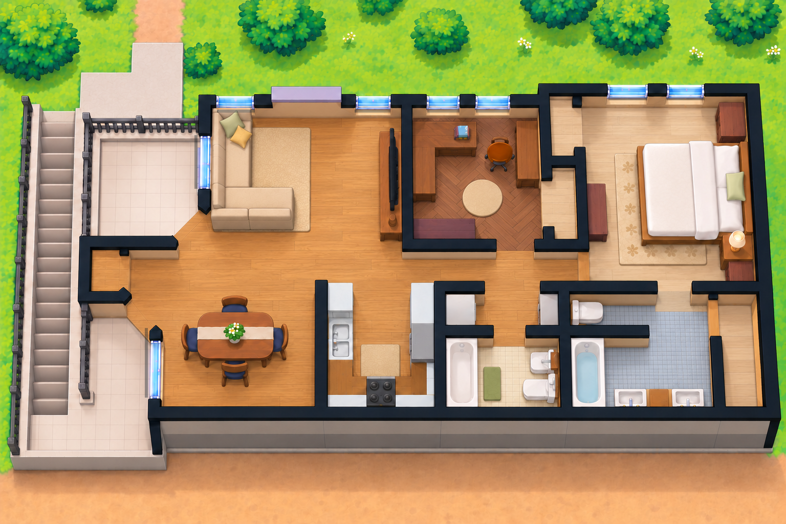

# Home Assistant

Custom software and reusable resources for Home Assistant, including projects intended for a Home Assistant Green installation.

## Active second-floor dashboard

The [Roomcraft project](projects/roomcraft/README.md) is the active Home Assistant floor-plan editor and dashboard source. Engineers can start with the [current handoff](projects/roomcraft/docs/engineering-handoff.md); the [illustrated manual](projects/roomcraft/docs/user-manual.md) explains editing walls, floors, furniture, and Home Assistant controls. The Home Assistant **Layout Studio** view is the official editing entry.

[View full-size current plan](projects/roomcraft/docs/images/published-plan.png). The older planning illustration and its prompts are retained in the [legacy archive](legacy/planning-illustration-2026-10-25/README.md).

This illustration is a visual interface, not a measured construction drawing. Use the editable layout and real room measurements for placement decisions.

## What belongs here

| Project type | Typical use |
| --- | --- |
| Custom integration | Add entities, services, or support for an external API or device |
| App/add-on | Run a separate service alongside Home Assistant |
| Dashboard card or view | Build custom controls, visualizations, or layouts |
| Automation or blueprint | Reuse event-driven behavior and workflows |
| Script or development tool | Simplify configuration, diagnostics, and maintenance |
| Image or graphic asset | Provide dashboard icons, backgrounds, and illustrations |

Choose the simplest project type that solves the actual problem. An automation or script may be enough without creating an app.

## Start a project

1. Create `projects/<project-name>/`.
2. Copy [the project brief](templates/project-brief.md) into that folder.
3. Add a README describing the feature and its current status.
4. Develop locally, test with safe inputs, and document dependencies.
5. Follow [deployment and rollback guidance](docs/deployment.md) when installation is requested.

## Project index

| Project | Description | Status |
| --- | --- | --- |
| [Roomcraft](projects/roomcraft/README.md) | Official second-floor layout editor with furnished illustration, editable walls/floors/objects, and dashboard transfer | Active on one installation; [illustrated manual](projects/roomcraft/docs/user-manual.md) |
| [Tuya LAN migration](projects/tuya-lan/README.md) | Direct local control pilot for eligible, already-paired Tuya devices using HA entities | One bulb imported into `tuya-local`; control, recovery, and cloud-offline gates remain open |
| [ishioho](projects/ishioho/README.md) | Four illustrated dashboard themes with room controls, searchable entities, camera popups, weather/moon display, and a room-level robot tracker | Legacy prototype for this layout workflow; source and tests preserved |

## Management approach

Prefer authenticated Home Assistant APIs, HACS APIs, Supervisor commands, and SSH/SCP over browser automation. Use the browser for visual checks and workflows that lack a working direct interface.

Keep access credentials and machine-specific connection details in the private local management workspace. This public repository does not contain the live home's configuration or management credentials.

## Compatibility

Document the Home Assistant version, dependencies, and target architecture tested by each project. Home Assistant Green uses ARM64; apps with native dependencies need compatible builds. Do not describe untested platforms or versions as supported.

## References

- [Home Assistant developer documentation](https://developers.home-assistant.io/)
- [Home Assistant dashboard documentation](https://www.home-assistant.io/dashboards/)
- [HACS documentation](https://www.hacs.xyz/docs/)
