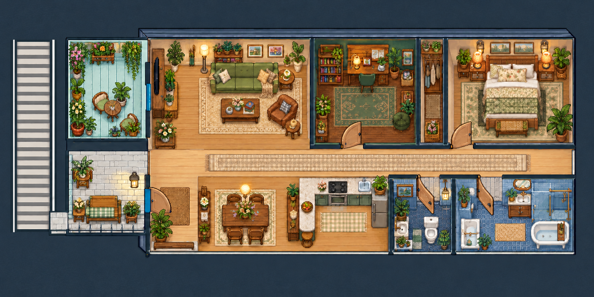

# ishioho

A landscape Home Assistant dashboard with four illustrated themes: Pokémon, Pokédex, Animal Crossing, and a Stardew-inspired countryside view. Room pins open contextual controls, while a searchable directory exposes every current entity allowed by the dashboard configuration.

**Status: legacy tested prototype for the second-floor authoring workflow.** Its four-theme panel remains an independent, reproducible experiment. [Roomcraft](../roomcraft/README.md) is the active second-floor layout editor. This folder retains its source, artwork versions, and tests for reference; it is not a copy of a live home's configuration, and a GitHub update does not deploy it.

The package uses standard browser JavaScript modules and CSS, JSON configuration, a [typed floor-plan model](floorplan-format.md), PNG runtime artwork, editable SVG artwork for earlier themes, and a licensed TTF font. There is no proprietary project file, build service, npm dependency, or Home Assistant add-on. It is a portable *file package*, but the bundled layout and example device IDs need adaptation for a different home.



The image is the bundled static artwork. The Stardew view also has a separate, editable [floor-plan model](ishioho/floorplan.json) for rooms, walls, openings, objects, and anchors; device readings and camera images are not part of this preview.

## Behavior

- Four views reuse the same room/device catalog. The Stardew view is the default when `theme` is omitted or unrecognized. Its `floorplan.json` is the canonical spatial model, with the PNG as a visual skin. A **Plan** button exposes generated, selectable SVG geometry, and optional `scene_devices` make illustrated fixtures interactive. The v5 scene shows only the second-floor home: the exterior stair runs beside the separate planted balcony and joins the covered porch at its lower-screen end. From the upstairs porch, the route down toward the garage/driveway points toward the **top of the screen**. The blue front door leads to a separate indoor Entry, with Dining to its right. The single-car garage is a lower-level space beneath the left wing, reached through the Garage popup on the stair. That popup has its own SVG illustration and native controls; no garage façade is painted along the upstairs art's bottom edge.
- Pokémon v8 and Stardew v5 use static PNG day/night backgrounds; interface effects still animate. Pokémon v8 uses 2800×1400 raster exports of its SVG artwork. Stardew v5 uses 1774×887 illustrations; older v1–v4 PNGs and independent v1 SVG reconstructions remain for reference. The JSON model is editable geometry, but no SVG in this project reproduces the v5 painting. Pokédex and Animal Crossing retain their SVG animated/still backgrounds and prior room coordinates.
- The panel fills the screen. A small illustrated **Menu** button opens the theme choices, home controls, and fullscreen action without taking map space. Pokémon and Stardew preserve their artwork's 2:1 proportions and align pins with the contained image instead of stretching rooms to the screen.
- Room popups combine an explicit entity list with exact Home Assistant area metadata. The directory supports name/ID search, domain, area, availability, and pagination.
- Native entity details provide device-specific controls. Unknown and unavailable current entities remain inspectable; unsafe generic toggles are not offered for covers, locks, or alarms.
- Camera popups use `custom:webrtc-camera`. Optional Eufy start/stop services support on-demand viewing; sessions started by the card are released when the popup closes.
- The robot marker shows its reported room only when location is available and unambiguous. The robot's own map camera provides its precise position and route.
- Weather, moon phase, sunrise/sunset, and automatic day/night appearance come from Home Assistant entities. A manual day/night preview changes appearance only. A calculated moon fallback is labeled as calculated.
- The Stardew map animates the **current** provider condition over exterior portions of the scene: sunlight, moonlight, clouds, wind, rain, snow, fog, and storms. Near-horizon sun telemetry adds a dawn or dusk tint. The separate **Next hours** strip animates predicted conditions without making the map appear to show future weather. Pause and reduced-motion settings stop decorative animation.
- Optional Stardew `scene_devices` make the fixtures themselves into controls. Their light, fan, purifier, and vent sprites reflect current Home Assistant on/off/availability states; animation runs only while a device reports on and decorative motion is enabled. Tap a fixture to toggle its configured entity, or open its room for device-specific controls. A light can also shade its part of the illustration while it reports off, covering lamps baked into the static PNG with a subtle daytime tint and stronger night shading.
- The weather popup shows the remaining hourly outlook for today and dated upcoming periods when the provider supplies them. Forecasts use the Home Assistant time zone and a shared 15-minute cache; unavailable or stale data is labeled. Missing precipitation probability is never inferred from precipitation amount.
- Alerts cover configured binary events, garage-open state, maintenance events, unavailable monitored entities, and PM2.5 readings over the current fixed threshold of 35.

## Prerequisites

- A Home Assistant dashboard supporting local JavaScript module resources and native cards.
- The [WebRTC Camera integration/card](https://github.com/AlexxIT/WebRTC) for camera views. Camera entities must already provide usable streams. The dashboard does not install or configure cameras.
- Optional [Eufy Security](https://github.com/fuatakgun/eufy_security) integration for the example on-demand garage camera. Its configured start/stop services must exist.
- Entities for your lights, climate, power, garage cover, robot, and map camera. Configure the underlying integrations separately.
- A weather entity, `sun.sun`, and optionally the official [Moon integration](https://www.home-assistant.io/integrations/moon/). The example uses a [Met.no](https://www.home-assistant.io/integrations/met/) weather entity, but the card accepts another weather entity ID. The outlook requires that entity to support Home Assistant's [weather forecast action](https://www.home-assistant.io/actions/weather.get_forecasts/); current conditions still work without forecasts.
- Node.js 18 or newer to run the isolated checks. There is no npm installation or build step.

This prototype was checked in one Home Assistant installation and in desktop and phone-landscape browser layouts. A Home Assistant release compatibility range has not been established.

## Install

From this project directory, you can make a reviewable install folder using Node.js 18 or newer. Choose a **new path whose parent already exists, outside this Git checkout**:

```sh
node scripts/stage-install.cjs --output "/absolute/path/to/new/ishioho-package"
node scripts/stage-install.cjs --verify "/absolute/path/to/new/ishioho-package"
```

The staged folder contains a `START-HERE.txt` quick start, `www/ishioho/` (including `floorplan.json` and its schema), `www/pallet-house/`, the three synthetic `examples/*.json` files, `release.json`, and `SHA256SUMS`. Staging validates imports, artwork format and size, and example structure; verification checks every staged file's SHA-256 and rejects missing, extra, or symlinked files. It neither contacts Home Assistant nor edits an existing destination. The staged **copy** of `ishioho-panel.js` uses each imported module's content hash as its browser cache key; the GitHub source remains unchanged. `release.json` records those imports and the exact `recommended_resource_url` for Home Assistant. Example `catalog.json` and `robot.json` stay **outside** staged `www/` so updating assets cannot silently overwrite installed metadata. You can ZIP this folder with any standard archive utility and verify it after extraction. You can also copy the same folders directly from the repository if Node is unavailable; substitute the corresponding repository paths in the steps below and manage browser cache keys manually.

1. Back up the target dashboard's raw configuration, its registered resource URL, and any existing `www/ishioho/` or `www/pallet-house/` files. Keep those backups outside this public repository.
2. Copy the package's complete `www/ishioho/` and `www/pallet-house/` folders into Home Assistant's configuration directory as `/config/www/ishioho/` and `/config/www/pallet-house/`. For a direct source copy, use this project's `ishioho/` and `pallet-house/` folders instead. Preserve `pallet-house/font-OFL.txt`. If `www` did not exist before, restart Home Assistant once so it starts serving that directory. Existing `www` installations normally need only a browser reload after file changes; see Home Assistant's [resource documentation](https://contributors.home-assistant.io/frontend/custom-ui/resources/).
3. Copy the package's `examples/catalog.json` and `examples/robot.json` to `www/ishioho/catalog.json` and `www/ishioho/robot.json`. Their synthetic content is safe as a starting point. To omit area/robot metadata, use `{"entities":[],"areas":[]}` and `{"room_segments":[]}` respectively. The directory still lists current `hass.states`, although area labels and room grouping then rely on explicitly configured room entities. Read the [installed metadata privacy note](#privacy-of-installed-metadata) before adding real names. On an update, keep your existing installed metadata unless you intentionally change it.
4. Edit a **local copy** of the package's `examples/dashboard.json`: replace example entity IDs with your own, remove unavailable camera entries and optional device IDs, and verify each room's location. Keep `rooms`, `cameras`, `lights`, `monitored`, `temperatures`, `air`, `energy`, and `calendars` as arrays even when unused; the inherited card expects those collections. The example dashboard URL path is `prototype-copy`; if you choose another slug, set `dashboard_path` on each view's card. Do not commit your private configuration to this repository.
5. In Home Assistant, create a separate dashboard with URL path `prototype-copy` (or the slug you configured as `dashboard_path`), open its raw configuration editor, and paste the complete edited JSON object. JSON is valid YAML input for this editor. Leave your existing default dashboard untouched while verifying the new one.
6. Under **Settings → Dashboards → Resources**, register the package's `release.json` **`recommended_resource_url`** as a **JavaScript module** resource. For a direct source copy, use `/local/ishioho/ishioho-panel.js` and add a new `?v=` cache key after updates. The main module imports the other modules and base card. Open `/prototype-copy/stardew` (or `/<your-dashboard-path>/stardew`) and reload the browser. The `www` path maps to `/local/` in the browser, so `/config/www/ishioho/ishioho-panel.js` must load at `/local/ishioho/ishioho-panel.js`.
7. Follow the [first-run checks](#first-run-checks) below before putting the dashboard on a tablet. Preserve the versioned artwork names: Pokémon uses `-v8.png` and active Stardew uses `-v5.png`.

Use supported Home Assistant dashboard editing or APIs for configuration and SSH/SCP or another supported file method for assets. Once `www` already exists, replacing these frontend files does not normally require a Home Assistant restart.

The illustrated **Menu** includes a browser fullscreen button and an entry to home controls. A kiosk browser may need its own fullscreen setting. The Home Assistant navigation link supports an existing kiosk-mode installation; this project does not install or configure kiosk mode or change the default dashboard.

### First-run checks

1. Confirm that `/local/ishioho/ishioho-panel.js`, `/local/ishioho/floorplan.json`, `/local/ishioho/stardew-map-v5.png`, and `/local/pallet-house/pallet-panel.js` load. Open the small **Menu** and check all four theme choices; Stardew should be marked as the default world. A blank card usually means a missing module, a stale import URL, or an unregistered resource; inspect the browser console and the resource entry. In Stardew, open **Plan** and confirm the selectable SVG rooms and partitions align with the art. If new artwork appears with old room positions after an update, reload the WebView page so it fetches the new `floorplan.json`.
2. Open **All devices**. It should list current entities even with an empty catalog. Check room popups against the actual floor plan, especially the indoor Entry, the separate exterior Porch and plant balcony, and the Garage popup on the far-left stair. The stair descends **screen-up** from the upstairs porch toward the top driveway. In **Plan**, the garage belongs to the lower level: its roll-up faces that top driveway and its pedestrian door is on the left wall. Garage controls stay in the popup; the upper-floor illustration has no garage façade.
3. Open weather details. Current weather should come from the configured entity; the forecast can say unavailable if its provider does not support `weather.get_forecasts`. Try the day/night preview and return it to **Auto**.
4. Open only cameras that have working streams. Check the garage feed in its popup if configured. For a tablet, test in landscape at its actual resolution and check that the Menu, room pins, popups, and forecast strip remain usable.
5. Confirm any device control through Home Assistant's own entity details before relying on this dashboard. The automated checks mock physical devices and do not establish hardware compatibility.

## Configure

[The example dashboard](examples/dashboard.json) includes all four panel views: `home`, `pokedex`, `crossing`, and `stardew`. All IDs, names, and metadata in `examples/` are illustrative. Matching an example ID on your system does not prove that its camera or physical room is correct.

| Field | Purpose |
| --- | --- |
| `theme` | `stardew` (default), `pokemon`, `pokedex`, or `crossing` |
| `dashboard_path` | Optional dashboard URL slug for the four theme links. If absent, the card uses the current page's dashboard path, with `prototype-copy` as a fallback. Set the same slug on all four cards when using a custom path. |
| `rooms` | Room IDs, names, curated entities, optional temperature/humidity/status, exact `area_names`, and explanatory notes. Stardew pins with matching IDs take their positions from `floorplan.json`; `x`/`y` remain fallbacks and positions for other themes. |
| `cameras` | Ordered `{entity, name}` entries; optional paired `start_service`/`stop_service` names for Eufy on-demand streams |
| `garage_camera` | Optional camera entity ID from `cameras` for the garage popup. Otherwise the card looks for a camera in the Garage room, then a configured camera whose name contains “garage”. |
| `lights`, `climate` | Quick control entities and thermostat |
| `scene_devices` | Optional Stardew-only artwork controls: `{entity, kind, anchor?, x?, y?, label, shade?}`. `anchor` names a `floorplan.json` device anchor; `x`/`y` map percentages and a light's `shade` are fallbacks. A model anchor's `effectPolygon` takes precedence over legacy `shade`. |
| `outside`, `outside_humidity`, `living_temp`, `power` | Summary sensor IDs; `living_temp` supplies the current Dining summary tile |
| `weather_entity`, `moon_entity`, `sun_entity`, `night_assets` | Environment sources and day/night artwork selection |
| `vacuum`, `vacuum_battery`, `vacuum_map`, `robot_room` | Robot controls, telemetry, native map camera, and reported room |
| `robot_entity_prefix`, `robot_entities` | Optional robot object-ID stem (defaults to the configured `vacuum` object ID) and extra entity IDs for its directory. |
| `robot_metrics`, `robot_room_aliases` | Optional `{entity,label}` metric entries and a map from the robot's reported room names to configured room IDs. |
| `garage` | Garage cover entity |
| `events`, `maintenance`, `air` | Lists of `{entity, name}` for alerts and air sensor readings |
| `monitored`, `energy`, `calendars` | Availability alerts, power detail entities, and native calendar view |
| `temperatures` | `{entity, name, humidity?}` entries for the climate popup |
| `aliases` | Optional display labels keyed by entity ID |
| `excluded_entities` | IDs removed from the searchable directory and curated room membership |

Remove an unusable camera from `cameras` and room lists, then add its ID to `excluded_entities` if it should also be hidden in the directory. This affects this dashboard only. The example excludes `camera.front_door` to demonstrate the configuration; it makes no claim about any device with that ID.

Only place a control in a room after confirming its physical location. A device's friendly name is not a location source. Unknown assignments belong in the directory's **No area assigned** group. The illustrated balcony plants are decorative; they do not imply plant sensors or irrigation controls.

For `scene_devices`, identify the actual fixture and its entity before placing its sprite. A room-level location is appropriate when a fixture's exact mount point is unknown; do not use a ceiling-fan sprite for an air purifier. The card accepts only `light`, `switch`, `fan`, and `humidifier` entity domains for these controls. Excluded, missing, unknown, or unavailable entities must not operate. On/off appearance follows the live state; loading the map does not issue a service call. A light anchor's `effectPolygon` is expressed in the model's `[0, 0, 100, 50]` coordinates and dims that area when the mapped light reports **off**—slightly by day, more visibly at night. It overrides a legacy `shade` polygon in image percentages. On and unavailable states leave the artwork unshaded, so missing telemetry does not pretend the room is dark. Keep polygons within their actual room and avoid overlapping masks where multiple independent lights share a space. The room pin and **All devices** remain the route to full native controls such as brightness and speed. The public example uses fictional IDs and positions; replace them with verified assignments for your home. See the [floor-plan format](floorplan-format.md) for geometry and binding details.

`examples/catalog.json` documents the metadata schema: `entities` is an array of `{entity_id, name, domain, area_id, area_name, device_id, device_name}`, and `areas` is an array of `{area_id, name}`. The card lists current `hass.states`, enriched by this metadata. Registry entries with no runtime state are not shown. New runtime IDs remain searchable even if absent from the catalog.

### Privacy of installed metadata

Home Assistant serves files under `www/` at `/local/` [without authentication](https://contributors.home-assistant.io/frontend/custom-ui/resources/). Anyone who can reach your Home Assistant URL can download `catalog.json`, `robot.json`, and `floorplan.json` from there. Do not put a private inventory, serials, addresses, camera URLs, access tokens, or sensitive room names in these files. `floorplan.json` contains approximate room arrangement and object labels, so review it if the layout itself is sensitive. Use the empty metadata files described in [Install](#install), or include only labels you are comfortable exposing at that URL. Real entity bindings remain in the authenticated dashboard configuration; live states come from the authenticated frontend and are not written to the model.

`examples/robot.json` supplies `room_segments` with display names for duplicate-room detection. The marker uses the live room sensor and the vacuum's `located` attribute; it does not project raw map coordinates onto the decorative art. Robot map content comes directly from the configured map camera.

## Current integration assumptions

This is a prototype with a bundled Ishioho layout and some device-specific presentation behavior. Adapt the following to your installation:

- The example dashboard still uses the `prototype-copy` URL path. The `dashboard_path` option or current browser path supplies the compact theme Menu links; each of the four view paths (`home`, `pokedex`, `crossing`, `stardew`) must still match the example or be changed together with the source. `stardew` is the default card theme when no valid `theme` is set; opening `/prototype-copy/stardew` selects that dashboard view.
- If no `garage_camera` is set, the popup selects a configured camera explicitly listed in the Garage room, then a configured camera with “garage” in its name. A configured garage cover without a camera still offers the cover controls and labels the live view unavailable. Without a `garage` cover entity, the dedicated dock control is hidden and the Garage pin opens a normal room directory.
- Robot telemetry defaults to entity IDs based on the configured `vacuum` object ID. Use `robot_entity_prefix`, `robot_entities`, `robot_metrics`, and `robot_room_aliases` to adapt another integration. Without a `vacuum`, the dedicated tracker is hidden. The marker requires a reliable reported room and the robot's `located` attribute.
- Common room names such as Dining, Living Room, Kitchen, Master Bedroom, and Hallway have built-in mapping. Add `robot_room_aliases` for other reported names. A generic Bathroom report without an explicit alias hides the decorative marker. Duplicate segment names in `robot.json` also hide it, even with an alias, because the reported room string cannot distinguish those segments.
- Outdoor fallback IDs are `sensor.hub_temperature` and `sensor.hub_humidity`. Set `outside` and `outside_humidity` explicitly to avoid relying on them.
- The Stardew model and artwork describe the included floor plan. Replace both to represent another physical layout; this package does not include a drag-and-drop floor-plan editor.
- Stardew v5 loads its room pins from the anchors in `floorplan.json`, with matching fallback percentages in the example dashboard and `room-positions.json`. The Porch pin is on the covered outdoor landing, the Garage popup is on the far-left exterior stair, and the single-car garage is modeled below the left wing rather than painted on the upstairs map. The stair meets the porch near its lower-screen end and runs toward the top driveway, without an opening into the balcony. Its roll-up faces that driveway, with a separate pedestrian opening on its left wall. Pokémon retains its earlier Porch `(15.089%, 73.291%)` and Garage `(16.246%, 49.84%)` anchors. Pokédex and Animal Crossing keep their previous room coordinates and have no separate Porch pin.
- Camera labels describe configured feeds. Confirm that each one actually works before including it. Camera connectivity depends on the integration, network, and device state.

## Maintain and update

The files in GitHub are the public source of the card; the Home Assistant dashboard's raw configuration is a separate installed copy. Editing either one does not update the other. Keep your real entity assignments and any sensitive backups outside GitHub.

| Change | Source to edit | Installed copy to update |
| --- | --- | --- |
| Card logic, weather, styles | `ishioho/*.js`, `pallet-house/pallet-panel.js` | Corresponding files in `www/`; staging rewrites direct import cache keys and recommends the registered resource URL |
| Entity IDs, cameras, scene fixture bindings | A private copy of `examples/dashboard.json`; keep the public file synthetic | Dashboard raw configuration through Home Assistant's editor or supported API |
| Stardew room geometry, pin and fixture anchors, walls, doors, objects | `ishioho/floorplan.json` and `ishioho/floorplan.schema.json` | Corresponding files in `www/ishioho/`; the card fetches the model on load |
| Pokémon, Pokédex, and Animal Crossing room pins | A private copy of `examples/dashboard.json` | Dashboard raw configuration |
| Area and robot labels | Minimal, non-sensitive `catalog.json` and `robot.json` | Corresponding `www/ishioho/` files; reload the dashboard after editing them (metadata fetches bypass the browser cache) |
| Pokémon or Stardew visible art | Versioned runtime PNG and the appropriate editable source if available | New PNG files in `www/ishioho/`; update `_mapAsset` in `ishioho-environment.js`, and the Stardew model if framing changed |
| Pokédex or Animal Crossing art | Runtime SVG | SVG in `www/ishioho/`; update its asset URL query when replacing content |

For the PNG themes, changing an SVG alone does **not** change the displayed painting. Pokémon's v8 SVGs are editable sources for its PNG exports. The Stardew SVGs reconstruct historical v1 geometry and do **not** match or generate the active v5 PNGs. The [floor-plan format](floorplan-format.md) is the canonical editable geometry for Stardew, while the [Stardew v5 art spec](stardew-v5-art-spec.md) records the raster update workflow. Keep day, night, animated, and still variants aligned to the model. If an image's framing changes, update model coordinates and check them on the target screen; keep private entity bindings mapped to stable room and fixture IDs. The [room-position metadata](ishioho/room-positions.json) remains a record of legacy and theme-specific positions, not the Stardew runtime source.

Before an update, save the currently working dashboard raw configuration, resource URL, and affected `www/` files privately. Run `node scripts/verify-source.cjs` and `node tests/run.cjs`, stage a new package, and verify its manifest. Copy new versioned assets first, then changed modules, and change the registered resource URL to the new package's `release.json.recommended_resource_url` last. The stager computes direct-import and top-level cache keys from file content; no manual query-number tracking is needed when installing its output. If copying straight from the source instead, update changed imports' `?v=` values in `ishioho-panel.js` and the registered resource query yourself. These keys do not version artwork: for changed PNG/SVG maps, add new versioned filenames and update the `_mapAsset` profile in `ishioho-environment.js`. Reload the browser and repeat the [first-run checks](#first-run-checks). If the new view fails, restore the previous files, raw configuration and resource URL together, then reload and verify the prior view.

## Verification

From this project directory, run:

```sh
node tests/run.cjs
```

The runner stages sources, synthetic fixtures, and artwork in a temporary directory, then runs the component, directory, environment, and base-card suites. Check its output for the current number of passing checks. It removes only its own temporary directory after checking its resolved location. Home Assistant, network access, camera playback, and device actions are mocked.

Checks cover pagination across a generated inventory, configuration exclusions, unassigned areas, robot location honesty, day/night selection, forecast caching and time-zone boundaries, escaping, unavailable entities, scene fixture state and safe toggle routing, camera session ownership/races, and native-card configuration. The tests do not prove physical device actuation or camera compatibility on another installation.

During prototype development, browser checks covered the original three themes, searching and native entity details, room popups, a working garage feed, the robot's native map, and a phone-landscape viewport. Real lights, covers, climate equipment, and vacuum commands were not actuated as part of those checks. Recheck your own configured feeds, room placement, unavailable states, and mobile layout after installation.

The v8 Pokémon update was also checked on the target tablet in day and night modes, including the garage popup. Its PNG backgrounds removed the observed SVG flecks, and the contained image and pin layer preserved room proportions. These checks concern that installation; bundled camera examples are not verified feeds for another home.

The prior Stardew v3 scene was checked on the 1920×1080 target tablet after installation, including its Garage popup and Porch camera; it was superseded because its garage and stairs were placed incorrectly. The prior v4 scene was checked on the same tablet in day and night illustrated views and in Plan view. Its Garage popup displayed a working camera image and the current cover state. V5 was checked on the same tablet in automatic night appearance and a temporary day preview, then returned to Auto. The revised room pins, structured Plan, compact Menu, and separate Garage popup rendered correctly; the Garage popup showed the current cover state and a working camera image. The garage door and other physical devices were not operated during this visual check.

The weather update was rechecked on that tablet with the live Met.no and sun entities while v1 artwork was active. The main map showed current sunny conditions and a separate hourly outlook; the scrollable weather popup displayed the remaining local-day periods, upcoming periods, and exact sunrise/sunset readings. A night appearance preview was captured and returned to Auto. Isolated browser checks covered rainy, snowy, foggy, windy, stormy, disconnected, dawn, dusk, reduced-motion, keyboard, and phone-landscape states without changing live weather or operating devices.

## Roll back or remove

Restore your private prior dashboard configuration through Home Assistant's supported editor or API, and restore its asset/resource versions. To remove this dashboard, remove its resource only after no dashboard references `custom:ishioho-panel`, then remove the installed `www/ishioho/` files. Keep `www/pallet-house/` if any other dashboard uses the base card. No integrations or device configuration are changed by removing these frontend files.

## Files and provenance

- `ishioho/`: six JavaScript modules, the versioned `floorplan.json` and JSON Schema, four Pokémon v8 PNGs and their four SVG sources, four active Stardew v5 PNGs, a separate v5 garage-popup SVG, historical v1/v2/v3/v4 PNGs and four independent v1 SVG reconstructions, twelve prior theme SVGs, and legacy room-coordinate metadata. The active Pokémon and Stardew illustration URLs load PNG files; their still variants keep the same artwork.
- `pallet-house/`: inherited base card, base floor-plan SVG, Press Start 2P font, and its SIL Open Font License notice.
- `examples/`: synthetic dashboard, catalog, and robot metadata; no live inventory or camera images.
- `scripts/`: dependency-free source checks and install-folder staging/manifest verification; no Home Assistant network or device access.
- `tests/`: isolated tests and a generated synthetic inventory fixture.

The original SVG scenes were authored as code from a floor-plan reference, and the Pokémon v8 PNGs are raster exports of those editable SVGs. The Stardew PNG illustrations were created with the built-in ImageGen tool, guided by user-provided style and layout references. V5 uses the homeowner's marked floor plan for the upstairs room arrangement and separates the lower garage from the visible upstairs artwork; all four active day/night and motion/still files share one geometry. Private reference photos and markup are not packaged. The four Stardew SVGs are independent v1 geometry reconstructions, not the source or exports of any v2/v3/v4/v5 PNG.

These are newly created themed illustrations. This Ishioho project folder and its staged package contain no reference screenshots, extracted game sprites, aerial reference photographs, camera captures, personal addresses, or live inventory. The font's upstream license is preserved in [font-OFL.txt](pallet-house/font-OFL.txt). The game names identify visual inspirations; this is an independent project.
