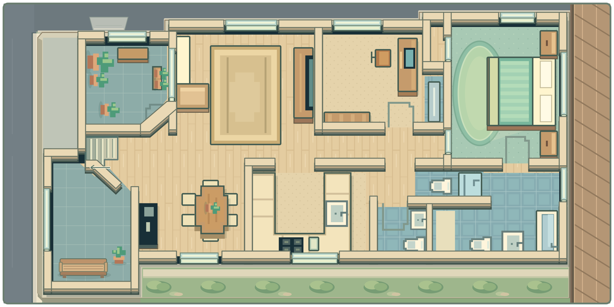

# ishioho

A landscape Home Assistant dashboard with three illustrated themes: Pokémon, Pokédex, and Animal Crossing. Room pins open contextual controls, while a searchable directory exposes every current entity allowed by the dashboard configuration.

**Status: tested prototype.** This is reusable frontend source with synthetic examples. It is not a copy of a live home's configuration, and a GitHub update does not deploy it.



The image is the bundled static artwork. Device readings and camera images are not part of this preview.

## Behavior

- Three views use the same underlying floor plan and device controls. Pokémon v8 separates the outdoor Porch from the interior Entry and keeps garage access at the stairs.
- Pokémon v8 displays 2800×1400 PNG day/night backgrounds, with editable SVG counterparts. This avoids the SVG rendering flecks observed on the tested tablet. The Pokémon background is static; interface effects still animate. Pokédex and Animal Crossing retain their SVG animated/still backgrounds and prior room coordinates.
- The panel fills the screen, with status, map settings and thumbnails in the **Controls** popup. Pokémon preserves the artwork's 2:1 proportions and aligns pins with the contained image instead of stretching rooms to the screen.
- Room popups combine an explicit entity list with exact Home Assistant area metadata. The directory supports name/ID search, domain, area, availability, and pagination.
- Native entity details provide device-specific controls. Unknown and unavailable current entities remain inspectable; unsafe generic toggles are not offered for covers, locks, or alarms.
- Camera popups use `custom:webrtc-camera`. Optional Eufy start/stop services support on-demand viewing; sessions started by the card are released when the popup closes.
- The robot marker shows its reported room only when location is available and unambiguous. The robot's own map camera provides its precise position and route.
- Weather, moon phase, sunrise/sunset, and automatic day/night appearance come from Home Assistant entities. A manual day/night preview changes appearance only. A calculated moon fallback is labeled as calculated.
- Alerts cover configured binary events, garage-open state, maintenance events, unavailable monitored entities, and PM2.5 readings over the current fixed threshold of 35.

## Prerequisites

- A Home Assistant dashboard supporting local JavaScript module resources and native cards.
- The [WebRTC Camera integration/card](https://github.com/AlexxIT/WebRTC) for camera views. Camera entities must already provide usable streams. The dashboard does not install or configure cameras.
- Optional [Eufy Security](https://github.com/fuatakgun/eufy_security) integration for the example on-demand garage camera. Its configured start/stop services must exist.
- Entities for your lights, climate, power, garage cover, robot, and map camera. Configure the underlying integrations separately.
- A weather entity, `sun.sun`, and optionally the official [Moon integration](https://www.home-assistant.io/integrations/moon/). The example uses a [Met.no](https://www.home-assistant.io/integrations/met/) weather entity, but the card accepts another weather entity ID.
- Node.js 18 or newer to run the isolated checks. There is no npm installation or build step.

This prototype was checked in one Home Assistant installation and in desktop and phone-landscape browser layouts. A Home Assistant release compatibility range has not been established.

## Install

1. Back up the dashboard configuration and any existing files with the same names. Keep that backup private.
2. Copy the complete `ishioho/` and `pallet-house/` folders to `/config/www/` on your Home Assistant host. Preserve the font license in `pallet-house/font-OFL.txt`.
3. Copy `examples/catalog.json` to `/config/www/ishioho/catalog.json` and `examples/robot.json` to `/config/www/ishioho/robot.json`. These contain synthetic metadata; edit them locally using your actual assignments, or use empty `entities`, `areas`, and `room_segments` arrays. State values always come from the connected Home Assistant frontend.
4. Add `/local/ishioho/ishioho-panel.js?v=13` as a **JavaScript module** dashboard resource. The main module imports the other three modules with `?v=12` and the base card with `?v=5` automatically. Pokémon image URLs use `-v8.png?v=8`; keep those filenames intact.
5. Create a separate dashboard with URL path `prototype-copy`. The current theme navigation expects this path. Copy the JSON object in `examples/dashboard.json` into the dashboard raw configuration editor, replacing entity IDs as described below. The raw editor accepts JSON's YAML-compatible object syntax.
6. Reload the browser. When updating an existing installation, bump both the top-level resource query and any changed imported module queries. Changing only the top-level resource can leave an older environment module switching the image back to SVG.

Use supported Home Assistant dashboard editing or APIs for configuration and SSH/SCP or another supported file method for assets. These files do not require a Home Assistant restart by themselves.

The **Controls** popup includes a browser fullscreen button. A kiosk browser may need its own fullscreen setting. The Home Assistant navigation link supports an existing kiosk-mode installation; this project does not install or configure kiosk mode or change the default dashboard.

## Configure

[The example dashboard](examples/dashboard.json) includes all three panel views: `home`, `pokedex`, and `crossing`. All IDs, names, and metadata in `examples/` are illustrative. Matching an example ID on your system does not prove that its camera or physical room is correct.

| Field | Purpose |
| --- | --- |
| `theme` | `pokemon`, `pokedex`, or `crossing` |
| `rooms` | Room IDs, names, pin percentages, curated entities, optional temperature/humidity/status, exact `area_names`, and explanatory notes |
| `cameras` | Ordered `{entity, name}` entries; optional paired `start_service`/`stop_service` names for Eufy on-demand streams |
| `lights`, `climate` | Quick control entities and thermostat |
| `outside`, `outside_humidity`, `living_temp`, `power` | Summary sensor IDs; `living_temp` supplies the current Dining summary tile |
| `weather_entity`, `moon_entity`, `sun_entity`, `night_assets` | Environment sources and day/night artwork selection |
| `vacuum`, `vacuum_battery`, `vacuum_map`, `robot_room` | Robot controls, telemetry, native map camera, and reported room |
| `garage` | Garage cover entity |
| `events`, `maintenance`, `air` | Lists of `{entity, name}` for alerts and air sensor readings |
| `monitored`, `energy`, `calendars` | Availability alerts, power detail entities, and native calendar view |
| `temperatures` | `{entity, name, humidity?}` entries for the climate popup |
| `aliases` | Optional display labels keyed by entity ID |
| `excluded_entities` | IDs removed from the searchable directory and curated room membership |

Remove an unusable camera from `cameras` and room lists, then add its ID to `excluded_entities` if it should also be hidden in the directory. This affects this dashboard only. The example excludes `camera.front_door` to demonstrate the configuration; it makes no claim about any device with that ID.

Only place a control in a room after confirming its physical location. A device's friendly name is not a location source. Unknown assignments belong in the directory's **No area assigned** group. The illustrated balcony plants are decorative; they do not imply plant sensors or irrigation controls.

`examples/catalog.json` documents the metadata schema: `entities` is an array of `{entity_id, name, domain, area_id, area_name, device_id, device_name}`, and `areas` is an array of `{area_id, name}`. The card lists current `hass.states`, enriched by this metadata. Registry entries with no runtime state are not shown. New runtime IDs remain searchable even if absent from the catalog. Keep any real catalog private.

`examples/robot.json` supplies `room_segments` with display names for duplicate-room detection. The marker uses the live room sensor and the vacuum's `located` attribute; it does not project raw map coordinates onto the decorative art. Robot map content comes directly from the configured map camera.

## Current integration assumptions

This is a prototype with several installation-specific constants still in the source. Remap them before using a different dashboard path or robot integration:

- Theme links in `ishioho/ishioho-panel.js` use `/prototype-copy/{home,pokedex,crossing}`.
- The garage popup selects `camera.garage_camera` from `cameras` by exact ID.
- The robot directory matches `l10s_ultra` in entity IDs; the robot popup's room, cleaned-area, and cleaning-time metrics also use that prefix. These remain explicit source edits even when the top-level vacuum IDs are changed.
- Room mapping recognizes a fixed set of names such as Dining, Living Room, Kitchen, Master Bedroom, and Hallway. Ambiguous Bathroom reports and duplicate segment names hide the decorative marker.
- Outdoor fallback IDs are `sensor.hub_temperature` and `sensor.hub_humidity`. Set `outside` and `outside_humidity` explicitly to avoid relying on them.
- The artwork and pin coordinates describe the included floor plan. Replace the artwork and coordinate data to represent another physical layout; it is not a floor-plan editor.
- Pokémon uses Entry at `(25.5%, 55%)`, Porch at `(15.089%, 73.291%)`, and Garage at `(16.246%, 49.84%)`. Other theme examples keep their previous room coordinates and have no separate Porch pin. `room-positions.json` records the Pokémon overrides.
- Camera labels describe configured feeds. Confirm that each one actually works before including it. Camera connectivity depends on the integration, network, and device state.

## Verification

From this project directory, run:

```sh
node tests/run.cjs
```

The runner stages sources, synthetic fixtures, and artwork in a temporary directory, then runs **101 checks**: 24 component, 18 directory, 21 environment, and 38 base-card checks. It removes only its own temporary directory after checking its resolved location. Home Assistant, network access, camera playback, and device actions are mocked.

Checks cover pagination across a generated inventory, configuration exclusions, unassigned areas, robot location honesty, day/night selection, escaping, unavailable entities, camera session ownership/races, and native-card configuration. The tests do not prove physical device actuation or camera compatibility on another installation.

During prototype development, browser checks covered all three themes, searching and native entity details, room popups, a working garage feed, the robot's native map, and a phone-landscape viewport. Real lights, covers, climate equipment, and vacuum commands were not actuated as part of those checks. Recheck your own configured feeds, room placement, unavailable states, and mobile layout after installation.

The v8 Pokémon update was also checked on the target tablet in day and night modes, including the garage popup. Its PNG backgrounds removed the observed SVG flecks, and the contained image and pin layer preserved room proportions. These checks concern that installation; bundled camera examples are not verified feeds for another home.

## Roll back or remove

Restore your private prior dashboard configuration through Home Assistant's supported editor or API, and restore its asset/resource versions. To remove this dashboard, remove its resource only after no dashboard references `custom:ishioho-panel`, then remove the installed `www/ishioho/` files. Keep `www/pallet-house/` if any other dashboard uses the base card. No integrations or device configuration are changed by removing these frontend files.

## Files and provenance

- `ishioho/`: four JavaScript modules, four active Pokémon v8 PNGs with four editable SVG counterparts, the twelve prior theme SVGs, and room-coordinate metadata. The prior Pokémon SVGs are retained as source history; v8 URLs load the new PNG files. Other theme SVGs remain unchanged.
- `pallet-house/`: inherited base card, base floor-plan SVG, Press Start 2P font, and its SIL Open Font License notice.
- `examples/`: synthetic dashboard, catalog, and robot metadata; no live inventory or camera images.
- `tests/`: isolated tests and a generated synthetic inventory fixture.

The SVG scenes were authored as code from a floor-plan reference; the v8 PNGs are raster exports of the editable SVGs. The public project contains no aerial reference photographs, camera captures, personal addresses, or live inventory. It uses themed colors and motifs without bundled game screenshots or extracted sprites. The font's upstream license is preserved in [font-OFL.txt](pallet-house/font-OFL.txt). Pokémon and Animal Crossing names identify visual inspirations; this is an independent project.
