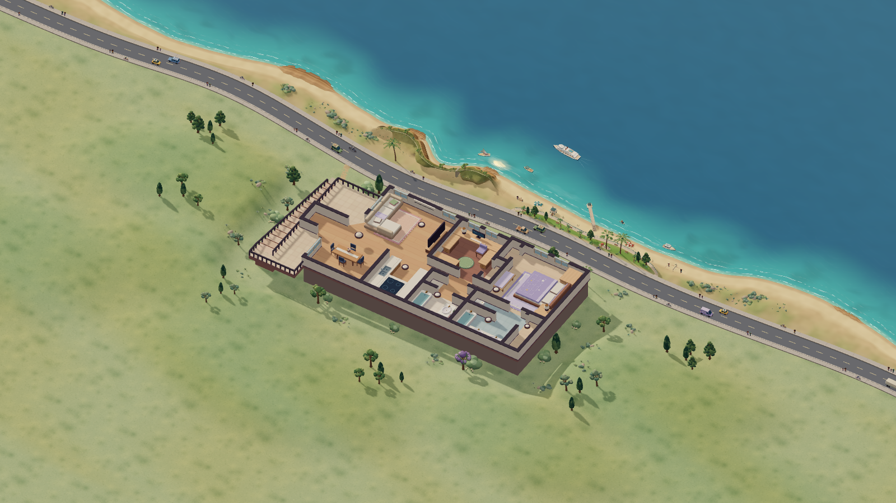

# Roomcraft

Roomcraft turns a Home Assistant dashboard into an illustrated 3D home with interactive device objects, animated scenery and a builder-style editor. Home and Studio use one saved layout and one shared 3D renderer.

**Start with the [architecture and engineering guide](docs/architecture.md).** It explains the framework, engine, module ownership, code and data flows, units, setup, builder limitations and implementation stages.

## Use the system

On your Home Assistant host, sign in and open these routes.

| View | Route | Purpose |
| --- | --- | --- |
| Home | `/roomcraft-home/home` | Live 3D controls and utility popups |
| Studio | `/roomcraft-home/studio` | Overhead authoring, catalog, walls, floors, terrain, Undo and Save |
| Controls | `/roomcraft-home/controls` | Conventional room-organized controls for phones and other screens |

Studio loads the current published design. **Save** publishes its layout and derived projection. **Return to live dashboard** is beside Save. An already-open editor can use **Import from dashboard** after another editor publishes. A different browser draft remains available for explicit recovery.

The optional owner-private hosted Studio uses the same saved project through its server bridge. GitHub, the Site, HA assets and the tablet browser are separate release surfaces.

## What is editable

- Rooms, floors, walls, fences and connected wall joins.
- Catalog objects, variants, dimensions, placement, bindings and actions.
- Terrain raise/lower/smooth/paint/erase brushes and individual trees, sage and rocks.
- Coast and road presets, beach width, road setback, hill height, planting and grouped landmark visibility.
- Living world species/categories, density, pace, variety and seeded activity; independent holiday themes.

Generated scenery is not yet entirely selectable piece by piece. [Builder completeness](docs/architecture.md#builder-completeness-and-target-architecture) states the remaining work. The 2D PNG export remains a compatibility output and does not include the 3D coastline.

## Engineering index

| Need | Guide |
| --- | --- |
| Framework, architecture, engine, units and flow diagrams | [Architecture](docs/architecture.md) |
| Current findings, improvements and verification | [Architecture audit](docs/architecture-audit-2026-11-12.md) |
| Automatic repair, rejected edits and Undo recovery | [Safe editing](docs/edit-safety.md) |
| Garage side driveway, opaque roof, detailed Prius and overhead light | [Garage editing](docs/garage-driveway.md) |
| Take over development | [Engineering handoff](docs/engineering-handoff.md) |
| Determinism, module contracts and migrations | [Engine contract](docs/engine-contract.md) |
| Release gates and rollback requirements | [Release standard](docs/release-standard.md) |
| Marine wildlife, ambient variety and shared settings | [Living world](docs/living-world.md) |
| Slow idle discoveries, safe touch wake and per-screen settings | [Idle camera](docs/idle-camera.md) |
| Landmark front views, local defaults and Studio view previews | [Device camera views](docs/device-camera-views.md) |
| Learn the editor | [Illustrated manual](docs/user-manual.md) |
| Install and recover | [Deployment](docs/deployment.md), [tablet access](docs/tablet-access.md) |
| Layout fields | [Format](docs/layout-format.md), [schema](layout.schema.json) |
| Terrain and coastline | [Coastal release](docs/coastal-art-release.md) |
| Feature priorities | [Roadmap](docs/roadmap.md) |
| Changes and reasons | [Changelog](CHANGELOG.md), [goals](docs/goals.md), [decisions](docs/decisions.md) |

## Development

From `site/`, run `npm ci`, then `npm run dev`. Node 22.13+ is required; CI uses Node 24. The source uses Three.js for the shared scene, native HA custom elements, and a static HTML/JavaScript editor. React/Vinext/Vite/Cloudflare provide the optional hosted shell and API.

Run `npm run architecture:check` to verify selected module boundaries and `npm run architecture:report` for a deterministic source inventory. The [full release gate](docs/release-standard.md#deterministic-release-evidence) includes tests, type checking, lint, build and the manifest.

The active HA dashboard stores private `roomcraft_layout` and `roomcraft_plan`. A signed-in administrator can publish through Studio. The iframe receives no HA token. Optional hosted credentials remain server-side. No HA core restart is needed for a normal asset update.

## Privacy and compatibility

This is public source and documentation. Keep credentials, raw dashboard backups, personal identifiers, private photos, camera media, location histories and live device values outside Git. Use synthetic fixtures for public tests.

The home uses a 1536 × 1024 design coordinate space. It is an illustration, not a dimensional survey. Physical measurements require verified calibration. The current deployment has been exercised on one installation, not certified across all HA/browser versions.

Historical releases and the separate `ishioho` prototype remain in Git and the legacy project. New work belongs in the current Roomcraft contracts.

