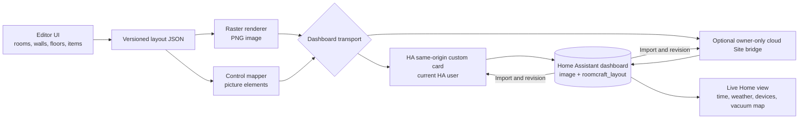

# Architecture and team boundaries

Roomcraft separates authored layout data, rendering, dashboard transport, and live Home Assistant state. Keep each boundary narrow so teams can change one layer without changing every other layer.



## Current contracts

| Layer | Source | Owns | Must avoid |
| --- | --- | --- | --- |
| Editor | `site/public/editor.html`, `app.js`, `styles.css`, `inventory.js` | User interactions, layout changes, local draft, JSON/YAML export | Direct access to server secrets |
| Art | `site/public/object-art.js`, `raster-renderer.js`, `responsive-inspector.js`, `assets/` | Perspective objects, room surfaces, windows, PNG render | Device service calls |
| HA transport | `site/ha-local/roomcraft-card.js`, `site/public/ha-iframe-bridge.js` | Same-origin editor messages, current-user HA API calls, PNG upload, revision check, dashboard save/verify, authenticated camera preview overlay | Sending an HA token into the iframe |
| Cloud transport | `site/app/api/dashboard/route.ts`, `site/lib/dashboard-elements.ts` | Owner authorization, input validation, HA image upload, revision check, dashboard save/verify, camera overlay configuration | Publishing the server token to client code |
| Home Assistant | Second Floor `plan`, `studio`, and `live` views | Official editor entry, authenticated device controls, displayed PNG, live native cards | Storing transient telemetry in layout geometry |
| Future live adapters | `integrations/` when introduced | Read-only subscriptions, entity bindings, calibrated robot position, safe service actions | Mutating layout geometry from telemetry |

The layout model stores `version`, `rooms`, `walls`, `items`, and `hotspots`. Rooms hold polygons and floor surface IDs; walls are endpoint pairs; items hold type, position, dimensions, rotation, and optional state/action bindings. `controlZone` items are invisible, movable hit areas. The separate `hotspots` array retains legacy independent `state-icon` controls with percentage positions. Both editor transports use layout version 2. **Any change to a persisted field's meaning requires a migration, a sample fixture, and a round-trip test in both transports.** The editable project space remains 1536 × 1024. The dashboard presentation PNG crops it to x20–1492 and y96–924, producing an exact 1472 × 828 16:9 view. This is a display transform, not a change in room or item coordinates.

Both dashboard transports read the `plan` view's `picture-elements` card and the top-level `roomcraft_layout`. On export each uploads a rendered PNG, updates the card image, derives object controls and camera overlays from items, merges independent hotspots, writes the project, then reads back to verify. Each rejects an export when the dashboard changed since import. The `studio` editor view, `live` state view, and reserved plan controls (editor link, weather, time) survive this transaction and stay out of editable hotspot data. The official `studio` card receives Home Assistant's `hass` object, validates the editor window, origin, and request IDs, and performs privileged operations itself. The static editor can request those operations only when framed or opened by that card.

For a wall-to-wall export, both transports map project `(x, y)` to crop `(x - 20, y - 96)`, then divide horizontal positions/sizes by 1472 and vertical positions/sizes by 828 for Home Assistant percentages. The plan card's `roomcraft_scene: wall-to-wall-v1` marker tells import to reverse both axes for independent `state-icon` controls; an unmarked legacy 3:2 card is imported without conversion. Camera and bound-object overlays are regenerated from original project items. The menu, weather, time, and editor link are viewport chrome and stay near the top of the cropped scene. See [layout format](layout-format.md) for the formula and compatibility contract.

### Bound objects and dashboard overlays

The editor owns item placement and binding IDs; Home Assistant owns live state and media. Export derives dashboard elements from bound items without copying telemetry into the authored layout:

| Item | Authored fields | Dashboard output | Offline behavior |
| --- | --- | --- | --- |
| Lamp, ceiling light, fan, invisible control zone | Item geometry, `entityId` state source, optional label/icon, tap and hold actions/target entities | `custom:roomcraft-object-control` at the item's percentage position; artwork or invisible zone is the actual tap target | Artwork remains; control reports unavailable state, while scenes report **Ready** rather than a false on/off state |
| Camera thumbnail | Item geometry, optional `camera.*`/`image.*` IDs, preview mode | A `custom:roomcraft-camera-thumbnail` picture element tied to that item ID | Neutral message in the frame; no stale public still |

The plan's unrelated editor link, clock, weather, and other dashboard elements remain outside Roomcraft's managed object-control, entity-menu, legacy-state-icon, and camera-element set. Both the HA card and the cloud bridge must use the same merge policy so an export from either editor preserves those overlays. A camera preview uses the current HA session to fetch an approved same-origin image-proxy URL; the event image state supplies an event timestamp. A live stream is shown only when Home Assistant already reports a working stream. Clicking the thumbnail opens native camera details. No camera token, proxy URL, or frame is written to public assets or the project JSON.

The upstairs exterior thumbnail uses the verified ONVIF HLS source `camera.porch_camera_profile_000`. The Eufy front-door camera and event image are separate entities; the tested Eufy P2P stream timeout does not determine the porch feed's availability. Keep each camera's media and stale/unavailable handling scoped to its own binding.

The two browser editors may each have a local draft. On opening, each loads the current dashboard project and preserves a different browser draft for explicit recovery. An already open editor must use **Import from dashboard** after the other publishes. The dashboard project, rather than a browser's local storage, is the shared source of truth. If the Studio iframe stays blank, its card opens the same editor in a new tab and accepts messages from that exact same-origin popup while Studio remains open; a direct static URL has no dashboard transport. The installed `/local/roomcraft/` assets are reachable by anyone who can reach the HA web server; do not put tokens, live entity inventories, private photos, or dashboard JSON in that static directory.

## Extension contracts

Future features should consume Home Assistant state through a small adapter, leaving geometry and art independent:

```ts
type EntityBinding = {
  sceneId: string;                 // stable room/object/control ID
  entityId: string;                // resolved privately for this installation
  capability: "light" | "fan" | "garage" | "camera" | "vacuum" | "weather";
};

type LiveState = {
  entityId: string;
  available: boolean;
  state: string;
  attributes: Record<string, unknown>;
  updatedAt: string;
};
```

Keep `EntityBinding` in private installation configuration or the private dashboard project. Public examples use fictional IDs. A renderer should receive normalized `LiveState` rather than reaching into Home Assistant globals. A command adapter should validate entity domain and availability, then call Home Assistant's native service or details action. No service action should run just because the map loaded.

The [public HA inventory](ha-inventory/README.md) is a dated, state-free metadata snapshot for planning and team handoff. It lists sanitized entity IDs, domain, area, integration, and audit availability; it does not supply runtime values, authenticated media, object coordinates, credentials, or a deployable binding file. The shipped drawer exposes On plan, All entities, search, registry availability, and the six curated sections recorded in the [Main Dashboard map](main-dashboard-map.md). The [control guide](ha-controls-and-menu.md) separates verified room placements from candidates. Revalidate every binding against live Home Assistant before use.

### Robot location

The vacuum map camera can expose a robot position and map calibration points. To place the robot on the illustrated plan, store a separate transform from vacuum-map coordinates to Roomcraft canvas coordinates, with the map identity and timestamp. At least three non-collinear matched points are needed for an affine transform. Hide the marker if the map changes, calibration is incomplete, or the position is stale. Keep camera access tokens and live map images inside authenticated Home Assistant.

### Responsive and motion layers

Maintain one scene coordinate system and fit it into phone, tablet, laptop, and kiosk viewports without stretching. UI panels can reflow independently. Decorative animation should respect `prefers-reduced-motion`, pause when hidden, and never substitute a forecast for observed weather. The clock and weather should use Home Assistant's time zone and entity data.

## Working agreements

- **Editor team:** schema migrations, geometry, undo/redo, accessible selection and touch behavior.
- **Art team:** asset provenance, perspective, windows, floors, object variants, export parity.
- **HA team:** same-origin card and cloud bridge parity, authenticated runtime adapters, device command safety, backups and rollback.
- **QA/documentation team:** visual snapshots at laptop/tablet sizes, JSON round-trip, release notes, user manual.

Use separate pull requests for model changes, art changes, and Home Assistant runtime changes when practical. A model change should include a migration plan and editor/bridge tests; art changes should include before/after graphics; runtime changes should include disconnected and unavailable states. The [deployment guide](deployment.md) defines release order and rollback.

