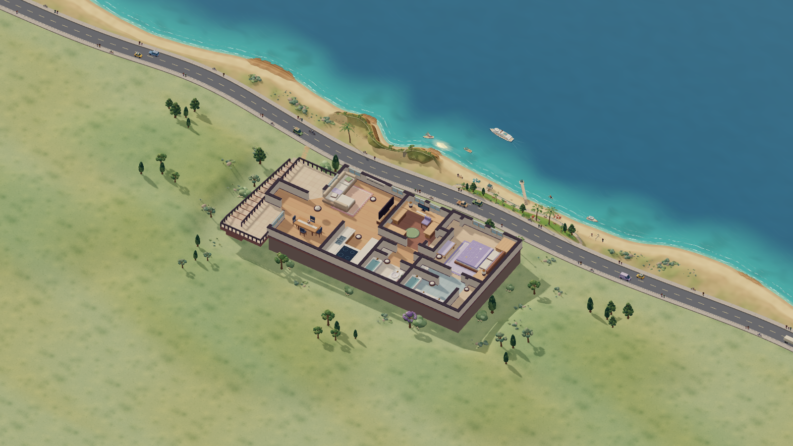
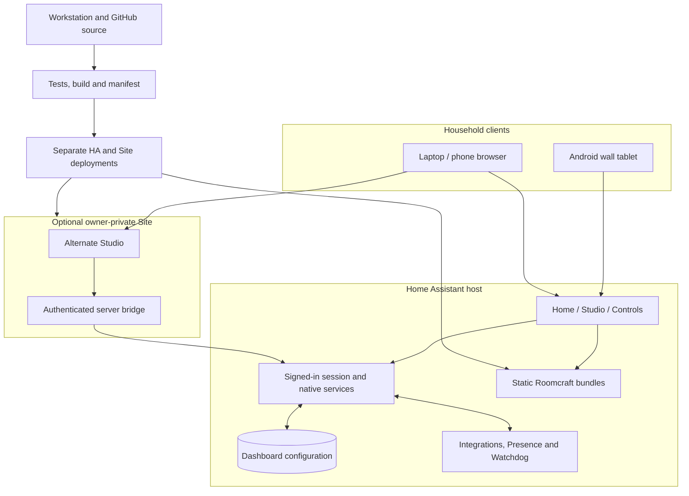
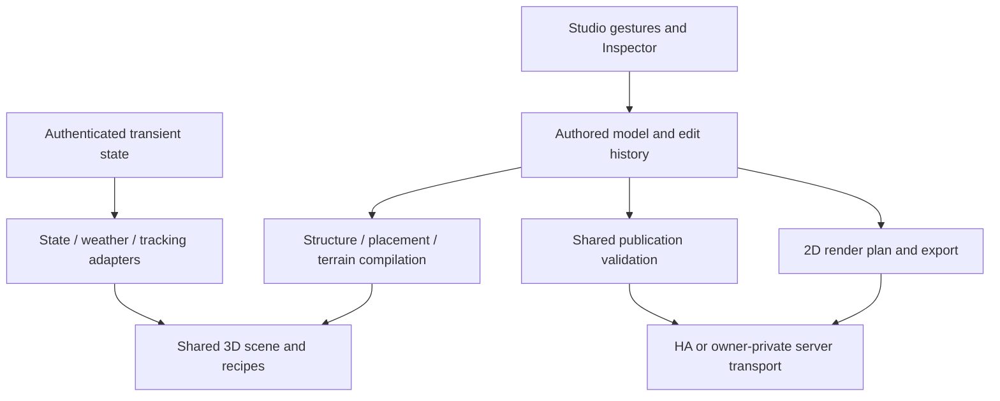
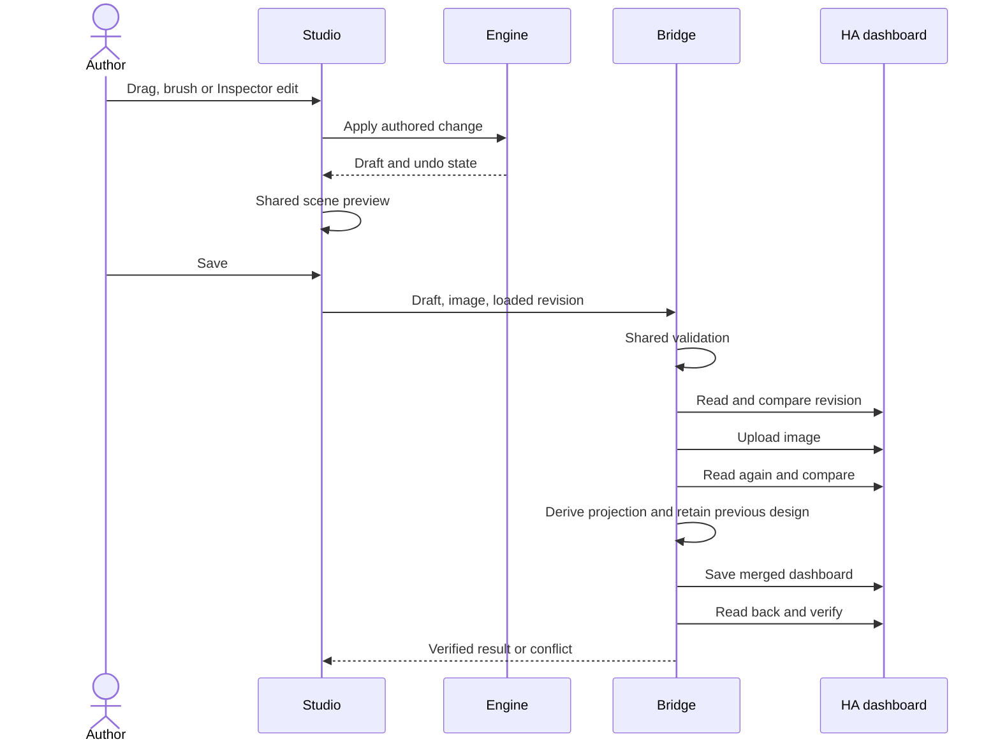
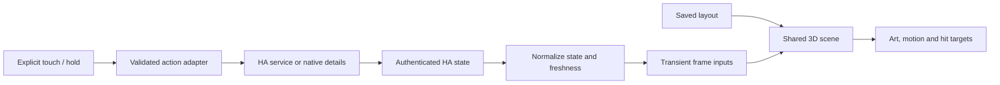
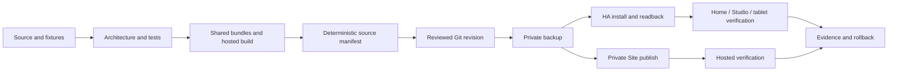

# Roomcraft architecture and engineering guide

Roomcraft is a Home Assistant control interface and a builder-style editor for the same home. Author rooms, furniture, controls, and outdoor scenery in Studio, save once, and see the same design respond to real devices in Home.

**Assessment, 12 November 2026.** The shared layout, renderer, deterministic terrain engine, and authenticated save adapters are a sound foundation. Roomcraft is not yet a fully generic building game. Some scenery remains procedural, large adapters combine responsibilities, and editor and publication validation are not yet one complete model validator.

[Audit and evidence](architecture-audit-2026-11-12.md) · [Engine contract](engine-contract.md) · [Release standard](release-standard.md) · [User manual](user-manual.md) · [Engineering handoff](engineering-handoff.md)



## Customer outcome

| Customer | Outcome | Acceptance |
| --- | --- | --- |
| Household operator | The illustrated device is the control and shows actual state | Separate light/fan bindings, unavailable treatment, explicit actions. Rendering never operates a device. |
| Builder | Arrange the home and landscape without editing source | Select, modify, undo, save, reload, and export the same result. Every new visible feature declares its editing surface. |
| Tablet user | A legible, responsive scene | Shared framing, bounded graphics, reduced motion, target-device verification. |
| Engineer | Continue without reconstructing chat history | Source ownership, units, data flow, tests, setup, known gaps and rollback are discoverable here. |
| Installer | Reuse the system for another home | Public code and synthetic examples stay separate from private geometry, credentials and telemetry. |

This audit improves engineering discoverability, boundary checks and publication validation. It does not replace the engine, change the customer's floor plan or make every generated mesh independently editable.

## System setup



HA routes are `/roomcraft-home/home`, `/roomcraft-home/studio` and `/roomcraft-home/controls`. Home is the 3D interface, Studio edits from above, and Controls is the room-organized conventional view. Main Dashboard remains separate.

The tablet runs the browser/Companion client. HA Green serves assets and device APIs. Development, bundling, Git and protected administration happen on the workstation and CI. The optional hosted editor is a separate deployment. GitHub publication alone changes neither runtime.

## Framework and base code

| Responsibility | Implementation and entry point |
| --- | --- |
| Shared 3D scene | Three.js and polygon-clipping, [scene source](../site/ha-local/storybook-scene.mjs) |
| HA interface | Native custom elements, [Home card](../site/ha-local/roomcraft-storybook.mjs), [Studio bridge](../site/ha-local/roomcraft-card.js) |
| Authoring app | HTML/CSS and classic JavaScript, [editor shell](../site/public/editor.html), [app](../site/public/app.js), [3D editor adapter](../site/ha-local/storybook-editor.mjs) |
| Portable engine | Browser/Node-testable scripts under [public/engine](../site/public/engine), frozen namespace registration |
| 2D compatibility export | [Raster renderer](../site/public/raster-renderer.js) and [object art](../site/public/object-art.js). Does not render the 3D coastline. |
| Optional hosted shell | React and Next-style routes through Vinext/Vite and Cloudflare Workers, [dashboard API](../site/app/api/dashboard/route.ts) |
| Build | esbuild for HA/Studio bundles, framework build for the Site, [orchestrator](../site/scripts/build-roomcraft.mjs) |
| Install | Python [installer](../site/ha-local/install.py), authenticated management adapter and SSH kept outside Git |
| Verification | Node/Python tests, TypeScript, ESLint, source manifest, synthetic browser fixtures and separate device checks |

[package.json](../site/package.json) and its lockfile own dependency versions. CI selects Node 24; the package accepts Node 22.13 or newer. The editor canvas is not a React component tree. Extend its shared contracts before adding another renderer or framework.

## Engine layers and modules



The pure engine must not import adapters or read DOM, network, storage, device services or ambient time. Adapters supply explicit inputs. Render animation can sample elapsed time; authored IDs and geometry cannot derive from it.

| Unit | Owns | Source |
| --- | --- | --- |
| Canonical core | Serialization, hashes, finite values, seeded IDs | [deterministic-core.js](../site/public/engine/deterministic-core.js) |
| Project runtime | Commands, replay, normalization, migration executor, canonical I/O | [project-runtime.js](../site/public/engine/project-runtime.js) |
| Render contract | Layers, ordered operations, assets, environment evidence | [render-contract.js](../site/public/engine/render-contract.js), [verification facade](../site/public/engine/verification-harness.js) |
| Structure | Connected walls, floors, railings, starter corrections | [wall joins](../site/public/engine/wall-joins.js), [reference geometry](../site/public/engine/reference-geometry.js), [3D structure](../site/ha-local/storybook-structure.mjs) |
| Terrain | Settings, sparse cells, brushes, normalization and limits | [terrain.js](../site/public/engine/terrain.js) |
| Catalog and models | Types, variants, footprints, finishes, placement roles | [inventory](../site/public/inventory.js), [variants](../site/public/catalog-variants.js), [furniture](../site/ha-local/storybook-furniture.mjs), [devices](../site/ha-local/storybook-devices.mjs) |
| Editor | Selection, Inspector, gestures, drafts, Save, Undo | [app](../site/public/app.js), [3D adapter](../site/ha-local/storybook-editor.mjs), [terrain UI](../site/ha-local/storybook-terrain-editor.mjs) |
| Scene composition | Combine geometry, models, lighting and effects | [storybook-scene.mjs](../site/ha-local/storybook-scene.mjs) |
| Outdoor world | Shared road/shore sampling, meadow, ocean, landmarks, planting | [street](../site/ha-local/storybook-street.mjs), [meadow](../site/ha-local/storybook-meadow.mjs), [ocean](../site/ha-local/storybook-ocean.mjs), [planting](../site/ha-local/storybook-coastal-planting.mjs) |
| Live state | Real state to visual targets and explicit actions | [state adapter](../site/ha-local/storybook-state.mjs), [Home](../site/ha-local/roomcraft-storybook.mjs) |
| Motion and calibration | Radar transforms, smoothing, supported routes, seating, robot alignment | [tracking](../site/ha-local/storybook-tracking.mjs), [floor support](../site/ha-local/storybook-floor-support.mjs), [person motion](../site/ha-local/storybook-person-motion.mjs), [vacuum alignment](../site/ha-local/storybook-vacuum-alignment.mjs) |
| Utility panels | Weather, energy, location, calendar, health and control dialogs | Domain `storybook-*.mjs` modules composed by Home |
| Publication | Shared validation, normalization, snapshots, revision checks, readback | [project](../site/ha-local/dashboard-project.mjs), [snapshots](../site/ha-local/dashboard-snapshots.mjs), HA and Site adapters |
| Release | Source inventory, boundaries, artifacts, evidence | [architecture checker](../site/scripts/architecture-check.mjs), [release script](../site/scripts/roomcraft-release.mjs), [CI](../../../../.github/workflows/roomcraft.yml) |

This is a modular monolith with shared source modules, not a plugin sandbox or a full entity-component-system engine. The largest adapters are extraction seams, not a pattern for new features.

## State, coordinates and units

| State | Owner and rule |
| --- | --- |
| `roomcraft_layout` | Saved private dashboard. Version 2, authored rooms, walls/fences, items, hotspots, optional scene settings and terrain. Shared editable truth. |
| `roomcraft_plan` | Derived picture card, image and control metadata. Compatibility projection, not another authored layout. |
| `roomcraft_snapshots` | Up to three displaced designs. Keep full dashboard backups separately. |
| Energy, commute, location and health mappings | Private dashboard root. Preserve them through layout saves. |
| Browser draft and display preferences | Local recovery and display choices, not another published project. |
| Entity values, media, tracks and forecasts | Authenticated transient runtime, excluded from authored geometry and public assets. |
| Demo | Explicit simulated inputs, no physical service calls. |

| Coordinate / unit | Meaning |
| --- | --- |
| Project `x,y` | 1536 × 1024 design units, not metres. |
| World `x,z` | Project `x,y` mapped to the ground plane. World `y` is elevation. |
| Elevation | Upstairs datum near zero, outdoor grade −111, stair base −108, default wall height 56. Renderer defaults, not surveyed storey heights. |
| Item dimensions | `w,h` are footprint; optional `modelHeight` is vertical span; rotation uses degrees. |
| Terrain grid | 32 world units, integer `col,row` to world `x,z`, height delta −32…64, ≤4096 cells and ≤96 props. |
| Terrain sliders | Beach width, hills and planting are relative percentages. Road setback and brush radius use world units. |
| Legacy plan export | `(x,y)` → `(x,y−80)` in 1536 × 864, then display percentages. Does not move authored geometry. |
| Radar | Source centimetres transformed to design coordinates through private calibration. |
| Vacuum | Raw map units and map identity must be verified. Metric distance uses inverse calibrated transform, not design-pixel distance. |
| Screen | CSS pixels and drawing-buffer pixels are separate. Graphics resolution cannot resize the authored home. |

See [layout format](layout-format.md) and [LiDAR alignment](lidar-tv-release.md) before changing units or transforms.

## Edit and Save flow



The HA path uses [iframe messaging](../site/public/ha-iframe-bridge.js) and the authenticated parent card. Exact origin, window and request checks protect the boundary. The iframe never receives a token. The Site uses owner authorization and a server-held secret.

Lovelace has no atomic compare-and-swap. Rechecks reduce conflicts but leave a short read-to-write race. Use one active publisher during planned recovery. A rejected layout must never reach upload/save.

Editor history currently stores gesture snapshots and journals `scene.replace`. Terrain records one completed stroke as one undoable change. Fine-grained commands such as `terrain.stroke` and `item.move` are future incremental work.

## Live control flow



Graphic state follows the actual bound state entity. Fan motor and fan light are independent. Unknown, stale and unavailable are distinct from off. Render frames, Studio previews and demos must not actuate devices. Media remains authenticated. Floor support and route checks constrain avatars and robot motion.

## Builder completeness and target architecture

Every new feature must declare its persisted settings, editor control, undo unit, serialization path, renderer consumer and acceptance test. Ordinary configuration should not require a later code change.

| Feature | Available now | Remaining gap |
| --- | --- | --- |
| Home | Editable floors, walls, fences, joins, materials | Broader automated touch/selection coverage |
| Objects | Catalog, variants, dimensions, transforms, bindings/actions | Registry-driven Inspector and full shared model validation |
| Terrain | Raise/lower/smooth/paint/erase, individual trees/sage/rocks, Undo/Save | More per-prop transforms and shape handles |
| Coast and road | Presets, width/setback, hills, planting, grouped landmark visibility | Generated ledges, roads, paths, umbrellas and plantings are not all independently selectable |
| Live appearance | Shared renderer and appearance preview | Authentication and live-source availability differ between transports |
| Views and graphics | Camera defaults/free view and display choices | Per-browser preferences intentionally remain separate from authored layout |

The next reusable foundation is an **environment recipe registry**. A recipe should declare stable identity, parameter types, units, defaults, bounds, Inspector controls, geometry builder, placement sampler and collision policy. Selectable instances can then expose coastline and road handles without duplicating geometry. This is a target design, not a claimed shipped universal registry.

## Development and release

Start in `home-assistant/projects/roomcraft/site`. Keep private adapters and credentials outside the checkout.

```powershell
npm ci
npm run architecture:check
npm run architecture:report
npm test
node --test ha-local/roomcraft-card.test.mjs ha-local/roomcraft-weather-outdoor.test.mjs
python -m unittest discover -s ha-local -p "test_*.py"
python -m unittest discover -s ../ha-presence/tests -p "test_*.py"
npx tsc --noEmit
npm run lint
npm run build
npm run release:manifest:verify
git diff --check
```

For local authoring development use `npm run dev` and its printed URL. Use synthetic fixtures for automated edits and save tests. Use the [deployment guide](deployment.md) for authenticated installation and backup.

After shared renderer changes, regenerate `public/storybook-editor.js` with `node scripts/build-storybook.mjs --write-editor`. After public changes run `npm run release:stamp-editor`. Never hand edit generated bundles.



The architecture report enumerates handwritten modules, ownership, imports and normalized line counts. Its checks cover declared shared imports and selected pure-engine boundaries. It is not proof of semantic purity, complete editability, frame rate or device operation.

## Team ownership and next stages

| Team | Owns | Evidence |
| --- | --- | --- |
| Engine | Model, IDs, commands, migrations, terrain, validation | Round-trip, rejection, determinism, compatibility |
| Builder | Selection, Inspector, gestures, history | Mouse/touch, undo/redo, save/reload, accessibility |
| World and art | Shared geometry, recipes, materials, placement | Live/Studio parity, cameras, floor support, tablet budget |
| Integrations | Auth, state, explicit actions, media and sensors | Both transports, stale/offline behavior, safe preview |
| Release | Build, provenance, backup, deployment | Exact revision and independently verified rollback route |

1. Extract one complete model validator shared by editor and publication, retaining compatibility fixtures.
2. Introduce a property/recipe registry. Convert one environment recipe end to end before migrating the rest.
3. Extract versioned domain commands from `app.js`, preserving snapshot replay during transition.
4. Separate compilation, world composition and lifecycle from `storybook-scene.mjs`, keeping one Home/Studio renderer.
5. Promote ad-hoc browser checks into sanitized reproducible fixtures for terrain, saves, controls and wide camera views.

Each stage must preserve saved layouts and provide an independently verifiable improvement. See the [dated audit](architecture-audit-2026-11-12.md) for this release's actual work and remaining limitations.

