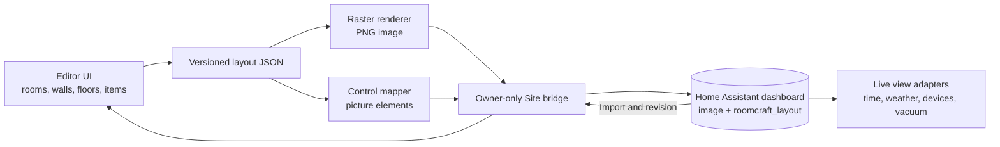

# Architecture and team boundaries

Roomcraft separates authored layout data, rendering, dashboard transport, and live Home Assistant state. Keep each boundary narrow so teams can change one layer without changing every other layer.



## Current contracts

| Layer | Source | Owns | Must avoid |
| --- | --- | --- | --- |
| Editor | `site/public/editor.html`, `app.js`, `styles.css`, `inventory.js` | User interactions, layout changes, local draft, JSON/YAML export | Direct access to server secrets |
| Art | `site/public/object-art.js`, `raster-renderer.js`, `responsive-inspector.js`, `assets/` | Perspective objects, room surfaces, windows, PNG render | Device service calls |
| Transport | `site/app/api/dashboard/route.ts` | Owner authorization, input validation, HA image upload, revision check, dashboard save/verify | Rendering UI, publishing credentials to client |
| Home Assistant | Second Floor dashboard configuration | Authenticated device controls and displayed PNG | Becoming a second editable layout source |
| Future live adapters | `integrations/` when introduced | Read-only subscriptions, entity bindings, calibrated robot position, safe service actions | Mutating layout geometry from telemetry |

The layout model stores `version`, `rooms`, `walls`, `items`, and `hotspots`. Rooms hold polygons and floor surface IDs; walls are endpoint pairs; items hold type, position, dimensions, and rotation; hotspots hold entity ID, action, and percentage position. The Site currently uses layout version 2. **Any schema change requires a migration, a sample fixture, and a round-trip test.** The design canvas is 1536 × 1024. Percentage-positioned controls survive viewport resizing.

The dashboard bridge reads the `plan` view's `picture-elements` card and the top-level `roomcraft_layout`. On export it uploads a rendered PNG, updates the card image and controls, writes the editable project, then reads back to verify. It rejects an export when the dashboard revision changed since import. The `studio` editor view, `live` state view, and reserved plan controls (editor link, weather, time) must survive this transaction and stay out of editable hotspot data.

## Extension contracts

Future features should consume Home Assistant state through a small adapter, leaving geometry and art independent:

```ts
type EntityBinding = {
  sceneId: string;                 // stable room/object/control ID
  entityId: string;                // resolved privately for this installation
  capability: "light" | "fan" | "garage" | "camera" | "vacuum" | "weather";
};

type LiveState = {
  entityId: string;
  available: boolean;
  state: string;
  attributes: Record<string, unknown>;
  updatedAt: string;
};
```

Keep `EntityBinding` in private installation configuration or the private dashboard project. Public examples use fictional IDs. A renderer should receive normalized `LiveState` rather than reaching into Home Assistant globals. A command adapter should validate entity domain and availability, then call Home Assistant's native service or details action. No service action should run just because the map loaded.

### Robot location

The vacuum map camera can expose a robot position and map calibration points. To place the robot on the illustrated plan, store a separate transform from vacuum-map coordinates to Roomcraft canvas coordinates, with the map identity and timestamp. At least three non-collinear matched points are needed for an affine transform. Hide the marker if the map changes, calibration is incomplete, or the position is stale. Keep camera access tokens and live map images inside authenticated Home Assistant.

### Responsive and motion layers

Maintain one scene coordinate system and fit it into phone, tablet, laptop, and kiosk viewports without stretching. UI panels can reflow independently. Decorative animation should respect `prefers-reduced-motion`, pause when hidden, and never substitute a forecast for observed weather. The clock and weather should use Home Assistant's time zone and entity data.

## Working agreements

- **Editor team:** schema migrations, geometry, undo/redo, accessible selection and touch behavior.
- **Art team:** asset provenance, perspective, windows, floors, object variants, export parity.
- **HA team:** dashboard bridge, authenticated runtime adapters, device command safety, backups and rollback.
- **QA/documentation team:** visual snapshots at laptop/tablet sizes, JSON round-trip, release notes, user manual.

Use separate pull requests for model changes, art changes, and Home Assistant runtime changes when practical. A model change should include a migration plan and editor/bridge tests; art changes should include before/after graphics; runtime changes should include disconnected and unavailable states. The [deployment guide](deployment.md) defines release order and rollback.

