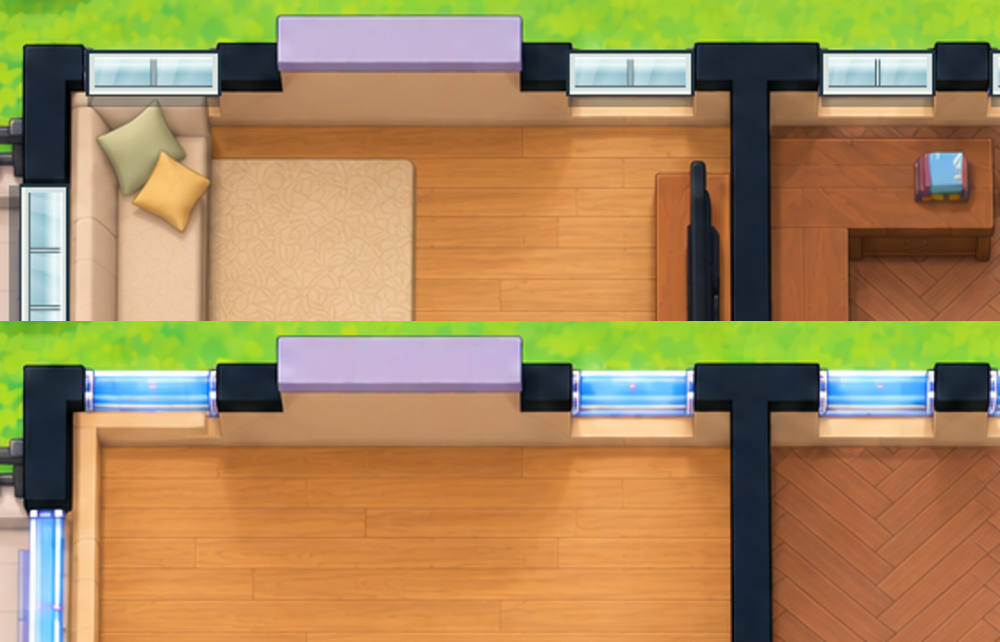

# Artwork and graphics

The road fleet uses small 3D vehicle recipes in `site/ha-local/storybook-vehicles.mjs`. Each design has a stable ID, a readable silhouette, inset glazing, wheels, and separate lamp accents. Use the authored lane width and existing road camera to check scale. Check the mixed fleet at the normal tablet view and the demo close-up. Keep all vehicles in the same miniature perspective, and keep vehicle finishes in the catalog so Home and Studio can share the renderer.

Roomcraft's 1536 × 1024 visual starting point was supplied as a PNG and refined for the sofa, stairs, floors, and windows. The bundled `floorplan.png` is the furnished Reference view. Design builds its own scene from shell, rooms, walls, and item records. The [published-plan image](images/published-plan.png) is a public-safe capture showing movable room fixtures, a bedside lamp, and a drawn camera placeholder. Home Assistant supplies real camera frames as separate authenticated overlays. The editor assets under `site/public/assets/` are shared by HA Studio, the hosted editor, and the PNG export. Earlier flat-window captures are in the [legacy screenshot archive](legacy/README.md).

| File or group | Role |
| --- | --- |
| `floorplan.png` | Corrected furnished reference bundled with the editor; the live published export is shown separately in the manual |
| `empty-shell.png`, `wall-free-shell.png` | Illustrated shell and replacement floor pixels for edited interior wall segments. Window and wall-unit repairs sit below their editable art. |
| `illustrated-furniture-atlas.png` | Perspective furniture sprites |
| `baby-and-home-atlas.png`, `baby-and-home-overhead-atlas.png` | Small-item artwork for baby, home, safety, and decor inventory |
| `rug-sprite.png`, `bedroom-rug-sprite.png` | Historical rug art retained for comparison. The living, office, and bedroom rug items use woven canvas recipes in the rugs layer. |
| `terrazzo-tile.png`, `sage-tile.png` | Room finish textures |

Preserve original source dimensions, transparency, and color alignment when replacing an asset. A new atlas should include a contact sheet or screenshot, a render comparison at 100% scale, and a note in the changelog. Check that a sprite's perspective, shadow direction, and wall attachment match the scene. Keep the reference PNG in source so future work can compare the rendered result without relying on an external attachment.

## Detailed crafted-miniature furniture and light system

The editor includes an 88-entry `crafted-miniature-v1` collection within the existing compatibility recipe families, `cuteFurniture` and `cuteLight`. Those internal recipe names are stable identifiers, not the visual direction. The visible art is detailed, warm, and materially believable: upholstery has panels, seams, piping, cushions, and woven texture; wood has directional grain, edge treatment, joinery, legs, and hardware; case furniture has framed fronts and working-looking drawers or doors; fixtures separate fabric, ceramic, glass, brass, and frosted-light components. Forms remain original and generic. Do not copy a branded character, game asset, logo, or recognizable commercial silhouette.

Catalog metadata separates a product **series** from its **design**, **size**, **material**, and **finish**. The Inspector uses those fields to offer independent Style, Size, and Color / finish menus. A Style or Size choice selects the destination catalog entry and applies its authored width and depth. A Finish choice changes material/color while preserving the placed item's current dimensions, center, rotation, binding, and custom name. Do not infer a new footprint by multiplying one drawing uniformly.

### Bed family contract

The 42 bed entries cover nine construction families and six size classes:

| Construction | Authored sizes | Required visible differences |
| --- | --- | --- |
| Quilted bed | Queen | Upholstered/quilted surface and distinct head treatment |
| Crib | Crib | Slatted enclosure and fitted infant mattress |
| Toddler bed | Toddler | Low rails and child-scale proportions |
| Low platform | Twin, full, queen, king | Low frame, exposed wood structure, size-appropriate mattress |
| Arched upholstered | Full, queen, king | Shaped padded headboard, seams/tufting, upholstered surround |
| Drawer storage | Full, queen, king | Framed base and visible drawer fronts/hardware |
| Four-poster canopy | Queen, king | Four posts and connecting canopy rails |
| Upholstered daybed | Twin | Side/back rails, sofa-like orientation, bolsters |
| Slatted bunk | Twin bunk | Two sleep levels, guard rail, ladder, and credible clearance |

Finish combinations produce the 42 catalog entries. Size IDs are `crib`, `toddler`, `twin`, `full`, `queen`, and `king`; “twin bunk” remains a twin footprint with a construction-specific display label. For a shared construction, larger adult size classes must have monotonically larger authored widths and appropriate depths. At equal nominal size, construction geometry and render traces must remain distinct. Tests should compare metadata and drawing operations rather than accepting labels alone.

Every furniture form draws in the item's actual local width and height, brackets canvas state with balanced `save`/`restore`, and uses deterministic highlights, material marks, and offset contact shadows. Furniture remains on `furniture`; ceiling fixtures declare `ceiling-devices`. Never use executable canvas `shadowBlur`, `filter`, pixel reads, timers, randomized marks, clock input, or floor-colored repair rectangles. A renderer review must cover default geometry plus compact, rotated, large, and quarter-turn cases; assert no clipping, floor bleed, transform leak, performance runaway, or loss of the construction's recognizable silhouette.

An unbound light is decorative. A bound light is omitted from the static plan once and rendered as one live overlay in Home Assistant. The validated `lightForm` preserves its authored table, floor, ceiling, pendant, or sconce construction while the bound entity alone supplies off, on, or unavailable treatment. The transparent target and 4-pixel state dot remain separate from the visible art. Live CSS art must match the material hierarchy of the editor/export art closely enough that the object does not change identity when it becomes interactive.

## Wall-mounted window quality check

Windows are architectural openings, so their frame and glazing must follow the direction and apparent thickness of the wall they attach to. For a change to window artwork or snapping, inspect all of the following in Design mode **and** in the downloaded detailed PNG:

In this comparison, the top crop shows the flat replacement windows and the lower crop shows the recessed shell glazing used by the corrected Design renderer.

1. Place one window on a horizontal exterior wall and another on a vertical exterior wall. Their long edges should follow the wall rather than appear as floor objects.
2. Check frame depth, reveal, sill, glazing reflections, and cast shadow at 100% scale. The light and dark sides should agree with nearby raised walls.
3. Drag each window along its wall and around a corner. Rotation should update to the new wall; the object should stay centered on that wall and not float into the room or outdoors.
4. Change the wall finish and a room floor finish. The window should remain legible and neither finish should paint over its frame or glass.
5. Export a PNG and compare its window position and perspective to the editor at the same scale. Check both laptop and tablet canvas sizes for clipping or alignment shifts.

The original furnished reference includes baked-in windows. Editable window objects are separate overlays; moving a wall or changing its finish does not cut a new structural opening into the reference bitmap. The exterior outline remains fixed to keep the supplied scene aligned.

To check layer ownership, export a disposable Design copy with zero items. The living, office, and bedroom rugs, the cooktop, bathroom fixtures, cabinets, windows, and wall unit should all disappear. Interior wall moves and removals additionally replace the old cap, face, and shadow within the authored source regions in `raster-renderer.js`. Inspect the exposed floor and adjacent wall joins at full scale.

## New fixture and live-state art

The office has one desk lamp. Its `lamp` item uses the bedroom-style perspective sprite; the former separate study ceiling fixture duplicated its light binding and is removed from the private project and default fixture list. `site/public/object-art.js` also draws three more editable fixture types: a raised hallway thermostat/AC case, a five-blade office window fan recessed into blue glazing, and a compact exterior garage-door control tile. Their catalog entries and default live-graphic kinds live in `site/public/app.js`. Inspect each at 100% in Design mode and in the exported PNG, including wall contact, shadow direction, surrounding glazing, and overlap with other controls. The garage tile represents a control surface outside the house; it is not a fictitious opening in the upstairs wall.

The static artwork stays neutral. Home Assistant draws bright, dark, or unknown state treatments on top of the linked object through `custom:roomcraft-object-control`; the five-blade fan rotor is a separate low-frame-rate authenticated overlay. The export omits the bound fan's fixed blades so the dashboard has one rotor, while the editor preview still shows the fixture. Its live backing is dark and feathered, without a square border. Keep state colors and animation out of the saved PNG so the image never freezes a device in an obsolete state. See the [live object guide](live-object-graphics.md) for the state legend, reduced-motion rule, and camera separation.

The public graphics show a fictionalized floor plan and are documentation/reference art. Do not add live camera frames, exact vacuum maps, household photos, or private access URLs to this folder.

Moving bound fan and robot art is visible in Design mode but intentionally absent from the clean exported PNG. Home Assistant supplies one live rotor and one calibrated robot overlay, preventing a frozen duplicate. Stateful lights preserve one of the six validated live silhouettes documented above; their entity alone supplies the glow and state treatment. Humidifier and air-purifier sprites are separate perspective-aware catalog objects; their mist/airflow is a runtime overlay, not baked art.

The [live-binding workflow diagram](images/live-binding-flow.svg) uses fictional `example_*` entity IDs and a drawn camera placeholder. The [camera-state diagram](images/camera-state-flow.svg) shows a dated front-door still, idle garage preview, connecting state, and decoded live state. These vector manual graphics contain no device image, stream URL, or installed entity inventory.

