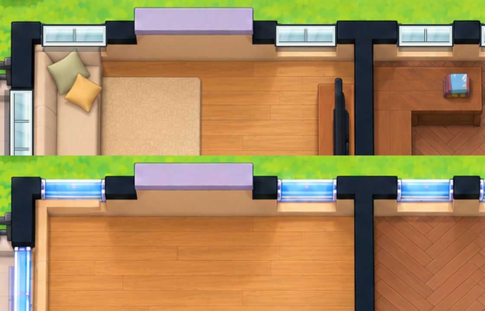

# Artwork and graphics

Roomcraft's 1536 × 1024 visual starting point was supplied for this project as a PNG and refined for the sofa, stair, floor, and window corrections. The bundled `floorplan.png` has recessed blue glazing. The [published-plan image](images/published-plan.png) is a public-safe release capture: it shows movable room fixtures, the bedside lamp, and a drawn camera placeholder. Its pixels differ from the bundled reference because the renderer encoded the editable scene anew. The real camera image is a separate authenticated dashboard overlay, never baked into this public illustration. The renderer also reapplies blue glazing pixels from `empty-shell.png` where edited rooms or objects disturb those baked-in windows. The editor's shell, floor textures, furniture atlas, baby/home atlases, and object overlays were created or derived for the Roomcraft layout workflow. They are bundled under `site/public/assets/` so the HA-hosted editor, optional cloud editor, and detailed PNG export use the same graphics. Earlier flat-window captures are in the [legacy screenshot archive](legacy/README.md).

| File or group | Role |
| --- | --- |
| `floorplan.png` | Corrected furnished reference bundled with the editor; the live published export is shown separately in the manual |
| `empty-shell.png`, `wall-free-shell.png` | Underlay art used when the editable layout is drawn; `empty-shell.png` restores default glazing around edited cutouts |
| `illustrated-furniture-atlas.png` | Perspective furniture sprites |
| `baby-and-home-atlas.png`, `baby-and-home-overhead-atlas.png` | Small-item artwork for baby, home, safety, and decor inventory |
| `rug-sprite.png`, `bedroom-rug-sprite.png` | Floor object detail |
| `terrazzo-tile.png`, `sage-tile.png` | Room finish textures |

Preserve original source dimensions, transparency, and color alignment when replacing an asset. A new atlas should include a contact sheet or screenshot, a render comparison at 100% scale, and a note in the changelog. Check that a sprite's perspective, shadow direction, and wall attachment match the scene. Keep the reference PNG in source so future work can compare the rendered result without relying on an external attachment.

## Wall-mounted window quality check

Windows are architectural openings, so their frame and glazing must follow the direction and apparent thickness of the wall they attach to. For a change to window artwork or snapping, inspect all of the following in Design mode **and** in the downloaded detailed PNG:

In this comparison, the top crop shows the flat replacement windows and the lower crop shows the recessed shell glazing used by the corrected Design renderer.

1. Place one window on a horizontal exterior wall and another on a vertical exterior wall. Their long edges should follow the wall rather than appear as floor objects.
2. Check frame depth, reveal, sill, glazing reflections, and cast shadow at 100% scale. The light and dark sides should agree with nearby raised walls.
3. Drag each window along its wall and around a corner. Rotation should update to the new wall; the object should stay centered on that wall and not float into the room or outdoors.
4. Change the wall finish and a room floor finish. The window should remain legible and neither finish should paint over its frame or glass.
5. Export a PNG and compare its window position and perspective to the editor at the same scale. Check both laptop and tablet canvas sizes for clipping or alignment shifts.

The original furnished reference includes baked-in windows. Editable window objects are separate overlays; moving a wall or changing its finish does not cut a new structural opening into the reference bitmap. The exterior outline remains fixed to keep the supplied scene aligned.

## New fixture and live-state art

The office desk lamp reuses the perspective-aware table-lamp drawing. `site/public/object-art.js` now draws three more editable fixture types: a raised hallway thermostat/AC case, a five-blade office window fan recessed into blue glazing, and a compact exterior garage-door control tile. Their catalog entries and default live-graphic kinds live in `site/public/app.js`. Inspect each at 100% in Design mode and in the exported PNG, including wall contact, shadow direction, surrounding glazing, and overlap with other controls. The garage tile represents a control surface outside the house; it is not a fictitious opening in the upstairs wall.

The static artwork stays neutral. Home Assistant draws bright, dark, or unknown state treatments on top of the linked object through `custom:roomcraft-object-control`; the five-blade fan rotor is a separate low-frame-rate authenticated overlay. The export omits the bound fan's fixed blades so the dashboard has one rotor, while the editor preview still shows the fixture. Its live backing is dark and feathered, without a square border. Keep state colors and animation out of the saved PNG so the image never freezes a device in an obsolete state. See the [live object guide](live-object-graphics.md) for the state legend, reduced-motion rule, and camera separation.

The public graphics show a fictionalized floor plan and are documentation/reference art. Do not add live camera frames, exact vacuum maps, household photos, or private access URLs to this folder.

The [live-binding workflow diagram](images/live-binding-flow.svg) uses fictional `example_*` entity IDs and a drawn camera placeholder. The [camera-state diagram](images/camera-state-flow.svg) shows a dated front-door still, idle garage preview, connecting state, and decoded live state. These vector manual graphics contain no device image, stream URL, or installed entity inventory.

