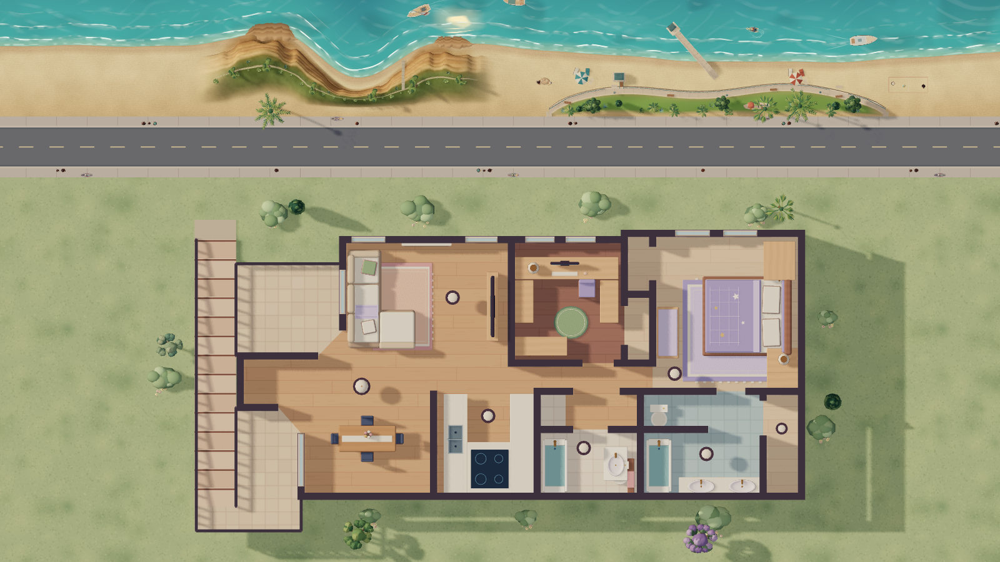
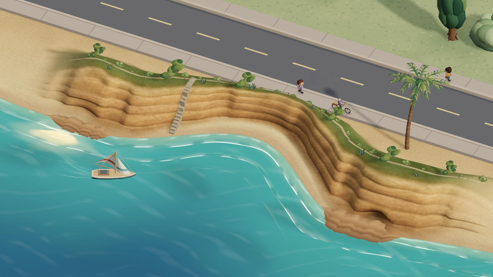
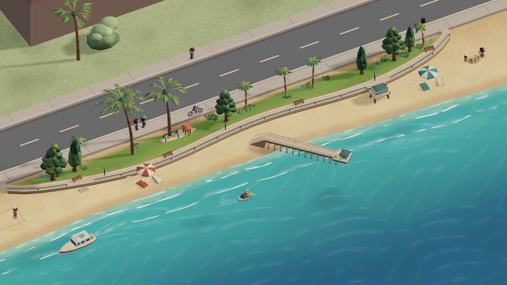
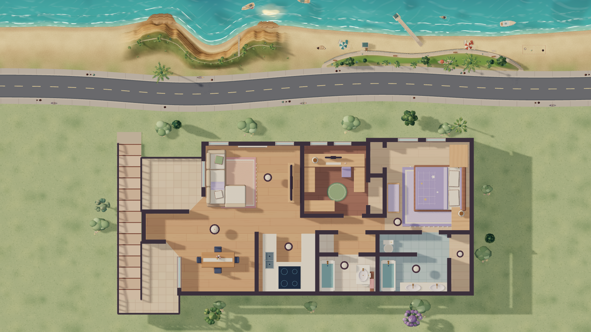

# La Jolla waterfront art

The wall dashboard should evoke La Jolla from its everyday overhead view. A guest should be able to inspect the cliffs, pier and landscaped park from angles where their depth is visible. Preserve the home footprint, touch targets, saved camera preferences, and weather controls. The Shores and Cove are combined for the dashboard composition.

| Customer outcome | Acceptance |
| --- | --- |
| Recognize La Jolla from the wall display | The overhead view shows the Cove on the left and Shores and the pier on the right, above the entire house. |
| See the coast in depth | The Cove shot faces one sandstone bluff with rock ledges and a crescent of sand at the water. The Shores shot frames the pier deck, pilings and landscaped promenade. House controls and camera tiles stay with the house views. |
| Keep the water alive | Animated shore break, reflections and rainfall follow the camera and the current weather. Reduced motion, manual quality, and the Insane graphics recovery remain available. |
| Maintain the release | Authored curves, seeded vegetation, camera bounds and verified artwork bytes can be reproduced and restored independently of the saved home. |

`storybook-street.mjs` supplies the shoreline, sand grade, play sites and separate camera frames. `storybook-la-jolla-bluffs.mjs` owns the continuous bluff surface and plantings. `storybook-la-jolla-shores.mjs` owns Scripps Pier, the promenade and Kellogg Park. `storybook-ocean.mjs` maps surf to the shared coast and uses world-space wind swells offshore. `storybook-camera.mjs` fits the two seaward views independently.

The continuous bluff shares the beach's sampled height and color along its edges. Point La Jolla forms the longer western shoulder, and lower shelves frame the east. The beach stair follows the sandstone face down to the sand. The ocean mesh and wet sand use the same crescent shoreline. [City aerial and ground photos](https://www.sandiego.gov/sites/default/files/californiasealionobservationslajollacovefinalrpt20160628.pdf#page=9) · [1969 Cove photo](https://www.sandiego.gov/digital-archives-photos/la-jolla-cove-beach-1969)

## Material provenance

The composition uses the [City aerial map and beach photographs](https://www.sandiego.gov/sites/default/files/2025-06/final-crmp-peir.pdf), the [Cove photograph](https://www.sandiego.gov/digital-archives-photos/la-jolla-cove-beach-1969), and [Scripps Pier](https://scripps.ucsd.edu/about/scripps-pier) as references. An ImageGen concept explored a high-angle miniature with a diagonal Scripps Pier, warm sandstone shelves, shaded coastal scrub, green-blue coves and broken white surf. The art direction was implemented as 3D geometry with weather-driven lighting.

Built-in ImageGen supplied `site/public/la-jolla-sandstone-v1.png`, a 1254 × 1254 local material texture. SHA-256 `45506ed71b9831abef277d8614558825fe56f0031e7f8dc394f933e3f7d0836e`.

> Generate one perfectly tileable square game-material albedo texture, a cropped macro surface swatch of the horizontally layered warm coastal sandstone cliffs at La Jolla Cove. Frontal orthographic material scan only, flat even light, no shadows or shading, no water, no sand beach, no grass, no plants, no scene, no border, no edges, no words. The whole 1:1 square is densely filled by sedimentary sandstone texture at approximately one meter close up: weathered fine sediment, diagonal hairline fractures crossing primarily near-horizontal strata, some thin darker cinnamon and ocher seams, golden beige chalky strata and softly variegated patchy grains. Restrained tonal contrast, warm balanced midtones, finely detailed hand-painted cinematic stylized realism as in a Japanese miniature background. Seamless left-right and top-bottom, homogeneous enough to repeat on a 3D cliff. Albedo texture only.

The live renderer maps the texture onto exposed rock in world coordinates. The sand, surf, planted caps and shadows are rendered independently of the texture. The numbered filename keeps the old Home Assistant cache compatible with a rollback.

## Initial art release verification and rollback

- Runtime revision `1ddfbca03023821b3bd46479a4a4d8169d3ee98f` passed 477 JavaScript and 38 Python tests, TypeScript, lint with existing warnings, and the production build. The exact source manifest was `sha256:990a0ca4bb35c404408567b341adc52c42630c069990a49906010f6f5680f3cb`.
- Chromium rendered overhead, Cove, and Shores with simulated daylight. Cove also rendered at night, in rain, and with Insane graphics. The signed-in Home Assistant check loaded the texture, switched to both coastal cameras, verified that their home controls were hidden, and confirmed the controls returned with Default. LAN and Nabu Casa served nine byte-identical release assets. The Home Assistant layout and projection matched the backup.
- The Android wall tablet rendered the Cove and Shores at live nighttime conditions. The final tablet check verified the Shores with home controls hidden, then cold-opened the full Default view. No device commands were sent for these checks.
- Owner-private Studio version 93 was published from `a3ce5afc953f440bce35fdbf83a79c8d6d7213fb`. The packaged editor bundle and texture matched the Home Assistant build.
- For rollback, reinstall runtime source `a6d36a086202789ea78c59b3ff9cccfb6a8e8faa` and restore private Studio version 91. The pre-art dashboard backup stays in the protected backup directory. See [deployment recovery](deployment.md).

## Shoreline correction verification and rollback

- Runtime revision `82213b8e3635dca5fefb55dc4221472f8d2ac54a` passed 478 JavaScript and 38 Python tests, TypeScript, lint with existing warnings, and the production build. The exact source manifest was `sha256:e7d57338349535b8b2f1f5a4006b1c093aaa3a09f6192441766a90c446b3c191`.
- The renderer reproduced the corrected overhead view and both coastal camera views. The shore also rendered in simulated nighttime, rain, and Insane graphics. Signed-in Home Assistant confirmed the left-hand Cove and both camera options. LAN and Nabu Casa served nine matching release assets and the published layout matched the backup. The wall tablet cold-opened the corrected Default view.
- Owner-private Studio version 94 was published from `b07e8dc0a52d64f2137ee74be997a1e65de32e75` with matching editor and texture bytes. To roll back this correction, reinstall `1ddfbca03023821b3bd46479a4a4d8169d3ee98f` and restore private Studio version 93.

## Continuous bluff release verification and rollback

- Runtime revision `96a8d20eec9ddbc74e3b105dcfd8a1a5a66aaae6` passed 479 JavaScript and 38 Python tests, TypeScript, lint with existing warnings, and the production build. The verified source manifest was `sha256:af172f42f7119dadd397eba69c6d07d96337b50fff028317d8986eac1c6059c4`.
- The built renderer reproduced the overhead view and both coastal camera views. Cove also rendered at night, in rain, and with Insane graphics. Signed-in Home Assistant opened Cove, Shores and Default, and the wall tablet cold-opened to the continuous bluff on the left. LAN and Nabu Casa served nine matching assets and the dashboard layout matched the backup.
- Owner-private Studio version 95 was published from `6323baeaee349379747a829048d4d6d374421e1f` with matching editor and texture bytes. To roll back, reinstall `82213b8e3635dca5fefb55dc4221472f8d2ac54a` and restore private Studio version 94.

## Curved street and natural terrain transitions

On the wall display and in Studio, the road should read as part of the coast. A gentle reverse bend should be visible from above, with vehicles and people following the pavement and with no gap at either promenade entrance. Break up the grass and sand border with pockets of scrub, bare ground, and irregular gradation. The left-hand Cove, the beach crescent, the pier, and the saved home stay in place. No project migration or device changes apply.

`storybook-street.mjs` owns the analytic road sample `(x, baselineZ) → {x, z, yaw}`. Its static ribbons share columns across curbs, lanes, and walks; the beach's vertex colors and height rows follow the same seaside sidewalk edge. The street reserves the full curve's landward reach against the saved layout bounds, including detached structures and stairs. The traffic and sidewalk modules use the road tangent and preserve their existing clocks, lane spacing, and straight profile fallback. Shores samples the paving and sand at the apron and park edges. Cove feathers the back slope and plants sparse scrub clear of the sidewalk. No new texture is needed.

