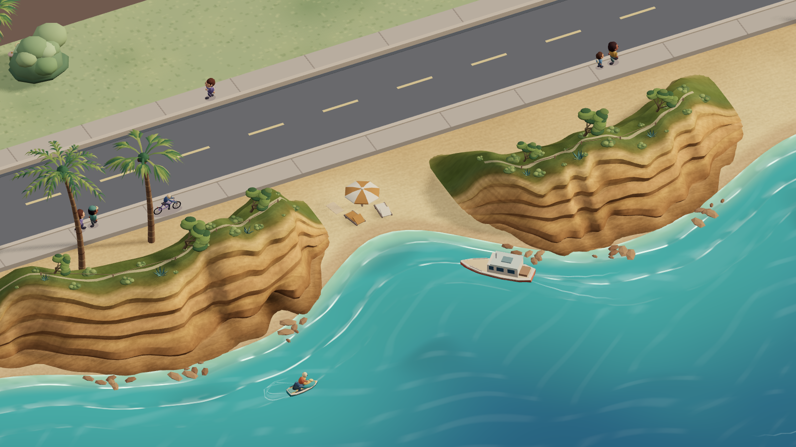
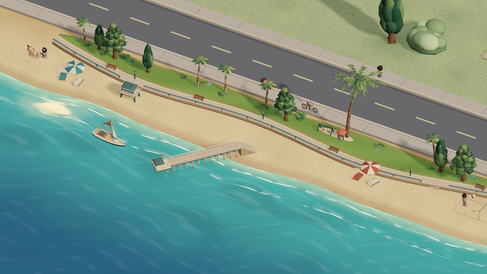

# La Jolla waterfront art

The wall dashboard should evoke La Jolla from its everyday overhead view. A guest should be able to inspect the cliffs, pier and landscaped park from angles where their depth is visible. Preserve the home footprint, touch targets, saved camera preferences, and weather controls. The Shores and Cove are combined for the dashboard composition.

| Customer outcome | Acceptance |
| --- | --- |
| Recognize La Jolla from the wall display | The overhead view shows the pier and the cove alongside the entire house. |
| See the coast in depth | The Cove shot faces exposed sandstone and planted headlands. The Shores shot frames the pier deck, pilings and landscaped promenade. House controls and camera tiles stay with the house views. |
| Keep the water alive | Animated shore break, reflections and rainfall follow the camera and the current weather. Reduced motion, manual quality, and the Insane graphics recovery remain available. |
| Maintain the release | Authored curves, seeded vegetation, camera bounds and verified artwork bytes can be reproduced and restored independently of the saved home. |

`storybook-street.mjs` supplies the shoreline, sand grade, play sites and separate camera frames. `storybook-la-jolla-bluffs.mjs` owns the continuous bluff surface and plantings. `storybook-la-jolla-shores.mjs` owns Scripps Pier, the promenade and Kellogg Park. `storybook-ocean.mjs` maps surf to the shared coast and uses world-space wind swells offshore. `storybook-camera.mjs` fits the two seaward views independently.

## Material provenance

The composition uses the [City aerial map and beach photographs](https://www.sandiego.gov/sites/default/files/2025-06/final-crmp-peir.pdf), the [Cove photograph](https://www.sandiego.gov/digital-archives-photos/la-jolla-cove-beach-1969), and [Scripps Pier](https://scripps.ucsd.edu/about/scripps-pier) as references. An ImageGen concept explored a high-angle miniature with a diagonal Scripps Pier, warm sandstone shelves, shaded coastal scrub, green-blue coves and broken white surf. The art direction was implemented as 3D geometry with weather-driven lighting.

Built-in ImageGen supplied `site/public/la-jolla-sandstone-v1.png`, a 1254 × 1254 local material texture. SHA-256 `45506ed71b9831abef277d8614558825fe56f0031e7f8dc394f933e3f7d0836e`.

> Generate one perfectly tileable square game-material albedo texture, a cropped macro surface swatch of the horizontally layered warm coastal sandstone cliffs at La Jolla Cove. Frontal orthographic material scan only, flat even light, no shadows or shading, no water, no sand beach, no grass, no plants, no scene, no border, no edges, no words. The whole 1:1 square is densely filled by sedimentary sandstone texture at approximately one meter close up: weathered fine sediment, diagonal hairline fractures crossing primarily near-horizontal strata, some thin darker cinnamon and ocher seams, golden beige chalky strata and softly variegated patchy grains. Restrained tonal contrast, warm balanced midtones, finely detailed hand-painted cinematic stylized realism as in a Japanese miniature background. Seamless left-right and top-bottom, homogeneous enough to repeat on a 3D cliff. Albedo texture only.

The live renderer maps the texture onto exposed rock in world coordinates. The sand, surf, planted caps and shadows are rendered independently of the texture. The numbered filename keeps the old Home Assistant cache compatible with a rollback.
