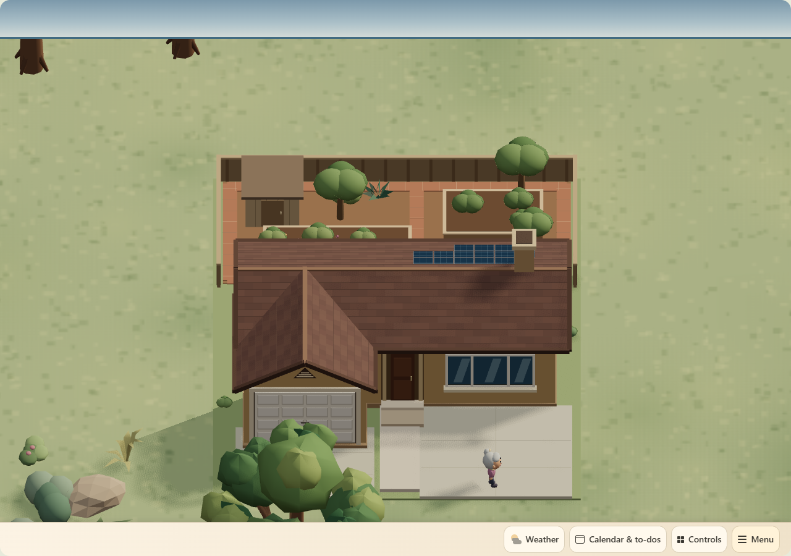
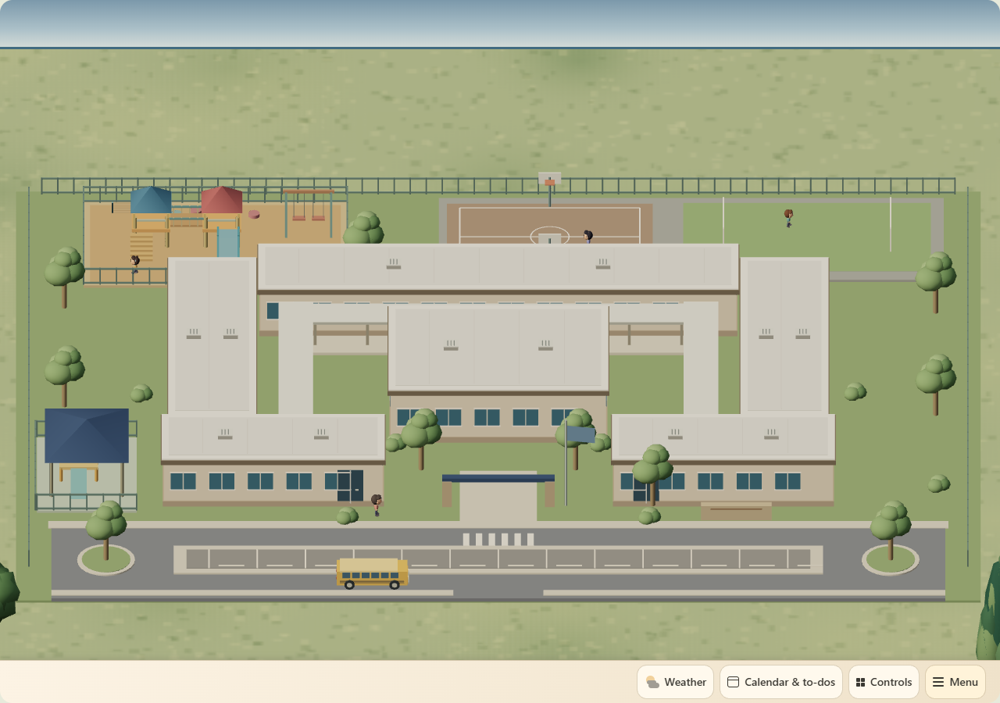
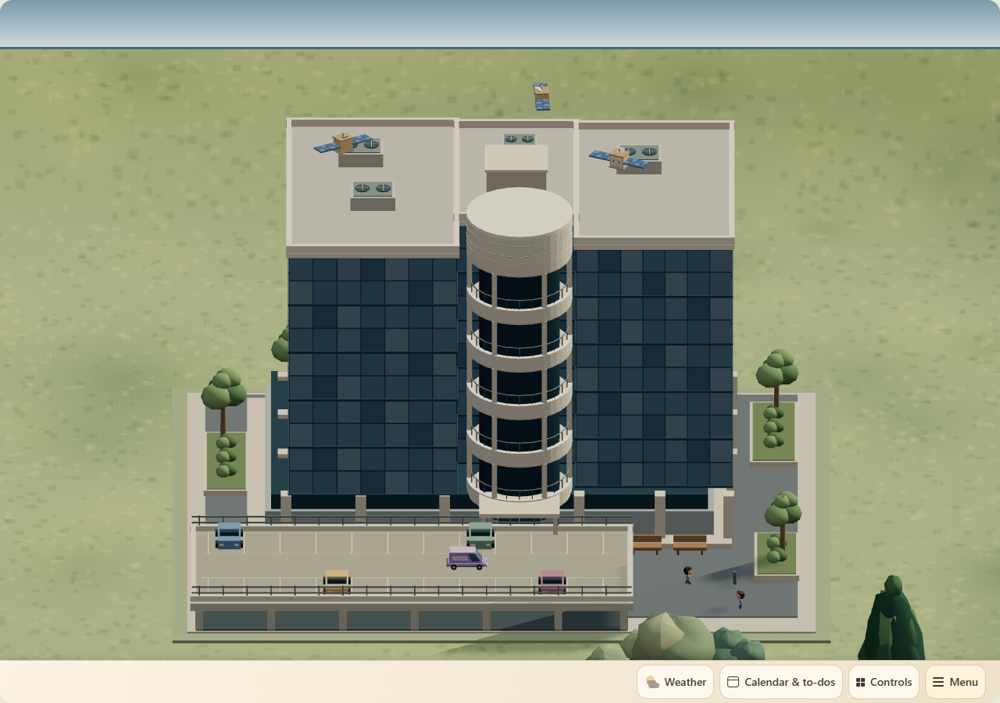
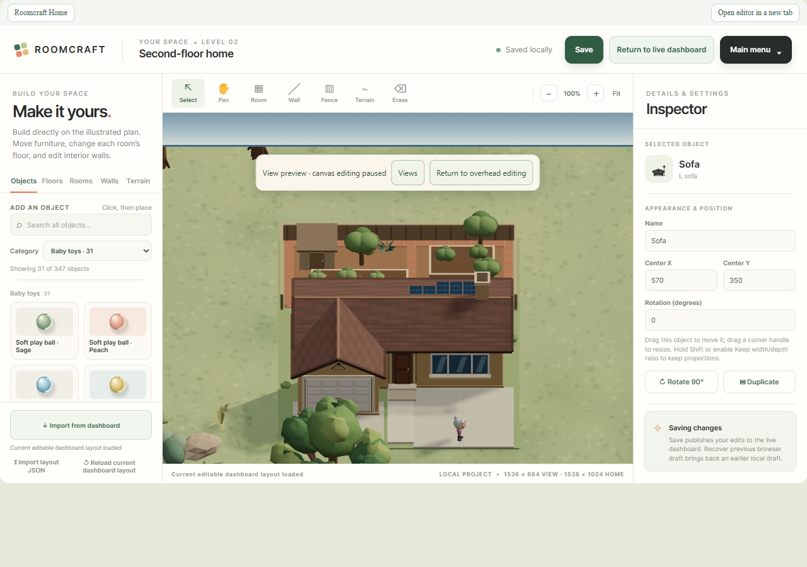

# Front views and a default for each frontend

## Customer outcome and acceptance

The household uses the same Home Assistant account on a wall tablet, phone and laptop. Each screen needs its own useful opening composition. The previous account-wide camera preference allowed one screen's choice to replace another's; the exterior landmarks also needed reliable views of their fronts.

Acceptance criteria:

- **Gold Coast · front**, **Elementary school · front**, and **Innoflight · front** appear in the shared camera list and frame the actual visible model from its front.
- Moving, rotating or resizing a landmark updates its framing. A missing landmark falls back to the whole scene without stale target coordinates.
- Any complete supported camera view can become this frontend's default. A named landmark default follows its authored front; a saved Free view retains its exact chosen angle.
- Saving or resetting one browser/app profile and dashboard never writes another frontend's default, shared layout or HA user preference.
- Existing HA account defaults migrate once into each frontend's local storage. A local reset remains reset after reload instead of importing the old value again.
- Embedded Studio and Home share the HA parent's local preference. Studio keeps overhead authoring; a separate preview temporarily shows the chosen view with editing paused.
- Failed or blocked storage reports failure, with no persistence claim. The UI refreshes its cached default after a successful local change.

Non-goals: no new building art, layout migration, physical device operation, account synchronization, cloud camera storage or independent editing camera. This does not add arbitrary pan coordinates to the stored pose.

## Use the views

In Home, open **Menu → View controls → Camera view** and choose a front view. **Save as this device’s default** saves the current supported view for this frontend; **Use Top down on this device** resets it locally. Choosing **Default** or waking the idle camera uses that saved composition. In Home's **Free view**, orbit and zoom before saving to retain an exact angle rather than automatically following a landmark's front.

Studio's **Main menu → Views & device default** dialog offers the same view list. Choose **Preview view** to inspect the shared 3D scene. The banner says **View preview · canvas editing paused**; select **Return to overhead editing** before placing or moving objects. Closing the dialog leaves the preview visible until that explicit return. While the preview canvas is active, Delete/Backspace, tool shortcuts and Undo/Redo cannot modify the layout; Escape returns to overhead editing. Dialog and form controls keep their normal keyboard behavior. The dialog's **Save as this device’s default** and **Use Top down on this device** use the same preference transport as Home when Studio is embedded in HA. The main **Save** still publishes the layout and is separate from camera preferences.

“This device” means the current browser/app profile, website origin and dashboard. Two browsers on one laptop have separate storage, as do the Companion app and Chrome. LAN HTTP and remote HTTPS addresses are different origins and can have different defaults. Clearing site data removes the local preference; the next read can migrate the retained legacy HA value again. A private hosted Studio has its own origin and does not change the HA tablet's default.

## Synthetic browser gallery

These captures use public-safe synthetic layout/device fixtures, not household media or a deployed tablet.

[](images/device-camera-views/front-goldcoast.png)

Gold Coast front — Synthetic browser fixture, shared production renderer.

[](images/device-camera-views/front-school.png)

Elementary school front — Synthetic browser fixture, shared production renderer.

[](images/device-camera-views/front-innoflight.png)

Innoflight front — Synthetic browser fixture, shared production renderer.

[](images/device-camera-views/studio-local-default-preview.png)

Studio local-default preview — Synthetic browser fixture, shared production renderer.

## Camera and framing contract

| View | Authored catalog type | Target rule |
| --- | --- | --- |
| Gold Coast · front | `sceneryRanchHouse` | First authored placement with a visible rendered root |
| Elementary school · front | `scenerySchoolCampus` | First authored placement with a visible rendered root |
| Innoflight · front | `sceneryOfficeCampus` | First authored placement with a visible rendered root |

All three model facades face local +Z. The camera derives their world-facing direction from the rendered world matrix and fits the transformed mesh bounds, including width, depth, height and rotation. No installation coordinates are hard-coded into the camera preference. Real model bounds are cached until authored changes invalidate them; selecting a view or resizing the viewport reuses those bounds. Draft movement and model rebuilds after dimension/rotation edits refresh the framing. Gold Coast uses a 50° default tilt to keep the current composition above the foreground condo wall. If duplicate catalog types exist, the first visible authored placement supplies that view. Missing, deleted or invisible targets fall back to ordinary whole-scene bounds at the preset angle.

The renderer-independent [`storybook-camera-views.mjs`](../site/ha-local/storybook-camera-views.mjs) owns the shared menu, normalization and strict storage validation. The stored DTO is `{preset, azimuth, tilt, zoom, framePreset?, followFront?}`. Unknown fields are discarded, finite numeric ranges are enforced, and old complete Free-view records remain valid. `framePreset` identifies an authored landmark/coast target, not copied geometry. A named landmark resolved as **Default** carries `followFront:true`; a Default derived from Free view retains the target frame but omits that flag to preserve the exact angle.

[`storybook-camera.mjs`](../site/ha-local/storybook-camera.mjs) fits the camera. [`storybook-scene.mjs`](../site/ha-local/storybook-scene.mjs) owns actual model/world bounds. Neither camera normalization nor persistence changes room coordinates, model dimensions, layout items or device state. Existing shared artwork is reused without new binary assets.

## Local persistence and migration

[`storybook-camera-preferences.mjs`](../site/ha-local/storybook-camera-preferences.mjs) exposes:

```js
createCameraPreferences({host, dashboard: 'roomcraft-home', readLegacy})
// async read() -> canonical view or null
// async write(viewOrNull) -> canonical saved view or null
```

The key is `roomcraft.default-camera.v2:<encoded-dashboard>`. Different dashboard names have different local keys. The value is a canonical pose or literal JSON `null`. A missing key triggers one legacy read; an explicit `null` is a reset tombstone and never triggers migration.

The HA parent adapter keeps `RoomcraftEditorCard.readStartupView` / `writeStartupView` and the iframe's `CAMERA_GET` / `CAMERA_SET` contract. On first read only, the parent requests the old `frontend/get_user_data` preference and snapshots it locally. Its historical `roomcraft-home` → `second-floor` alias is used only for that legacy HA lookup. New writes never call `frontend/set_user_data`. Unembedded Studio can migrate its old `roomcraft.default-camera.v1` browser key once through the same helper.

Migration rechecks the local key after awaiting HA so a concurrent explicit save or reset wins. Missing/invalid legacy values become a local null fallback. A failed legacy read leaves migration incomplete and retryable. Corrupt existing local data produces a clear error and does not silently reimport the old shared value; explicit Save or reset can replace it.

Writes read back the exact serialized value before returning success. Missing, inaccessible, quota-limited or silently discarded storage rejects the operation. There is no account-wide fallback write and no silent session-only claim of a saved default.

Successful explicit saves and resets dispatch `roomcraft-camera-preference-change` on the host when `CustomEvent` is available. Its sole detail is `{dashboard}`; it contains no pose, entity or account data. Migration and normal reads emit nothing. Home can invalidate its cached preference with this same-document event and the browser's cross-document `storage` event. Event delivery failure cannot undo a confirmed storage write. The parent origin owns embedded Studio's storage, keeping the iframe credential-free.

## Ownership and privacy

| Module | Responsibility |
| --- | --- |
| `storybook-camera-views.mjs` | Lightweight shared presets and strict DTO contract; no Three.js dependency |
| `storybook-camera-preferences.mjs` | Local key, migration, tombstone, verified persistence and change notification |
| `roomcraft-card.js` | Authenticated legacy read and trusted iframe bridge; no new HA preference writes |
| `roomcraft-storybook.mjs` | Home selection, local save/reset, cached-default refresh and idle-return integration |
| `storybook-studio-camera.mjs` / `storybook-editor.mjs` | Separate view-preview dialog, paused authoring and overhead restoration |
| `storybook-camera.mjs` / `storybook-scene.mjs` | Shared projection and model-derived target bounds |

No credentials, private device values, account identifiers, photos, camera media or personal location data are stored in the preference or public tests. The helper stores only camera presentation data. Schema, layout Undo/Save, integrations and artwork retain their existing owners.

## Verification checkpoint and release status

At this checkpoint, the combined camera, card and persistence suites passed **85/85 tests**, including migration and save/reset race checks, failed-storage handling and notification semantics. Additional model-front framing tests are tracked by the camera module owner. The source browser fixture passed frontend isolation, embedded Studio preference sharing, idle return and unchanged layout/device-state checks. The final Free-view azimuth correction still awaits one final source browser run. Production browser verification, the final full release gate, exact deployment/readback, CI and physical-tablet proof remain pending. No deployed revision is claimed here. The release owner will record exact final evidence in the [engineering handoff](engineering-handoff.md).

Reproduce targeted checks from `site/`:

```powershell
node --test tests/storybook-camera.test.mjs tests/storybook-landmark-camera.test.mjs tests/storybook-camera-preferences.test.mjs ha-local/roomcraft-card.test.mjs
node scripts/verify-device-camera-browser.mjs
# After the full production build:
$env:ROOMCRAFT_DEVICE_CAMERA_QA_DIST='1'
node scripts/verify-device-camera-browser.mjs
```

The browser fixture is designed to run two isolated storage contexts using the same synthetic HA account. It uses the production Home card, editor card, iframe bridge and Studio renderer, and rejects HA preference/layout/device writes. Required checks include all three front views, independent saves/reloads, Studio-to-Home local sharing, reset tombstones, framed idle wake and unchanged authored/device data. The camera tests exercise landscape, portrait and ultrawide fitting with real model factories, transformed bounds, target movement/scale/rotation, deterministic output and deleted-target fallback.

Run the complete [release gate](release-standard.md#deterministic-release-evidence) after the last source change; browser assertions alone do not prove publication. Before deployment, preserve protected backups and capture the actual previous revision, then deploy the exact built input set and verify readback and the intended tablet frontend.

## Rollback and recovery

Use **Use Top down on this device** to clear only that frontend's saved camera. If storage is blocked, allow site storage and retry; the UI must not claim it persisted a value before that succeeds. A software rollback uses the previous verified runtime/assets and [deployment recovery](deployment.md). No layout rollback is required for this feature. The old HA user default remains untouched for older runtime versions; its value may differ from a newer local default. Avoid clearing all browser data as a routine rollback because that also removes unrelated local preferences.
