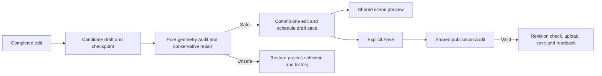

# Safe terrain and structure editing

Roomcraft checks completed edits before committing them to the browser draft. It repairs a small set of unambiguous problems and rejects changes that would require guessing the author's intent. **Main menu → Check & repair layout** runs the same checks on demand.

This is edit protection, not a guarantee against every software, graphics, network or device failure. The goal is to preserve the last valid layout and a usable recovery path when an authored edit is malformed.

## Customer outcome and acceptance

**Customer** — the household member building a home or landscape in Studio.

**Problem** — a terrain spike, crossed room boundary or collapsed wall can leave an unusable design, and a failed edit can unexpectedly consume Undo or destroy Redo.

**Outcome** — ordinary repairable changes settle into safe geometry, while unsafe changes restore the previous draft without replacing the saved dashboard.

| Scenario | Required observable result |
| --- | --- |
| Finish a terrain stroke with an abrupt peak or pit | Excessive neighboring height differences soften, paint and placed props remain, and Undo restores the preceding terrain. |
| A room repeats an adjacent corner or its closing point | Redundant points are removed without moving the boundary. |
| A room crosses itself or has no usable area | The entire edit is rejected and the previous draft returns with a clear status message. |
| Wall/fence endpoints collapse to one point | Reject the edit rather than silently deleting the segment. |
| An invalid edit follows Undo | The rejected edit does not consume history or discard the available Redo. |
| Run Check & repair twice | The second check makes no additional changes or Undo entry. |
| Publish invalid geometry through either bridge | Reject before image upload or dashboard write. |
| Open an older valid landscape | Preserve its authored slopes until a terrain change or explicit repair is requested. |

## Use it in Studio

Edit protection is on automatically. Finish a drag or terrain stroke to let Studio check the completed change.

- **Auto-repaired the edit** means Studio applied a safe cleanup. Use **Undo** if you prefer the preceding design.
- **Previous layout restored** means the change could not be repaired safely. Adjust the offending boundary or dimensions and try again.
- For an existing draft, choose **Main menu → Check & repair layout**. A repair is one undoable change. If nothing needs repair, the status says the checks passed.
- Choose **Save** when the draft is ready to publish. A blocked save reports its issue and leaves the current dashboard intact.

Finish the current gesture or dashboard transfer before running the manual action. It changes the draft only. It does not publish or operate a household device.

## Repair policy

### Terrain

[terrain.js](../site/public/engine/terrain.js) repairs authored height deltas on the existing 32-unit grid. The default adjacent step limit is 24 design units. These are illustration units, not physical metres.

The algorithm reduces excessive positive and negative magnitudes toward the unedited terrain. It never changes a peak into a pit or a pit into a peak. Opposite-sign jumps share the allowed step proportionally. Missing cells remain zero-delta boundary samples. Repeated synchronous passes reach a fixed point, so repair is deterministic, independent of cell order and idempotent.

Repair preserves cover paint, placed terrain props and landscape settings. It does not add grid cells, exceed the 4096-cell/96-prop caps, reshape the base coastline or flatten already-safe broad hills. The pure helper accepts an explicit slope budget for engine callers. Studio uses the standard budget rather than exposing an unsafe bypass.

Existing steep but structurally valid terrain remains compatible on import, Undo/Redo and publication. Automatic slope repair runs when a normal edit changes terrain, or when the author explicitly chooses Check & repair. A furniture move alone does not resculpt the landscape.

### Rooms, walls and objects

[edit-safety.js](../site/public/engine/edit-safety.js) removes exactly repeated adjacent polygon points and a repeated closing point. It rejects self-crossing or self-touching room boundaries, zero-area rooms, collapsed walls/fences, invalid or duplicate identities within a geometry collection, and unusable finite-coordinate/dimension values. Detail limits bound the work required to inspect room polygons.

Room cleanup does not move a corner, reverse a polygon, infer a missing room, close a doorway, join disconnected walls or delete a model. Crossing wall segments can be intentional. This guard checks room polygon topology and wall usability rather than inventing a new building layout.

All checks succeed before any repairs are accepted. If one issue remains, the entire candidate change is rejected. No partial room cleanup or terrain adjustment is committed.

## Engine and adapter boundaries



| Owner | Responsibility |
| --- | --- |
| [edit-safety.js](../site/public/engine/edit-safety.js) | Pure bounded audit, redundant-corner cleanup, whole-candidate acceptance, stable issue/repair records |
| [terrain.js](../site/public/engine/terrain.js) | Validated height-step reduction without model or browser side effects |
| [app.js](../site/public/app.js) | Transaction checkpoint, last-valid draft, history/selection recovery, status, manual menu action and Save preflight |
| [dashboard-project.mjs](../site/ha-local/dashboard-project.mjs) | Shared audit for both authenticated publication transports before side effects |
| [3D editor adapter](../site/ha-local/storybook-editor.mjs) | Preview the accepted draft through the existing scene renderer |

The pure safety API returns data only. It does not read the DOM, storage, time, Home Assistant state or credentials. The editor owns the transaction and feedback.

A completed successful gesture remains one undo unit, including any repair. A rejection restores the pre-edit history and selection. Undo/Redo validate geometry while preserving the terrain represented by the chosen history state. The runtime scene, hosted transport and HA transport do not silently rewrite a published design to repair it.

## Compatibility and non-goals

Layout version 2, authored IDs, design coordinates, bindings and reference migration version remain unchanged. No artwork or household integration migration is required.

This feature does not yet solve furniture collision preferences, arbitrary room overlaps, intentional architectural openings, renderer/GPU faults or a concurrent publisher's changes. Existing placement rules, renderer recovery, revision checks and backups continue to own those cases. It does not promise to make any shape attractive. It prevents specific invalid edit states and preserves recovery.

## Verification and release record

Verified on 2026-11-12 against runtime source [`57b7b2cfba0f329e52d5e37978158d8c46e8f42f`](https://github.com/Kenkneeshio/AI_VIBECODING/commit/57b7b2cfba0f329e52d5e37978158d8c46e8f42f). The runtime source and this later evidence record are separate commits.

- **Release gate:** clean dependency install, architecture guard, engine/release verification, 484 site tests, 65 native bridge/weather tests, 30 installer tests and 8 presence tests passed (587 total). Typecheck, production build, manifest readback and whitespace checks passed. ESLint has zero errors and the existing 17 warnings. [GitHub Actions passed on the same runtime source](https://github.com/Kenkneeshio/AI_VIBECODING/actions/runs/43278368480).
- **Deterministic input manifest:** `sha256:b2ce5f0f0dd596ef39b44c6f91dc940489322ffb65aaff517eed0d0caec8a4f0` for 339 canonical inputs.
- **Browser:** the checked-in [browser verification script](../site/scripts/verify-edit-safety-browser.mjs) passed against generated editor assets in headless Chrome at 1280 × 900. It exercises real mouse and touch terrain gestures, protected house boundaries, paint/props, Undo/Redo, auto repair, self-crossing room rollback, incomplete-drag Save blocking and the menu check. Save uses an isolated mock; no household actions occur.
- **Home Assistant:** pre-install backup retained outside Git. Resource version `2e7c11c7487e8c80` installed and read back; 11 selected assets (including both safety engines) match source through LAN and remote HA. Home/Studio/Controls and all eight non-view dashboard fields match the expected backed-up configuration. The current project passed preflight with 9 rooms, 40 structural segments and 75 objects.
- **Authenticated browser:** Home opened Studio with current live appearance. Manual repair was checked with the exact draft restored afterward; 3D stayed active. A write guard confirmed no image upload or dashboard save.
- **Private Studio:** owner-private version **102** deployed successfully from Site source `0c2fc6a9fcff458938f5afcf1b985476ff806cac`; saved-version provenance and archive read back. Its source contains the app subset, without the parent GitHub documentation, so its input manifest differs.
- **Wall tablet:** Apolosign cold launch, Home, Studio 3D, menu visibility and a tap on Check & repair were observed on its 1920 × 1080 screen. It reported “Terrain and structure checks passed.” The tablet was returned to Home. Initial cold loading briefly displayed HA's configuration-error placeholder before the module registered; it cleared without intervention. This release does not change that startup behavior.

To repeat the isolated browser check from `site/` after building:

```powershell
$env:ROOMCRAFT_LIDAR_QA_DIST = '1'
node scripts/verify-edit-safety-browser.mjs
```

Set `ROOMCRAFT_QA_CHROME` when Chrome is not at the script's Windows default path. Test captures remain in an OS temporary directory. Live screenshots and backups stay private; no camera images, entity state or credentials are committed. Private Site browser interaction was not separately repeated; its saved artifact, source provenance and deployment status were verified.

## Rollback

The preceding verified runtime is `5671e943d983496f7c59d74bfeec4b774afb4704`, with HA resource version `d25830e164fd80b1` and owner-private Studio version 101. Reinstall matching prior assets and restore the prior Site version independently if software rollback is necessary. Use the protected pre-install backup only when dashboard configuration also requires recovery.

A repair to an unpublished draft can be reversed with Undo. A published design can use the existing layout snapshots, subject to their retained history. See [deployment recovery](deployment.md) for the full procedure.
