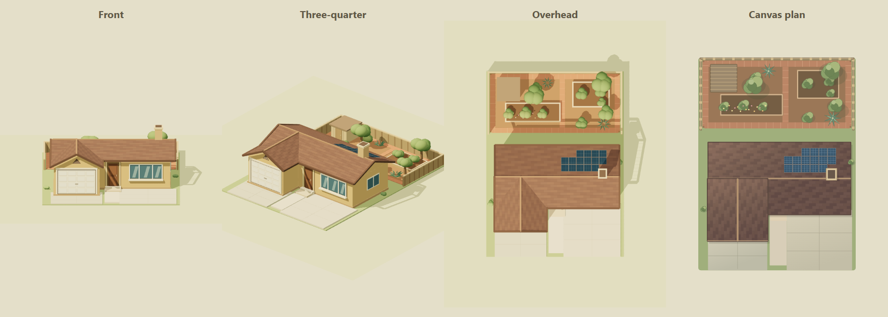
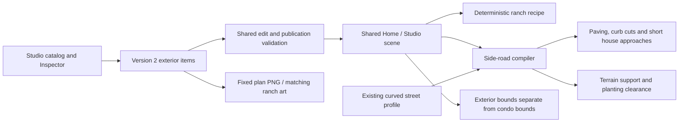

# Editable exterior landmarks

The [shared-road follow-up](road-connections.md) supersedes the original tangent-based side-road alignment described in this release record and adds an office parking connection. This page retains the original deployment evidence.

**Status: deployed and verified, 12 November 2026.** Runtime source `4490638e29e831cd21c9723627f5bc44eeab6353`, Home Assistant resource `309de5e7f537f676`, and owner-private Studio version **106**. The exact source passed 634 automated tests and GitHub CI; guarded Studio publication, independent layout readback and a 1920 × 1080 wall-tablet capture verified the customer result. The previous garage release remains the rollback baseline below.

The customer clarified that the front area is a second driveway and the large garden belongs behind the house. The revised recipe incorporates that correction and the verified overhead arrangement: two front concrete bays, a substantial enclosed rear garden, a small shed and an L-shaped rear-roof solar array.

## Customer outcome and acceptance

**Customer:** the household member composing a recognizable, personal miniature landscape around the second-floor condo.

**Problem:** an exterior landmark should be part of the editable scene rather than a photo, a hard-painted background or an enlargement of the condo's floor plan. A nearby side street should connect naturally to the existing curved road.

**Outcome:** a small, detailed single-story ranch and a perpendicular side road can be added, moved, resized, duplicated and removed through Studio. Home and Studio render the same saved objects at exterior ground level. The condo's geometry and home bounds remain separate; camera framing unions the exterior bounds so the added landscape can be seen without resizing the home.

| Need | Observable acceptance | Owner |
| --- | --- | --- |
| Place a recognizable house miniature | A tan ranch has a projecting front-left garage, continuous shingle roof, front window, chimney, two front driveways, solar panels and a large rear garden | House art recipe |
| Edit without source changes | Both entries appear under **Exterior scenery**; normal position, size, duplicate, delete, Undo and Save workflows apply | Catalog and Studio |
| Connect a side street | The road meets the local curved-street tangent at a right angle, with matching curb and sidewalk openings | Side-road compiler and street renderer |
| Preserve the actual home | Exterior objects do not change condo rooms, walls, upstairs support, home bounds or the existing street profile | Exterior classification and shared scene |
| Keep scenery truthful | Neither object accepts a Home Assistant entity or action target; it does not imply a monitored second home | Binding validation and Inspector |
| Keep the landscape coherent | Road/house footprints keep procedural planting clear and provide terrain support; obstructed roads are omitted | Corridor, terrain and scene integration |
| Preserve a user's work | Existing version 2 layouts remain valid; changes round-trip and undo through the existing publication contract | Shared engine and save transports |

This is an artistic miniature, not a building survey or a real-estate record. An interior floor plan, independent editing of the house's constituent walls/plants, automatic traffic routing onto the side road, distant-home telemetry and real-world geolocation are outside this release.

## Use it in Studio

1. Open **Main menu → Object models → Exterior scenery**.
2. Add **Single-story landscape house** and **Perpendicular side road**. Place them outside the condo. The editor allows these two types beyond the original plan rectangle.
3. Select the house to edit **Center X**, **Center Y**, **Rotation**, **Width**, **Depth** and optional **Height in 3D**. The footprint includes its front yard and driveway. Keep the width/depth ratio enabled to preserve its proportions.
4. Select the road to edit its center, **Width** and **Length**. Its rotation is automatic: the road always meets the main street at a right angle. Move the center to choose a different junction; the saved rotation remains zero.
5. Orient the house frontage toward the side road and leave a clear gap. Short connectors align with the two front driveway bays when the house is close enough, faces the road and has unobstructed approaches.
6. Use **Undo** to revert an edit. Use **Save**, then **Return to live dashboard** to review the shared scene.

If a road is not drawn, check that its center is inland of the main road, its dimensions are within the supported limits and its full paved/sidewalk corridor avoids the condo, garages, stairs, low fences and other side roads. The compiler omits a blocked route rather than cutting through a building. Reposition the object to restore a valid connection.

The house is one editable recipe. Its roof, windows, garage, driveways, rear garden, shed and solar panels scale together; they are not individually selectable catalog objects. The surrounding scene's terrain and placed vegetation retain their existing editing tools. Road rotation and elevation are derived properties, so they are intentionally not free-form controls.



*Corrected synthetic model comparison, captured in Chrome: two front driveways, a deeper rear garden and roof solar panels. No source photograph, address, household media, entity data or person is included. The Canvas panel shows the compatibility illustration rather than the live 3D lighting.*

## Persisted contract and units

Layout version 2, the 1536 × 1024 design space and the condo's existing authored geometry remain unchanged. Coordinates and dimensions use illustration plan units, not surveyed metres. Exterior items can lie outside the original plan rectangle without resizing it.

| Field or model | Default | Meaning and constraints |
| --- | --- | --- |
| `sceneryRanchHouse` | 130 × 176 | Width/depth include the complete miniature yard; ordinary position and rotation; optional existing `modelHeight` override |
| `scenerySideRoad` | 64 × 380 | Width 48–140 and authored length 120–1000; ordinary center position |
| Road `rotation` | `0` | Persisted neutral value; rendered orientation derives from the main street's tangent. Nonzero imported values are rejected |
| Road `modelHeight` | Omitted | Unsupported: the shared ground/street grade determines elevation |
| Device/action bindings | Empty | Decorative exterior types reject primary and secondary entity targets, including hand-edited imports |

The 3D world uses Y for elevation and X/Z for the plan. Both objects use the shared exterior ground origin, currently Y = −111, instead of the upstairs condo floor. The house model's local support plane is Y = 0 and its front faces +Z before placement rotation. The side road's actual rendered length includes its connection back to the main street, so it can differ from the authored body length shown in the Inspector.

The house's driveway connectors are derived, not additional saved objects. They are created only for a suitably facing nearby ranch with clear corridors, matching the two front bays. Street width, bends, traffic timing and the condo's dimensions are not rewritten to accommodate a landmark. Exterior framing bounds are unioned with the scene's camera bounds; the unchanged home bounds continue to own the condo and main-street contract.

### Export limitation

The 2D PNG remains the fixed-size plan compatibility export. Objects outside that crop are not visible in its pixels even though they remain in the saved project JSON and the live/Studio 3D scene. The ranch has matching Canvas art for the portion inside the crop, and the road has a simple junction glyph. The exact derived side-road route, terrain grading, curb junction and 3D exterior environment are not represented by that PNG. Use the saved JSON and shared 3D views for the full landscape; do not enlarge or distort the condo to fit it into a plan export.

## Module ownership and data flow



| Module | Responsibility |
| --- | --- |
| [Scenery house](../site/ha-local/storybook-scenery-house.mjs) | `makeStorybookSceneryHouse(item)` creates an independently disposable `{root, anchorY}`; exact footprint, +Z frontage and ground support |
| [Side road](../site/ha-local/storybook-side-road.mjs) | Pure route compilation, perpendicular alignment, obstacle checks, driveway approaches, pavement and sidewalk geometry |
| [Exterior contract](../site/ha-local/storybook-exterior.mjs) | Type classification, rotated footprints, exterior bounds and house clearance |
| [Shared scene](../site/ha-local/storybook-scene.mjs) | Integrates models, grades, clearances and road junctions for Home and Studio |
| [Meadow](../site/ha-local/storybook-meadow.mjs) and [street](../site/ha-local/storybook-street.mjs) | Supported terrain pads and matching cuts into the existing street/sidewalk geometry |
| [Model library](../site/public/model-library.js) | Searchable catalog, exterior classification, dimension limits, model-height support and mapping exclusions |
| [Object controls](../site/public/object-controls.js) | Exterior Inspector, automatic-alignment explanation and binding rejection |
| [Object art](../site/public/object-art.js) | Independent, scalable ranch Canvas recipe; no source-photo crop or imported address data |
| [Edit safety](../site/public/engine/edit-safety.js) | Rejects unsupported road dimensions/rotation/height and exterior entity targets before publication |

The house recipe is four opaque merged material layers: shell, roof, glazing and garden. It contains 9,656 triangles and no image texture, clock dependency, network request or random generator. The increased 176-unit depth adds a 60-unit rear garden without stretching the previously authored building. Roof shingle variation and geometry are deterministic. Each invocation owns its geometries/materials so disposing one preview does not damage another.

The side-road compiler uses the existing street sampler. Pavement, curb cuts and procedural-plant exclusions share the same derived route. No live Home Assistant state enters the saved geometry or the house recipe. The existing garage control and parked-car model remain separate features.

## Reference and privacy boundary

The frontage was informed by a publicly visible street-level reference captured in **May 2017**. It establishes the visible single-story ranch massing, projecting garage, roof direction, front openings and chimney at that time. It does not verify the building's current condition, exact dimensions or unseen geometry.

The customer's correction establishes two front driveways and a large rear garden and takes precedence over the dated visible planting arrangement. Overhead imagery was visually checked for the lot/roof arrangement, rear enclosure, garden paths, small shed and solar array. Its capture date was not provided; a 2026 copyright label is not treated as a capture date. Side/rear elevations, exact proportions, materials, foliage and small details remain artistic inferences. Neighboring buildings, vehicles, people and unrelated properties are excluded. The public recipe is named generically; its source, tests, documentation and synthetic illustrations must not contain the private reference address, identifying labels, reference URL or original photograph. Reference imagery stays outside Git.

## Verification and release record

| Check | Current evidence |
| --- | --- |
| House footprint and art unit checks | Passed the eight focused tests in `scenery-house.test.mjs`, `parked-vehicles.test.mjs` and `photo-object-art.test.mjs` after the driveway/garden correction: exact 130 × 176 dimensions and resized variants, ground support, rear-only raised garden geometry, four opaque layers, geometry budget, deterministic bytes, independent disposal, safe type fallback and Canvas transforms |
| House source checks | ESLint passed for the house module, its test and `public/object-art.js`; `git diff --check` passed for those files |
| Synthetic visual check | Real headless Chrome rendered the corrected model from front, three-quarter and overhead views beside its Canvas plan. The inspected final image has two front bays, a large rear garden, roof solar panels clear of the chimney and full model framing |
| Exterior integration and route checks | Passed catalog/binding guards, road dimensions and automatic alignment, two driveway endpoints and height overrides, obstacle handling, terrain support/clearance, stable home/street bounds and responsive camera framing |
| Full release gate | Passed install/locked dependencies, generated editor/stamp verification, architecture check, 531 site tests, 65 HA bridge/weather tests, 30 installer tests, 8 presence tests, TypeScript, lint (0 errors; 17 existing warnings), production build, manifest verification and whitespace validation |
| Customer Studio workflow | Built-bundle Chrome fixture passed catalog placement beyond the original plan, move/Undo, road resizing, rotation/binding guards, selection, unchanged condo/street coordinates and PNG+layout mock Save. Authenticated HA Studio then authored and saved the actual two items |
| Home Assistant / hosted Studio / tablet | HA installer backed up first; 11 assets matched source over LAN and Nabu Casa. Home/Studio/Controls and 8 non-view fields were verified before layout Save. The saved layout contains the original 77 objects unchanged plus the two specified decorations. Tablet ADB, Companion cold launch and the full 1920 × 1080 Home screenshot were checked. Site deployment/provenance/audience were verified through Sites; no separate hosted-browser visual check is claimed |

From `site`, the focused art checks are repeatable with:

```powershell
node --test tests/scenery-house.test.mjs tests/parked-vehicles.test.mjs tests/photo-object-art.test.mjs
node node_modules/eslint/bin/eslint.js ha-local/storybook-scenery-house.mjs tests/scenery-house.test.mjs public/object-art.js
```

### Exact artifacts and deployment evidence

| Surface | Verified revision |
| --- | --- |
| Canonical runtime | `4490638e29e831cd21c9723627f5bc44eeab6353` |
| Full source manifest | `sha256:9026897108aa1b641dc78a8829860288b969ed6d087a8cb8341893e1963838e6` — 357 inputs |
| GitHub gate | [Successful run 43296952976](https://github.com/Kenkneeshio/AI_VIBECODING/actions/runs/43296952976) |
| HA static resource | `309de5e7f537f676` |
| Owner-private Site | Version **106**; source `3e636f5a198d2f277218a3b21b6ce9e98be3714e` |
| Site subset manifest | `sha256:7414ff815f96b23faa8548ae09f3cd9fb93da2ce734aec6e85c1106b2749beb6` — 262 inputs |
| Site archive | `sha256:c078b05e652046795817c5436cdab87c2d3079dc3e4cc65997e83bb0f6c3e87f` |

The Site subset excludes repository-only documentation and HA management files; its manifest is intentionally different from the canonical repository manifest. The deployment retained owner-only access.

The actual Studio save guard observed one PNG upload and one dashboard save, with zero blocked configuration writes. Device-service attempts were blocked by the QA harness; no physical device was actuated. The first external verifier timed out because it compared the in-editor draft hotspots to the saved publication, which intentionally regenerates linked control hotspots. This was a verifier mismatch, not a failed Save. An independent authenticated readback proved the exact expected layout: all 77 original item records, rooms, walls and hotspots unchanged, plus only the two specified unbound objects, a fresh PNG and unchanged existing control mappings and unrelated dashboard fields. The verifier now captures the outgoing publication payload for future comparisons. No duplicate Save was issued.

Protected installer and pre-layout backups and tablet captures remain in the administrator's documented management backup directory. Household media and layout data are not repository artifacts. The synthetic model illustration above and `scripts/verify-exterior-browser.mjs` provide shareable engineering evidence. The tablet capture shows the west-facing miniature, both front connections and rear garden wholly inside the screen; the condo and previous garage remain intact.

This documentation/evidence update follows the frozen runtime commit and is not a new runtime deployment.

## Rollback

The pre-landmark rollback baseline is the [garage correction release](garage-driveway.md#full-roof-correction-release): runtime `4b8870e4432945afb9897e6ed27283846eccafe0`, HA resource `fced00a0d6eff1fa`, owner-private Studio version **105**. Protected installer and pre-layout backups were created and verified before the live writes; restore them together with the prior runtime assets when rolling back.

If integrated validation or a deployment check fails, use the [deployment runbook](deployment.md) to restore that baseline and its matching saved project. Restoring code alone is insufficient if a newer project contains exterior items unknown to the old renderer. Do not put protected backup paths, household project JSON, addresses or credentials in the public rollback record. Ordinary authoring mistakes remain recoverable with **Undo** before Save or the existing saved-layout snapshot workflow afterward.
