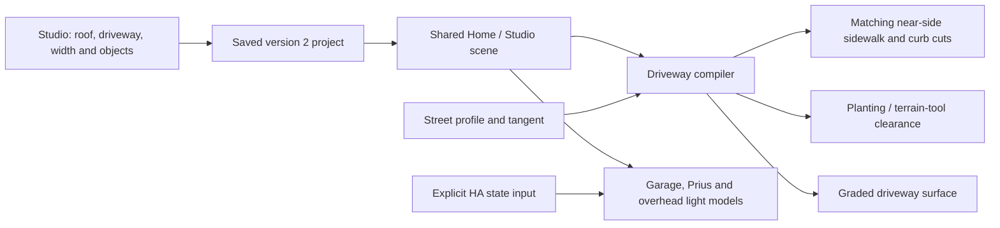

# Garage driveway, parked car and overhead light

The detached garage can connect to the street with a graded driveway. A blue Prius and an overhead light are separate catalog objects, and the optional cutaway roof makes the interior visible. Home and Studio use the same scene implementation.

## Customer outcome and acceptance

**Customer:** the household member arranging the detached garage in Studio.

**Problem:** the garage has no road connection and its full roof hides the parked car and ceiling fixture.

**Outcome:** a visible, coherent first-floor garage with a driveway to the existing street, a blue Prius inside, and an independently editable overhead fixture.

| Need | Observable acceptance | Owner |
| --- | --- | --- |
| Connect the garage to the road | Paving starts on the garage pad, crosses a matching sidewalk/curb cut and meets the actual curved asphalt | Driveway compiler and street renderer |
| Keep the entrance usable | No generated shrubs or trees occupy the driveway; no house, stair, wall or other garage is crossed | Shared corridor exclusion and obstacle checks |
| Show the parked car | The blue Prius is visible with the roof cut away and remains separately movable, resizable and removable | Model catalog and shared vehicle renderer |
| Add an overhead fixture | The fixture sits at garage elevation, has its own editor selection and can be mapped to a real light or switch | Catalog, device renderer and existing control mapping |
| Preserve the building level | Garage, car and fixture use the first-floor scene origin while the condo remains upstairs | Shared scene placement |
| Preserve authored choices | Save/import and Undo retain roof, driveway and dimension settings | Version 2 project and existing editor transaction |

Automatic parent-child movement, car telemetry, simulated driving into the garage and a new Home Assistant integration are outside this change. The light is left unassigned until its real controlling entity is identified. An unassigned decorative fixture does not claim that a physical light is on.

## Use it in Studio

1. Select the detached **Garage door control** object.
2. In its appearance settings, choose **Roof view → Cutaway · show interior**.
3. Set **Connect driveway to street → On**. Face the garage entrance toward the street. The entrance is the shutter side; rotating the garage also rotates the connector's starting direction.
4. Leave **Driveway width** blank for automatic sizing, or enter 32–200 plan units. The route follows the actual street profile and includes a sidewalk ramp.
5. Open **Main menu → Object models** and search for **Blue Prius hatchback** and **Garage overhead light**. Place them inside the garage, then adjust their dimensions and rotation in the Inspector.
6. Choose **Save** to publish and **Return to live dashboard** to review the result.

Use **Full roof** to restore the covered building. The objects remain in the saved layout when the roof hides them. Turn the driveway setting off to remove its derived paving and restore the continuous sidewalk.

The garage, car and light are independent objects. Moving or rotating the garage does not move its contents. Reposition the car and fixture after a building move. The driveway is a garage property, so it recomputes from the garage and street rather than requiring individual paving pieces to be dragged.

For the overhead fixture, choose its actual **State entity**, **Tap** and **Hold** actions using the existing object-control workflow. Keep the garage shutter binding on the garage object. Do not reuse the shutter's state as a light state. A real physical command is sent only through the configured object action.

If the entrance faces away from the street, is too close or too far away, or all tested approaches cross a structure, the connector is omitted. Reposition or rotate the garage; the engine does not guess a path through the home. [Safe editing](edit-safety.md) continues to protect committed geometry changes.

## Persisted contract and units

Layout version 2 and the 1536 × 1024 design space remain unchanged. Values are illustration units, not a physical survey.

| Field or model | Type/default | Bounds and meaning |
| --- | --- | --- |
| `garageRoof` on `garageDoor` | `full` or `cutaway`; omitted means `full` | Presentation choice; does not change the building footprint or shutter state |
| `garageDriveway` on `garageDoor` | Optional boolean; omitted means off | Enables the derived entrance route |
| `garageDrivewayWidth` on `garageDoor` | Optional finite number | 32–200 plan units; omitted uses 72% of garage width within those limits |
| `garagePriusBlue` | Catalog footprint 34 × 70 | Separate parked blue hatchback; ordinary position, rotation and dimension fields |
| `garageCeilingLight` | Catalog footprint 32 × 18 | Separate overhead fixture with the existing light-control binding contract |

The world uses Y for height and X/Z for the plan. The existing ground origin is Y = −111; the garage pad rises five units above it. The parked car is placed at ground +5.21. The overhead fixture uses the garage ground origin and its model's suspension height. These are renderer conventions shared by Home and Studio, not new persisted real-world measurements.

The connector is derived geometry. It does not add rooms, walls, floor polygons or hidden furniture to the project. The 2D PNG remains a compatibility export and does not include the 3D environment driveway.

## Module ownership and data flow

| Module | Responsibility |
| --- | --- |
| [garage driveway](../site/ha-local/storybook-garage-driveway.mjs) | Pure deterministic route selection, corridor tests and graded paving geometry |
| [street](../site/ha-local/storybook-street.mjs) | Apply driveway cuts only to the house-side sidewalk and curb, preserving asphalt and the opposite sidewalk |
| [scene](../site/ha-local/storybook-scene.mjs) | Shared first-floor placement, route integration, planting exclusion and terrain-tool protection |
| [vehicles](../site/ha-local/storybook-vehicles.mjs) and [devices](../site/ha-local/storybook-devices.mjs) | Common car, garage and fixture model factories; supplied state determines visible activation |
| [model library](../site/public/model-library.js) | Searchable, independently placeable models and editor mapping |
| [object controls](../site/public/object-controls.js) | Garage property inputs and existing light actions |

The route uses a bounded set of deterministic candidate curves. Its start follows the rotated garage pad and its end samples the street's current curve. Paving stays above the meadow triangles, reaches the garage slab, and grades through the removed sidewalk section into asphalt. The same corridor predicate prevents generated plants and terrain tools from occupying the road. The compiler does not read time, live state, browser storage or Home Assistant credentials.

## Verification and release record

The release owner records the exact runtime source, complete release gate, browser/tablet captures, installed resource version, private Site version, layout publication readback and backup receipt here. Feature implementation and focused tests are not deployment evidence.

Required checks include rotated entrance alignment, sidewalk cut continuity, obstacles and impossible routes, hillside clearance, width bounds, independent selection, real-state fixture behavior, save/import/Undo persistence, and the same objects in Home and Studio. Public tests use synthetic geometry and entity IDs. Private household bindings, backup configuration and camera imagery stay outside Git.

## Rollback

The preceding verified runtime is `57b7b2cfba0f329e52d5e37978158d8c46e8f42f`, HA asset version `2e7c11c7487e8c80`, and owner-private Studio version 102. Retain the protected pre-change dashboard backup before publishing the updated garage arrangement. Restore the matching previous layout when rolling back software that does not include these model types. Reinstall the previous assets and restore the previous Site version independently through the [deployment runbook](deployment.md).

Before publication, use Undo or turn off the driveway and select Full roof. After publication, use the saved layout snapshots or protected backup as appropriate. A software rollback alone is not a substitute for restoring an incompatible new object layout.
