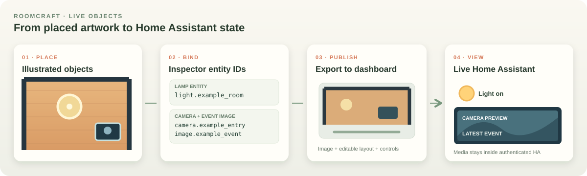

# Home Assistant controls and compact menu

The illustrated plan is the first place to look for a physical room or object. A tap on a bound lamp, fixture, window, fan, or appliance should open or run that object's Home Assistant control. The shipped drawer adds **On plan**, **All entities**, search, registry availability, and six curated sections from the old Main Dashboard. This guide uses the [sanitized entity inventory](ha-inventory/README.md), captured on 2026-10-31. Availability can change.

## Bind a physical object

1. In Home Assistant, find the device in **Settings → Devices & services → Entities**. Confirm its physical location and that it is available. A suggested room in an entity name is not sufficient proof.
2. Open `/second-floor/studio` while signed in. Select the illustrated object, or add one from **Objects**. Drag the object itself into place; the Inspector also accepts precise position, size, and rotation. Keep the picture perspective and wall alignment in view.
3. Enter that device's `domain.object_id` in the Inspector's entity binding field. Leave it blank for decorative furniture, baby toys, plants, and fixtures with no verified HA entity.
4. **Export to dashboard**, then open **Floor Plan**. The dashboard derives a control at the object's location. Check that one device has one control and that the art and control move together after a later edit. Reimport to verify the binding is retained.
5. Open the native Home Assistant details panel for brightness, color, tilt, fan mode, or other settings the actual entity supports. An unavailable entity should display an unavailable state; moving its art must still work in Studio.

The [layout schema](../layout.schema.json) is the authored scene. Live values, camera media, and device commands belong to Home Assistant. The public inventory is a dated metadata snapshot, not a configuration file to import into another home.

## Confirmed and candidate room bindings

| Plan location | Object | Entity | Evidence and use |
| --- | --- | --- | --- |
| Living / lounge | GU10 fixture | `light.smart_gu10_light_bulb_2` | Device name says Living; tap fixture to toggle, open details for supported color and brightness. |
| Living / lounge | Small-sofa, sofa, and TV windows | `cover.blinds_small_sofa_2`, `cover.blinds_sofa_2`, `cover.blinds_tv_2` | Three distinct blind zones are available; place each interaction on its own window, with tilt/position details. |
| Dining | GU10 fixture | `light.smart_gu10_light_bulb_3` | Device name says Dining; attach to a movable fixture. |
| Dining | Air filter and docked robot | `fan.air_filter_2`, `vacuum.l10s_ultra` | Area registry places both in Dining. They are searchable in the drawer now; place and bind their movable objects after confirming their exact positions. Robot art does not yet track live map coordinates. |
| Kitchen | Sink, pantry, cooking fixtures | `light.smart_gu10_light_bulb_5`, `light.smart_gu10_light_bulb_7`, `light.smart_gu10_light_bulb_8` | Names identify functions; verify exact physical placement before assigning each drawn light. |
| Kitchen | Sink track and counter lights | `light.sink_light_light_1`, `switch.smart_switch_3_switch_1` | Device names identify the sink track dimmer and counter switch. A `switch.*` binds to the light artwork only when the actual circuit is confirmed. |
| Office / study | Office bulb | `light.lab_light` | Named for the Office, but unavailable at audit. Keep the lamp movable and show its unavailable control state until the device reconnects. |
| Master bedroom | Master bulb | `light.master_light` | Named bedroom bulb; available at audit. |
| Hallway | Hall dimmer and thermostat | `light.hallway_switch_light_1`, `climate.thermostat_2` | Dimmer name and thermostat area support these locations. Their detail controls are searchable in the drawer; place a thermostat object only after confirming its wall position. |
| Living ceiling center, provisional | Ceiling fan motor, light, and state | `scene.ceiling_fan_on_scene`, `scene.ceiling_fan_off`, `scene.ceiling_fan_light_toggle`, `switch.ceiling_fan` | The old Main Dashboard uses separate Fan On, Fan Off, and Light scene buttons, and shows the switch as state. The published artwork is at canvas position (690, 420), with a separate 68 × 68 center light target. None has a verified HA area; confirm the physical room and move both targets together if needed. |
| Master bathroom | Humidifier | `humidifier.humidifier` | Area registry confirms the appliance; its `light.master_bathroom_humidifier_ambient_light` controls only the appliance's ambient light. |
| Exterior entry | Porch camera | `camera.porch_camera_profile_000` | Verified ONVIF HLS is the live source for this floor's exterior thumbnail. Label it **Live** while streaming and open native camera details on tap. |
| Garage, outside this plan | Door and camera | `cover.garage_door_door_1`, `camera.garage_camera` | Put these in Security or a separate exterior view. Verify the camera stream and require clear intent before a door command. |

No primary room light was verified for either bathroom, the dressing nook, or the balcony. The ceiling-fan light has no separate `light.*` entity or readable on/off state: its available Tuya scene is a one-shot toggle. `switch.ceiling_fan` is available, but the old dashboard treats it as state while separate scenes operate Fan On and Fan Off. The unsupported `switch.ceiling_fan_switch_switch_1` is unavailable and should not be used. The Dining/Sink GU10 and photo-wall bulbs still need placement confirmation. The Eufy `camera.front_door` and `image.front_door_event_image` remain in the HA inventory for other security views; they are not this floor's exterior camera. The [full room mapping](ha-inventory/entity-inventory.json) records these confidence limits.

## Interaction rules

| Illustrated object | Primary interaction | Detail or status |
| --- | --- | --- |
| Lamp, pendant, ceiling fixture | Toggle bound `light.*` | Native details for supported dimming, color temperature, or color. |
| Counter light connected to a switch | Toggle confirmed `switch.*` | Native details; do not treat an unrelated outlet as a lamp. |
| Window with a blind | Open native cover details on the frame | Tilt and position if the entity reports support. |
| Ceiling fan motor | Fan artwork: tap activates `scene.ceiling_fan_on_scene`; hold activates `scene.ceiling_fan_off` | Bind `switch.ceiling_fan` as the displayed state, with the two scenes as separate tap/hold targets. Do not infer speed control or assume the switch affects only the motor. |
| Ceiling-fan light | Center light area: tap activates `scene.ceiling_fan_light_toggle` | This scene toggles the light without reporting its current on/off state. Label the action **Toggle light**, not **Light on/off**. |
| Air filter or humidifier | Open the appliance's control | Mode, humidity, and nearby environmental readouts. |
| Robot vacuum | Open status and action panel | Start, pause, return to base, battery, and authenticated map; live plan position waits for calibration. |
| Porch camera thumbnail | Open native camera details | Use the verified HLS source for **Live**. If a future camera uses an event still, label that feed **Latest event** and show its time. |
| Garage door | Open a clearly labeled Security control | Current cover state and an intentional open/close action. |

Place weather and clock readouts near the plan edge; keep room surfaces visible. Useful readout sources include `weather.forecast_ishioho_city`, `sun.sun`, `sensor.thermostat_temperature_2`, `sensor.thermostat_humidity_2`, the air-quality monitor CO₂ and PM2.5 sensors, and the robot's status/battery sensors. The [inventory JSON](ha-inventory/entity-inventory.json) lists their IDs and audit availability without exporting their changing values.

## Shipped dashboard drawer

The drawer preserves the six curated groups in the [Main Dashboard map](main-dashboard-map.md), adds a complete registry search, and keeps direct controls tied to illustrated objects:

| Drawer view | Content | Relationship to the plan |
| --- | --- | --- |
| On plan | Entities represented by floor-plan objects and controls | Objects remain the direct touch targets. |
| All entities | Search the full registry with availability, including disabled and unavailable entries | Discovery and diagnostics stay off the drawing. |
| Planning | Calendar and task controls from Main Dashboard | Private event details stay in authenticated views. |
| Weather and Air Quality | Weather, thermostat, humidifier, temperature, humidity, and air quality | A few compact readouts can remain on the plan edge. |
| Lighting | Lights, switches, three blind zones, fan, and scenes | The actual light and window objects remain tappable. |
| Security and Control | Cameras, motion, door sensors, and garage control | The porch camera is the floor thumbnail; off-floor devices stay in this group. |
| Energy | Power and energy charts | No dense chart layer over the room drawing. |
| Robot Vacuum | Dreame map, status, controls, and maintenance | Robot art opens detail; live location needs calibration. |

The Studio edit link remains a separate entry on the plan. Search and availability come from Home Assistant's registry, so refresh or reimport after entity changes. The drawer has shipped; fit and touch behavior on the target tablet still need an on-device check. Keep the old Main Dashboard as a reference while validating the curated views.
