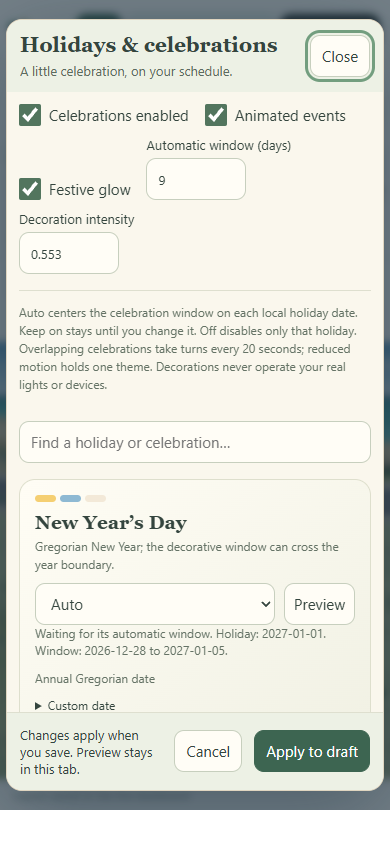

# Holiday themes and independent schedules

## Customer outcome

The household wants the miniature neighborhood to celebrate major holidays automatically, with particular attention to Asian observances, and to turn off one holiday without disabling the others. The same art and authoring settings must work in Home and Studio. The initial catalog contains 31 independently configurable presets spanning East, South, Southeast and West Asian traditions and common global/US celebrations. It is a curated catalog rather than a claim to cover every culture or regional calendar.

Acceptance: each preset has Auto, Keep on and Off; default Auto uses seven local calendar days centered on the holiday; Off affects only that preset and remains saved across devices and years. Keep on lasts until changed. Dates follow the Home Assistant time zone. Overlapping enabled themes take turns every 20 seconds rather than overwrite each other's preferences. Reduced motion holds one theme still. Temporary Preview never changes a saved preference or physical device. Settings support normal Studio Undo/import/Save and verified administrator save from Home, preserving every existing object and control.

## Customer controls

Open **Menu → Holidays & celebrations** in Home, or **Holidays & celebrations** in Studio. Search by holiday, select Auto/Keep on/Off, preview its art, then save. Preview closes the large panel so the scenery is visible and offers End preview and Settings controls. Changes remain a draft until saved.

Global controls adjust the automatic window, decoration intensity, animated events and festive glow. Advanced decoration placement changes its position, scale and rotation or returns to automatic placement. Each holiday accepts an annual `MM-DD` or one-year `YYYY-MM-DD` override. These overrides are useful for local or family observance conventions; verified coverage and regional notes are shown beside each preset.

The default automatic window is the date plus three days before and three after. The configurable window is 1–31 days. The art window is separate from a festival's religious or legal duration. In particular, Hanukkah actually spans eight nights, and lunar or regional festivals do not all share one worldwide civil date. Read the [calendar source record](holiday-calendar-sources.md) for conventions and supported years. A future date outside verified coverage does not silently acquire an invented schedule; an override or Keep on remains available.

## Deterministic system contract

`roomcraft_layout.sceneSettings.holidays` is the single saved source. Existing layouts without this branch use compatible defaults; no destructive migration or extra object is required. The render clock, today's date and preview selection never enter the layout.

| Field | Contract |
| --- | --- |
| `enabled`, `events`, `lighting` | Boolean, default true |
| `modes` | Map of known holiday IDs to `auto`, `on`, `off`; default auto |
| `windowDays` | Integer 1–31, default 7 |
| `intensity` | Number 0–1, default 0.7 |
| `dateOverrides` | Known holiday IDs to valid annual or year-specific civil dates |
| `placement` | Optional `{x,y,scale,rotation}`; x/y −4000…5000 plan units, scale 0.4…2, rotation 0…359 degrees |

The scene derives an outdoor clearing between the home and the street, keeps generated planting clear, and supports the display on the terrain. Decoration meshes do not receive selection hits or become device controls. Two shared draws add festive trim along actual exterior wall spans and the ranch, school and office roof contours. Roof trim follows building dimensions, height, rotation and movement without changing selection bounds. Lighting affects decorative materials only; lamps, fans, switches, door state and indoor presence keep their real Home Assistant meanings. This feature sends no light, switch, lock or other device service calls.

## Module ownership

- `public/engine/holiday-settings.js`: pure settings validation, compatible defaults and immutable scene-settings update.
- `storybook-holidays.mjs`: explicit-date catalog resolver, supported date tables, upcoming/active/unavailable results and time-zone conversion from an explicit epoch.
- `storybook-holiday-art.mjs`: original procedural themed geometry, bounded animation, quiet observances, reduced motion and resource disposal.
- `storybook-holiday-runtime.mjs`: theme rotation, placement, preview isolation and cached calendar resolution.
- `storybook-holiday-panel.mjs`: shared responsive settings/preview UI.
- `storybook-holiday-save.mjs`: administrator-only, conflict-aware Home save with prior-design snapshot and readback.
- `storybook-state.mjs`, `roomcraft-storybook.mjs`, `storybook-studio-look.mjs`: live time-zone/date and shared Home/Studio integration.

Holiday variants reuse standardized art families while retaining distinct details: lanterns, pine and New Year ornaments, dolls/blossoms, carp windsocks, wishes, dragon boats, moon/rabbit harvest, lotus/paper lanterns, diya/rangoli, crescent/stars, nine-candle Hanukkah display, hearts, pumpkins, gifts and spring flowers. Quiet observances suppress celebratory event particles. No reference media or external runtime calendar service is needed after installation.

## Verification and release record

The final source passed the complete release gate: **585 site tests, 65 bridge/weather tests, 30 installer tests and 8 presence tests (688 total)**, architecture boundaries, deterministic release/manifest verification, TypeScript, lint, production build and whitespace checks. Lint retains 17 existing warnings and no errors. Runtime GitHub CI [43336916567](https://github.com/Kenkneeshio/AI_VIBECODING/actions/runs/43336916567) passed.

Calendar cases cover reviewed lunar dates, regional coverage, leap-month and year boundaries, independent Off, overlap, unknown future dates, overrides, DST/local midnight and explicit-clock determinism. Art/runtime cases cover all 31 variants, quiet observances, reduced motion, disposal, exact wall/roof support, moved/resized landmarks and separate stage transforms. The Home/Studio state test proves the next refresh at HA local midnight.

The actual-card browser fixture uses the production animation scheduler. All 16 art-family previews must resume after the modal pauses rendering, produce continuing frames and restore the previous camera. It also verifies independent Off during overlap, saved settings, prior-layout snapshot, readback, persistent reopening, phone fit and zero device service calls. The final built Studio fixture exercises real menu controls, exact fractional placement, preview isolation, rapid reopen/Escape, Undo/Redo, reset to automatic and mock Save.

The first tablet preview exposed a gap in the earlier manually rendered fixture: the preview callback ran while its modal was still open, so the scheduler stayed paused. The corrected callback runs after closing the modal, and the final fixture no longer replaces the scheduler or manually renders frames. Source `23a3912` / Site 111 was superseded by the corrected release below; use the final source, not the intermediate deployment.

| Released artifact | Exact evidence |
| --- | --- |
| Final runtime source | `07972b7eda27db8c22362ac72d53571f2c9a0725` |
| Full-project manifest | `sha256:778001679c0af07b762019e1e24ada0cbca0073c90cb26e1713a6b84062341b2`, 381 inputs |
| HA resource revision | `fddc98664af18134` |
| HA asset readback | 13 exact hashes over LAN and Nabu Casa, including both holiday and scene settings engine scripts; Home/Studio/Controls structure and resource registrations verified |
| Authored data | All 82 existing objects and their control data retained. Actual tablet Save persisted 31 Auto modes, seven days, intensity 0.7, events/glow enabled, no date or placement override; only the holiday settings branch and normal prior-design snapshots changed |
| Owner-private Site | Version 112, deployment `appgdep_6af6593598548191b6020715365eeaa2`, succeeded; owner-only audience retained |
| Site source | `28b1051fe8816255bedf2009c5c3717b603856f3` |
| Site subset manifest | `sha256:e5c6b535277c43590a45acab0ceb799430278d3d11d967bf6c29f3193d9a647e`, 274 inputs |
| Local packaged archive hash | `sha256:88d0f98485c1f72fef910fb3abd864cd52939396299545ccb41f82f5d870f7ff` |
| Site stored archive hash | `sha256:6f1b0fe623090761acb9e696796b7d0a3cd38fce48a0d22b215fac33fc2b3616` |

The 1920 × 1080 Apolosign tablet cold-launched Companion 2026.10.1-full with its HOME alias intact. The actual menu, Lunar New Year animated preview, roof-trim neighborhood view, End preview restoration and Save action were exercised. Independent API readback confirmed the saved defaults, unchanged objects/other authored data and retained pre-save layout snapshot. Observed counters were 24 FPS on Home and 28 in the close preview; these are samples, not a benchmark. No physical device was actuated.

Public images and browser fixtures use synthetic scenes. Actual tablet images and full dashboard backups stay in the protected management folder. No separate hosted-Site visual check was performed: native publication verifies that deployment, while the shared built source was checked in Chrome and on the HA tablet. Reproduce browser proofs from `site/` with `ROOMCRAFT_HOLIDAY_QA_DIST=1 node scripts/verify-holiday-browser.mjs` and `ROOMCRAFT_HOLIDAY_STUDIO_QA_DIST=1 node scripts/verify-holiday-studio-browser.mjs` after the normal build. In PowerShell, set the corresponding `$env:` variable first. Post-deployment evidence is committed separately from the exact runtime revision above.

## Rollback

Previous verified runtime: `465aadf21978d7d9ba8ef91470a87616cfb9caaf`, HA resource `76cafcd1969162f8`, owner-private Studio 110. Restore the matching protected pre-install dashboard backup if holiday settings were saved, rebuild/reinstall the preceding source, and restore Studio 110 separately. The installer backs up before live writes. See [deployment recovery](deployment.md).
