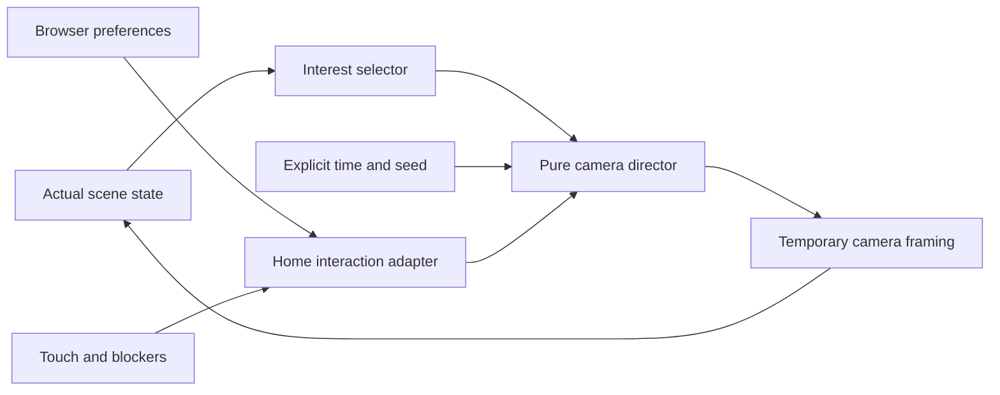

# Idle camera: discoveries with home first

## Customer outcome and acceptance

The wall-tablet user wants the home controls ready whenever someone approaches, while an untouched display slowly reveals the surrounding art. A fixed home view hides much of the coast and its occasional activities. Idle camera visits those existing scenes and then returns to the saved default home view.

Acceptance criteria:

- After 30 seconds without interaction, Home begins a gentle pan and zoom toward a valid scene interest. **Start idle view now** bypasses that wait.
- Each default excursion travels outward for 24 seconds, lingers for 16 seconds, returns over 24 seconds, and stays at home for 45 seconds before another visit.
- Touch immediately restores the saved default view. The complete first wake gesture is consumed so it cannot accidentally operate a device; the next normal touch works normally. Long presses, multiple fingers and assistive clicks require the same protection.
- Active holiday displays and current wildlife/activity events have greater selection weight. Disabled, hidden, invalid or preview-only subjects are excluded.
- Roomcraft menus and dialogs, previews, the demo, held gestures, hidden/inactive surfaces and reduced motion prevent automatic camera movement. Returning from a blocker starts a fresh inactivity interval.
- Preferences belong to the current browser. The authored layout, saved default view, actual weather, measured device states and Home Assistant controls remain unchanged.
- Studio and Controls do not acquire an idle camera. Editor placement gestures and Save semantics remain unchanged.

Non-goals: this is not a device demo, a screen dimmer, a new animation generator, occupant tracking, or a layout migration. It does not guarantee that a brief wildlife event will still be occurring when the slow camera arrives. The destination is held steady for that excursion rather than chasing an animal.

## Use and settings

In Home, choose **Menu → Display → Start idle view now**. Touch once to return to **Default**, then touch the desired home control. Keyboard or wheel activity also interrupts idle movement. The view comes from the existing saved default, including a saved free-camera orientation; idle mode never saves its temporary framing as the default.

Choose **Menu → Display → Idle view settings** to adjust this screen:

| Setting | Default | Menu range |
| --- | --- | --- |
| Automatic idle view | On | On / Off |
| Start after no touch | 30 seconds | 15–300 seconds |
| Slow pan duration | 24 seconds each way | 12–90 seconds |
| Pause at a discovery | 16 seconds | 5–60 seconds |
| Stay at home between visits | 45 seconds | 30–180 seconds |

**Save settings** stores these preferences in the browser. If storage is unavailable, the dialog reports that changes apply only for this visit. Turning automatic idle off still allows an explicit **Start idle view now**; **Reduce motion** prevents both automatic and manual movement. Opening another Roomcraft menu or dialog pauses the tour. Its display-only settings are intentionally separate from Studio's shared layout settings.


## Architecture and deterministic contract



| Owner | Responsibility |
| --- | --- |
| [`storybook-idle-camera.mjs`](../site/ha-local/storybook-idle-camera.mjs) | Pure state machine, bounded settings, seeded weighted selection and smooth travel/return |
| [`storybook-idle-interests.mjs`](../site/ha-local/storybook-idle-interests.mjs) | Filter actual scene samples into finite, public camera subjects |
| [`storybook-scene.mjs`](../site/ha-local/storybook-scene.mjs) | Transform authored landmark/habitat positions and expose `getIdleCameraInterests()` |
| [`storybook-idle-runtime.mjs`](../site/ha-local/storybook-idle-runtime.mjs) | Browser storage, explicit clocks, inactivity, blockers, safe wake handling and default restoration |
| [`roomcraft-storybook.mjs`](../site/ha-local/roomcraft-storybook.mjs) | Home menu, frame scheduling, temporary overlay visibility and adapter lifecycle |

`scene.getIdleCameraInterests()` returns at most 16 plain records: `{id, focus:{x,y,z}, weight, zoomFactor}`. Coordinates use the shared scene's existing world units. Selection rejects non-finite positions; IDs identify public scene subjects, never household telemetry. The getter returns an empty list before the first completed scene render, during transient/demo/holiday/wildlife previews, and after disposal. The Home adapter refreshes candidates at most once per second rather than traversing the scene every frame.

The selector weights the currently selected active holiday display above a marine event, then landmark activity, beach activities, animated habitats and ordinary wildlife, with coast/beach/road fallbacks. It respects the owning modules' visibility and settings. Offscreen culling alone does not disqualify a valid beach activity: approaching it makes its renderer visible again. Existing holiday, marine, landmark and world-moment modules remain the owners of all art and activity schedules.

The director accepts explicit time, interests and settings. It canonicalizes candidate order and uses a seeded weighted draw once per excursion. Sampling the same inputs gives the same result regardless of rendering frequency. A chosen focus is copied and held for the excursion, preventing a jittering or disappearing actor from steering the camera. With no valid candidates, it stays at home. Backward time resets safely, and skipped frames do not require replaying past excursions.

The browser boundary supplies monotonic animation time and derives a session seed from its configured seed and an explicit wall-clock bucket. The seed refreshes on connection, manual start and wake from an active idle visit. This varies later visits while preserving repeatable engine tests. The pure engine reads neither clocks nor browser storage. The runtime restores `resolveDefaultCameraView(savedStartupView)` and applies only temporary focus/zoom; it never overwrites the authored camera preference. Zoom is bounded by the existing scene camera.

The browser adapter checks connection, scene/frame readiness, stage size, document visibility, pending startup view, held pointers, Roomcraft menu/dialog/drawer state, demo, holiday preview and wildlife preview. Reduced motion and disabled automatic idle are separate director inputs. Touch capture shields both pointer events and the resulting compatibility click during a wake gesture. Listener and timer ownership follows card connection/disconnection.

## Compatibility, privacy and art

No layout/schema migration, Home Assistant project write, entity binding change, new physical control or HA core configuration is introduced. Idle camera reuses the current geometry, artwork, lighting and animations. There are no new image assets, remote services, cameras, audio tracks or private media in this release.

Preferences use `roomcraft.idle-camera.v1` in local storage and do not synchronize between displays. The feature records no touch history or occupancy history. It does not transmit its selected subjects or operate Home Assistant services. Decorative landmark people and animals remain illustrations, not reports of real people or wildlife. Actual controls continue to use their existing state/action contracts.

## Verification and release status

Focused interest-selector tests passed **6/6**, including a real world-moment sampler fixture for day/night, severe weather and category gates; focused ESLint and whitespace checks passed. An initial source-bundled browser check has passed. Expanded wake regressions, the production-built browser check, the complete exact-revision release gate, deployment/readback, CI and actual-tablet verification remain pending at this documentation checkpoint. No deployed version is claimed here; final operational evidence belongs in the [engineering handoff](engineering-handoff.md).

Reproduce the targeted checks from `site/`:

```powershell
node --test tests/storybook-idle-camera.test.mjs tests/storybook-idle-interests.test.mjs
node scripts/verify-idle-camera-browser.mjs
# After the complete production build:
$env:ROOMCRAFT_IDLE_CAMERA_QA_DIST='1'
node scripts/verify-idle-camera-browser.mjs
```

Director tests cover the real 30-second boundary in explicit-time samples, instant start, smooth outbound/return interpolation, the home interval, blocked/reduced-motion states, deterministic weighting, stable destinations, invalid inputs and clock rollback. The browser fixture uses the real Home card and animation scheduler against synthetic in-memory HA data. Its intended assertions cover the real inactivity wait, fresh-touch reset, slow camera framing, saved-default restoration, touch/assistive/long-press/multi-touch isolation, blockers, phone dialog fit, and absence of device or layout writes. Test assertions are not deployment evidence.

Run the complete [release gate](release-standard.md#deterministic-release-evidence) after the final source change. Before live publication, preserve the current asset/dashboard backup, bind the exact source to its manifest, deploy, read back the assets and verify the wall tablet. Verify that the first touch restores home without a service call and a subsequent deliberate control touch works as expected using a safe fixture or non-actuating inspection.

## Rollback

Turn **Automatic idle view** off for an immediate browser-local stop, or enable **Reduce motion**. Software rollback reinstalls the previous verified Roomcraft runtime/assets and resource revision using the [deployment recovery procedure](deployment.md). This feature needs no authored-layout rollback because it does not write the layout. The preceding verified runtime is recorded in [Living world](living-world.md#verification-and-release-evidence); the release owner must capture the actual pre-install revision and protected backup before deploying this change. Hosted Studio publication, HA installation and tablet verification remain separate release surfaces.
