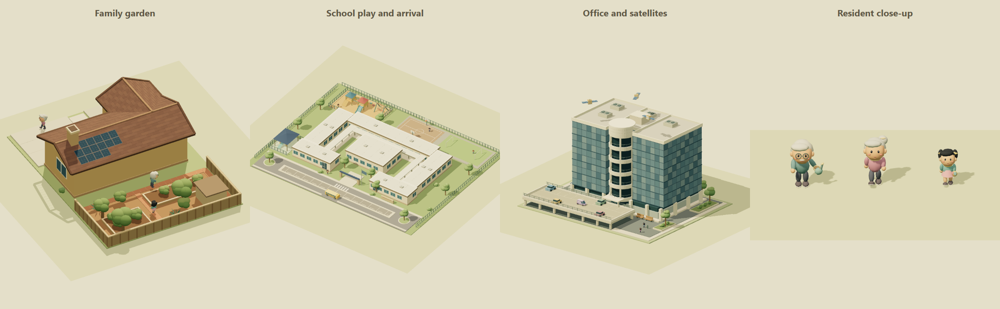
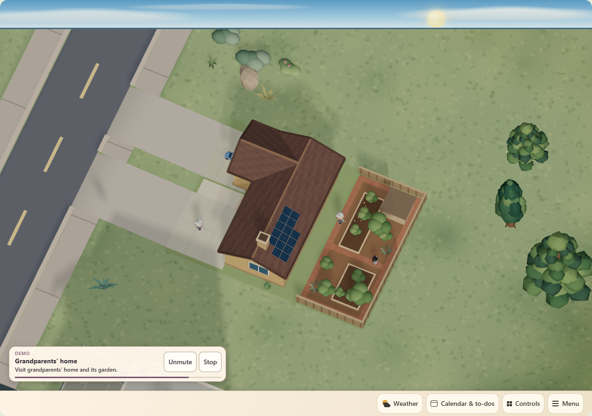
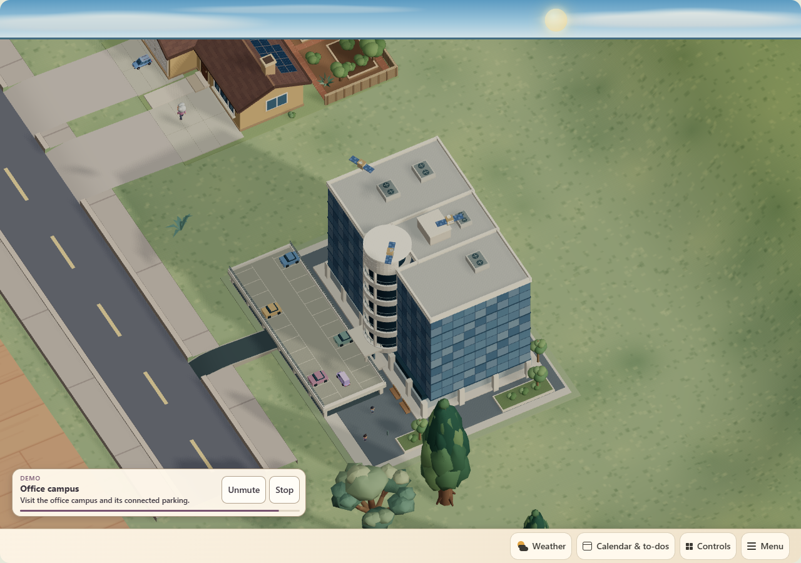

# Living landmarks and the one-minute tour

## Customer outcome and acceptance

The household wants the illustrated neighborhood to feel inhabited and the demo to visit its familiar destinations. A full tour lasts exactly 60 seconds, retains the indoor controls and weather sequence, and adds school, family-house and office stops. The family vignette has two grandparents and a young Asian girl; the office has cute floating satellites. These are decorative miniature stories, not occupancy reports, real events or physical device actions.

Acceptance: Home and Studio share the same actors, perspective, placement and clock; actors stay on the landmark parcel and avoid its buildings; the office satellites stay above its roof; body proportions survive dimensions/height edits; reduced motion freezes poses; night quiets outdoor activities. Each landmark's Inspector controls activity, people, vehicles, event accents and pace, with office-only satellites. Undo, import/export and Save preserve the settings. Existing authored objects, controls, room geometry and bindings remain unchanged.

## Authoring contract

Select a building in Studio and expand **Landmark activity** in its Inspector. All switches default on and **Pace** defaults to 1. Turn Activity off to hide the entire vignette, or disable individual categories. The satellites control appears only for the office. Change the building's position, dimensions or rotation using the existing controls; the vignette follows it. Save uses the existing shared project, and Return to live dashboard returns to Home.

| Saved optional field | Type / default / bounds | Consumer |
| --- | --- | --- |
| `landmarkActivity` | Boolean, true | Whole vignette visibility |
| `landmarkPeople` | Boolean, true | Miniature people |
| `landmarkVehicles` | Boolean, true | Campus vehicle activity |
| `landmarkEvents` | Boolean, true | Illustrated activity/event accents |
| `landmarkSatellites` | Boolean, true; office only | Orbiting satellites |
| `landmarkPace` | Number, 1; 0.25–2 | Explicit animation clock multiplier |

Missing fields retain compatible defaults without a migration or forced layout write. Non-default edits participate in normal command history and both publication transports' validation. Resetting a control removes its default-valued field. Malformed values are rejected. A campus remains a grouped recipe: its characters and event props are configured through the campus, not separate household sensor/control objects. Public source and fixtures contain no private addresses, names, camera media or entity values.

## Module boundaries and repeatability

- `storybook-landmark-life.mjs` owns deterministic miniature art, fixed activity routes, explicit-time animation and disposal. No network, HA actions, random clock or telemetry writes.
- `storybook-scene.mjs` places the vignette beside the static building, follows draft dragging, forwards night/reduced-motion inputs and supplies landmark demo focus. Actor bodies retain uniform scale while support planes and roof-relative satellites follow model height.
- `object-controls.js`, `app.js` and `engine/edit-safety.js` own Inspector fields, history and input validation.
- `storybook-demo.mjs` owns the 60-second camera/caption timeline; `storybook-demo-frame.mjs` owns simulated preview state; `roomcraft-storybook.mjs` owns playback/restoration and input isolation.
- `scripts/build-demo-narration.ps1` rebuilds the optional bundled voice track from the same cues using Microsoft Zira and FFmpeg. Voice remains off by default.

The full-layout chapters retain weather at 23.8–39.8 seconds and traffic through 43 seconds, then school 43–48, family house 48–53, office 53–58 and return 58–60. Layouts missing landmarks redistribute optional time using the existing demo rule. Demo activity never calls a device service.

## Verification and release evidence

Original procedural art uses the established Three.js materials and vehicle library. One skinned draw per resident keeps articulated arms, legs and heads inexpensive. The family includes a watering can and play ball; the school has play and greeting poses with a bus arrival; the office has greeting engineers, a delivery vehicle and three gently orbiting satellites with signal accents. Fixed routes stay within the authored parcels. Activity controls do not turn decorative stories into measured occupancy.

The initial camera proof exposed a roof-hidden family resident and insufficient close-up scale. The final family camera is more overhead, the gardener uses the clear garden-front path, and landmark demo zoom can reach 8 while the normal saved-view limit remains unchanged. The complete school, family house and office remain in their respective frames.

The final source passed the complete release gate: 555 site tests, 65 bridge/weather tests, 30 installer tests and 8 presence tests (658 total), architecture checks, deterministic release/manifest checks, TypeScript, lint, production build and whitespace validation. Lint retains 17 existing warnings and zero errors. The runtime GitHub CI [run 43322769537](https://github.com/Kenkneeshio/AI_VIBECODING/actions/runs/43322769537) passed.

The actual-card Chrome fixture ran against the final built bundle. It verifies all three chapters, 60-second completion, every weather/moon preview, muted narration and cue seeks, camera restoration, unchanged layout/state inputs and zero HA service calls. The final built Studio fixture exercises real Inspector inputs, Undo, invalid-value rejection, file import and mock Save/readback. All public visuals use synthetic layouts and generic labels.

An independent static-model collision review found the school guide passing through a shrub. The final route ends before it; 3,276 sampled route/support checks across native, resized and height-scaled variants then passed. A committed regression adds 459 actual campus geometry probes around the guide corridor. Decorative art totals 24,366 triangles and 22 draws across all three recipes; this is geometry accounting, not a general FPS guarantee.

| Released artifact | Exact evidence |
| --- | --- |
| Runtime source | `465aadf21978d7d9ba8ef91470a87616cfb9caaf` |
| Full-project manifest | `sha256:80c9e45a421a36464b2add22684b4044106a485b467f16b3302a4eadc24058f4`, 371 inputs |
| HA resource revision | `76cafcd1969162f8` |
| HA readback | 11 exact asset hashes over LAN and Nabu Casa; Home/Studio/Controls structure verified; all 8 non-view configuration fields match the pre-install backup, including the unchanged 82-item layout |
| Owner-private Site | Version 110, deployment `appgdep_6af641c7543081918234bedd922b3b71`, succeeded; owner-only audience retained |
| Site source | `cdbabc46785d7be894f2c4363713d5df35c9c1b6` |
| Site subset manifest | `sha256:c45fab6c51ef97de67cb0f744f1fa85d29e8c890fede2c4da48eccc4c5cec4f2`, 267 inputs |
| Local packaged archive hash | `sha256:924a428a5787ba0928019e26fbc40cd44651a77bf71cc803634e829f0de0f8b5` |
| Site stored archive hash | `sha256:0ce40324391e9b172ef3ae269cd5d3d11720785ab260afd22cf9886a225a59c2` |

The 1920 × 1080 Apolosign calendar tablet cold-launched Companion 2026.10.1-full with its HOME alias intact. A later loaded frame showed the complete home, roads and landmarks. The real **1-minute demo** menu action ran with narration muted; timed tablet captures verified school, all three family residents, office satellites and automatic return to the original Home view. The displayed FPS samples were 24 in Home, 34/42/41 at the landmark chapters and 24 after return; these are observations, not a controlled benchmark. No physical device was actuated.

No separate hosted-Site visual check was performed; successful native publication verifies deployment, while the matching shared source was checked in Chrome and HA. The protected installer backup is recorded in the local management log; private dashboard and tablet media are not published to GitHub. Runtime code and source gate are anchored to the exact commit above; this post-deployment evidence is a separate documentation update.

## Rollback

The previous verified runtime is `3d6f31db0adebb503f9ce0ad9b589d5aeda6acd3`, HA resource `8555f9c637e3207c`, owner-private Studio 109. Rebuild/reinstall that source through the [deployment guide](deployment.md), and restore Studio 109 separately. The current 82-item project is preserved by this update; the installer creates a protected dashboard backup before live writes. Optional activity fields need no destructive migration.
