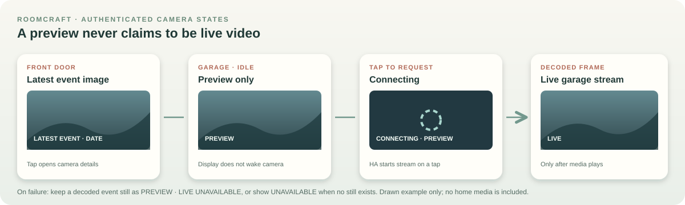

# Live object graphics and camera frames

Roomcraft keeps the editable second-floor project at 1536 × 1024. Its 1536 × 864 dashboard picture uses the full project width and source rows 80–943. Furniture, walls, and the exported PNG are authored art. Home Assistant owns device state and camera media, so a state change updates an authenticated overlay without changing layout coordinates or exporting a new PNG.

The current HA plan read back 41 editable items, 13 mapped object controls, three independently managed camera frames, and one outdoor-weather element. A private 1920 × 1080 wall-tablet capture showed the high-contrast treatments, a dated front-door event still, decoded garage and overhead live media, current rain, and the 12-hour strip without screen crop or scroll. Physical touch coverage, an actual doorbell event, long-running playback, and reboot recovery still need checks; no capture or media is published here.

## Configure an object's appearance

Select a bound item in Studio. **Entity ID** is the state source; optional tap and hold targets choose the command destination. **Live graphic** chooses how its on/off treatment appears. **Automatic** infers a kind from the item, entity domain, and label; choose **Light or lamp**, **Ceiling fan**, **Air conditioning**, **Window or blinds**, **Door or garage**, **General device**, or **No state graphic** when inference is wrong. The last option leaves the item interactive while suppressing the visual treatment. Export derives one `custom:roomcraft-object-control` from each bound item and writes its resolved `roomcraft_visual_kind` to the plan card. The project stores an explicit `visualKind` only when the owner overrides Automatic.

| Live source state | Display treatment | Interpretation |
| --- | --- | --- |
| A domain-appropriate active value, such as light or switch `on`, cover `open`, lock `unlocked`, or climate `cool` | Bright object treatment | The bound state entity reports active/open. One domain's value must not be interpreted as another domain's state. |
| A domain-appropriate inactive value, such as light or switch `off`, cover `closed`, or lock `locked` | Dark object treatment | The bound entity reports inactive/closed. |
| `unknown`, `unavailable`, missing, or an unrecognized state value | Neutral gray with **?** | The dashboard has no reliable normalized state; a prior bright appearance must not persist. |
| Available `scene`, `script`, or `button` | Action-ready control, without a false state badge | Last-run metadata is not an on/off sensor. The label and accessible action remain available. |

Validated light silhouettes are part of the version-2 item contract:

| `lightForm` | Live silhouette |
| --- | --- |
| `table_lamp` | Safe default and compatibility fallback |
| `bud_lamp` | Flower-bud table lamp |
| `cloud_floor_lamp` | Cloud-shade floor lamp |
| `bloom_ceiling` | Petal ceiling fixture |
| `star_pendant` | Hanging star pendant |
| `acorn_sconce` | Compact wall sconce |

Both export transports preserve these forms. Unknown values are rejected at projection time and render with the safe `table_lamp` fallback; they never create a new state source. The whole hit target stays transparent, and each toggle retains the same 4-pixel red/green state dot.

The same tap target remains on the object in every state. The object has no visible ON/OFF/OPEN/CLOSED text badge; its accessible name includes the current Home Assistant value and tap/hold actions, while the hover title shows the value. A tap gives a turquoise outline for 650 ms, a hold gives an amber outline, and keyboard focus has its own outline. A drag gesture on the dashboard does not run an action. A movable `controlZone` can cover an item that lacks its own state entity; it should not claim a false on/off state.

## Fan motion and accessibility

The five-blade dining fan rotor animates only when its verified motor channel reports on. It uses eight stepped CSS frames per 2.8-second rotation to limit tablet work; off and unavailable states are still. Its backing is dark and feathered without a square border. `prefers-reduced-motion: reduce` stops rotation while retaining the on treatment, accessible state, and hit target. The saved PNG omits bound fan, robot, and light art so each HA overlay appears exactly once. The center lamp uses a separate 42 × 42 target and verified light channel, cannot drive motor motion, and glows only from its own on state. Light button chrome is transparent; its compact fixture changes from neutral off art to illuminated on art. Keyboard focus and the brief post-touch pulse remain visible for interaction feedback.

`roomcraft_device_form` adds appliance-specific art without changing the state/action engine. The humidifier form emits slow mist only while its own entity is on. The air-purifier form moves airflow bars only while its own entity is on. Unknown, unavailable, and off are still. The calibrated robot is also omitted from the saved PNG; its one live overlay follows fresh map coordinates and animates only for cleaning or returning.

Electrical and indoor-air status markers are independent informational elements. Their icon animation and severity color may reflect configured sensor values, but opening a marker or row must not call a service. A row emits native Home Assistant more-info for its sensor.

## Three independent camera thumbnails

Each frame is its own editable `cameraThumbnail` item with a `camera.*` state/media source and an optional `image.*` dated event still. The current plan places front-door doorbell, overhead porch, and garage frames independently. A frame becomes a `custom:roomcraft-camera-thumbnail` element at that item's coordinates. Its `previewMode`, optional `imageEntityId`, and up to six distinct `eventEntityIds` are saved in layout version 2. `event_live` requires at least one `binary_sensor.*` event trigger. Both dashboard export transports derive the same `preview_mode`, `image_entity`, and `event_entities` fields. Public examples use fictional IDs.

| Mode | Intended use | Stream behavior |
| --- | --- | --- |
| `event_live` | Battery doorbell | A rising `on` edge from a configured ring or person sensor opens a 60-second window. The card requests `camera.turn_on` if the camera is idle, shows native live media only inside that window, and releases only a stream it started when the window closes. Outside it, show the dated last-event image. A failed start or decode falls back to the still. |
| `live_auto` | Overhead ONVIF/WebRTC camera | Mount the signed-in HA native live image element while available. Do not send `camera.turn_on` merely because the card mounted. Accept advancing video time or decoded frame count as evidence of live playback even when the entity state remains `idle`. |
| `live` | Garage camera | Keep the idle preview. A tap requests `camera.turn_on`; hold or right-click opens native camera details. |
| `event` / `offline` | Still-only / preview disabled | Do not wake a camera for an idle still or an intentionally disabled preview. |

The footer starts at **PREVIEW** for a still, changes to **CONNECTING** while a requested stream starts, and says **LIVE** only after actual media playback is detected. Failure returns to **PREVIEW · LIVE UNAVAILABLE** when an event still exists, or **UNAVAILABLE** without one. Long press or right-click opens native camera details. Each tile keeps its own state, timers, object URL, and failure path. The editor and public manual use drawn placeholders. Neither layout JSON nor GitHub may contain stream URLs, access tokens, frames, event images, or current camera values. A person/ring event opens a live *attempt*, not a guarantee that a battery camera can stream; the dated still remains the reliable fallback.

## Outdoor weather and 12-hour preview

`custom:roomcraft-weather-outdoor` is an independent picture element below cameras and controls. It receives `weather_entity`, optional `sun_entity` (default `sun.sun`), and optional `moon_entity` in the private dashboard config. It reads current condition and temperature from `hass.states`, requests hourly `weather.get_forecasts` through `hass.callWS`, and filters forecast entries by timestamps inside the next 12 hours. A provider may return fewer entries or omit an hour. Forecast icons do not assert that future conditions have already occurred. Tapping a tick previews that hour's weather and daylight briefly, then returns to observed conditions. Times use the HA time zone.

The SVG artwork has a 1536 × 864 viewBox and clips its light wash, precipitation, stars, sun, moon, clouds, fog, and wind to four exterior rectangles: top x0–1536/y0–75, stairs x0–145/y75–815, balcony x145–380/y75–380, and bottom x0–1536/y815–864. This conservative mask leaves rooms and their state graphics legible. `sun.sun` drives current day/night and the next dawn/dusk transition; the moon-phase sensor selects the moon shape. When hourly forecast access fails, current observed weather remains. Animations stop under `prefers-reduced-motion` and pause when the dashboard is hidden. The weather module is loaded through its own versioned Lovelace resource. See [deployment](deployment.md) for the exact picture-element placement.

## Engineering checks

1. Import the current dashboard in Studio, inspect each fixture's **Entity ID**, **Live graphic**, and action targets, and export once. Read back item IDs, `roomcraft_visual_kind`, three independent camera elements, one weather element, and the `full-width-v1` marker. The image must remain 1536 × 864 and non-Roomcraft plan elements and other views must survive.
2. Check known on, off, unavailable, and action-ready entities without sending physical commands solely for visual testing. Verify that the fan-light channel cannot make the motor appear on, appliance animation uses only its own entity, open covers/doors look active, and unknown values do not look active. Confirm accessible state labels and tap/hold feedback without adding visible status badges.
3. Check the fan both with normal motion and with reduced motion enabled on a laptop and the wall tablet. Verify that focus, tap, hold, and the entity drawer still work over the treatment.
4. Confirm the front-door tile shows its dated event still without a live claim between events. Use synthetic sensor transitions in tests to check the 60-second event gate, camera wake request, timeout, and still fallback. Check overhead playback while its HA entity is `idle`, without a wake command, and require advancing decoded video before **LIVE**. On the garage tile, check idle preview, tap-to-start, decoded-frame **LIVE**, and independent unavailable behavior. Keep captures private.
5. Compare current outdoor weather and sun with HA state, then tap forecast ticks across daytime and nighttime; check that they represent forecast timestamps through 12 hours. Confirm the exterior mask leaves rooms clear, missing hourly data falls back to observed weather, hidden-page and reduced-motion modes stop animation, and mobile/tablet fit retains touchable camera and object controls.

For the release sequence and rollback, see [deployment](deployment.md). For the underlying data boundary, see [architecture](architecture.md).
