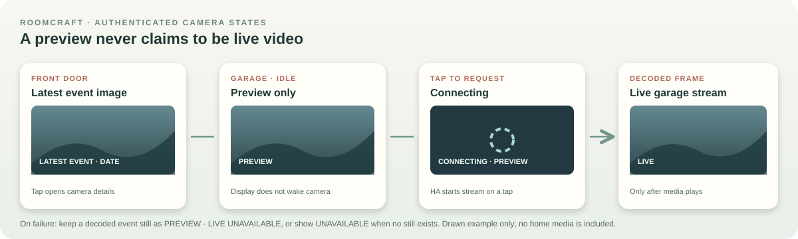

# Live object graphics and camera frames

Roomcraft keeps the editable second-floor project at 1536 × 1024. Its 1536 × 864 dashboard picture uses the full project width and source rows 80–943. Furniture, walls, and the exported PNG are authored art. Home Assistant owns device state and camera media, so a state change updates an authenticated overlay without changing layout coordinates or exporting a new PNG.

The current HA export read back 41 editable items, 14 bound object controls, and two independently managed camera frames. A private 1920 × 1080 wall-tablet check showed the high-contrast treatments, five-blade fan graphic, a dated front-door event still, and a garage stream after it was explicitly started. The tile showed **LIVE** after an MJPEG frame decoded. Physical touch alignment, long-running playback, and reboot recovery still need checks; no capture or media is published here.

## Configure an object's appearance

Select a bound item in Studio. **Entity ID** is the state source; optional tap and hold targets choose the command destination. **Live graphic** chooses how its on/off treatment appears. **Automatic** infers a kind from the item, entity domain, and label; choose **Light or lamp**, **Ceiling fan**, **Air conditioning**, **Window or blinds**, **Door or garage**, **General device**, or **No state graphic** when inference is wrong. The last option leaves the item interactive while suppressing the visual treatment. Export derives one `custom:roomcraft-object-control` from each bound item and writes its resolved `roomcraft_visual_kind` to the plan card. The project stores an explicit `visualKind` only when the owner overrides Automatic.

| Live source state | Display treatment | Interpretation |
| --- | --- | --- |
| `on`, `open`, `opening`, `unlocked`, or an active climate mode such as `cool` or `heat` | Bright object treatment | The bound state entity reports active/open. The overlay does not infer a separate light state from a fan-light toggle scene. |
| `off`, `closed`, `locked`, and other explicitly recognized inactive values | Dark object treatment | The bound entity reports inactive/closed. |
| `unknown`, `unavailable`, missing, or an unrecognized state value | Neutral gray with **?** | The dashboard has no reliable normalized state; a prior bright appearance must not persist. |
| Available `scene`, `script`, or `button` | Action-ready control, without a false state badge | Last-run metadata is not an on/off sensor. The label and accessible action remain available. |

The same tap target remains on the object in every state. The object has no visible ON/OFF/OPEN/CLOSED text badge; its accessible name includes the current Home Assistant value and tap/hold actions, while the hover title shows the value. A tap gives a turquoise outline for 650 ms, a hold gives an amber outline, and keyboard focus has its own outline. A drag gesture on the dashboard does not run an action. A movable `controlZone` can cover an item that lacks its own state entity; it should not claim a false on/off state.

## Fan motion and accessibility

The five-blade fan rotor animates only when its **motor state source** reports on. It uses eight stepped CSS frames per 2.8-second rotation to limit tablet work; off and unavailable states are still. Its backing is dark and feathered without a visible square border. `prefers-reduced-motion: reduce` stops the rotation while retaining a high-contrast on treatment, accessible state, and the same hit target. The editor preview is static, and the saved PNG omits this bound fan's fixed blades so the HA rotor appears only once. A scene action for the fan light does not drive the motor animation. Future animation should use the same state and reduced-motion boundary.

## Two independent camera thumbnails

Each frame is its own editable `cameraThumbnail` item. Place the front-door and garage frames independently, assign each its corresponding `camera.*` entity, and export. The current front-door frame also has an `image.*` event source and uses **Latest event image** because its live stream did not work; its footer shows the event date. The garage frame uses **Live stream** with an event still available while the camera is idle. A frame becomes a `custom:roomcraft-camera-thumbnail` element at that item's coordinates.

Displaying an idle garage frame does not wake its camera. Tap that frame to request `camera.turn_on`; a hold or right-click opens native Home Assistant camera details. The footer starts at **PREVIEW** for its still, changes to **CONNECTING** while a requested stream starts, and says **LIVE** only when HA reports `streaming` and the nested video or MJPEG image has decoded a playing frame. Failure returns to **PREVIEW · LIVE UNAVAILABLE** when an event still exists, or **UNAVAILABLE** without one. Tapping the front-door still opens its camera details. Both frames use the signed-in HA session, and one failure cannot replace or block the other. The editor and public manual use drawn placeholders. Neither layout JSON nor GitHub may contain stream URLs, access tokens, frames, event images, or current camera values.

## Engineering checks

1. Import the current dashboard in Studio, inspect each fixture's **Entity ID**, **Live graphic**, and action targets, and export once. Read back item IDs, `roomcraft_visual_kind`, two independent camera elements, and the `full-width-v1` marker. The image must remain 1536 × 864 and non-Roomcraft plan elements and other views must survive.
2. Check known on, off, unavailable, and action-ready entities without sending physical commands solely for visual testing. Verify that a fan-light scene cannot make the motor appear on, that open covers/doors look active, and that unknown values do not look active. Confirm accessible state labels and tap/hold feedback without adding visible status badges.
3. Check the fan both with normal motion and with reduced motion enabled on a laptop and the wall tablet. Verify that focus, tap, hold, and the entity drawer still work over the treatment.
4. Confirm the front-door tile shows its dated event still without a live claim. On the garage tile, check idle preview, tap-to-start, a decoded-frame **LIVE** footer, long-running playback, hold-for-details, and independent unavailable behavior. Keep captures private. Use a synthetic example in tests and documentation.

For the release sequence and rollback, see [deployment](deployment.md). For the underlying data boundary, see [architecture](architecture.md).
