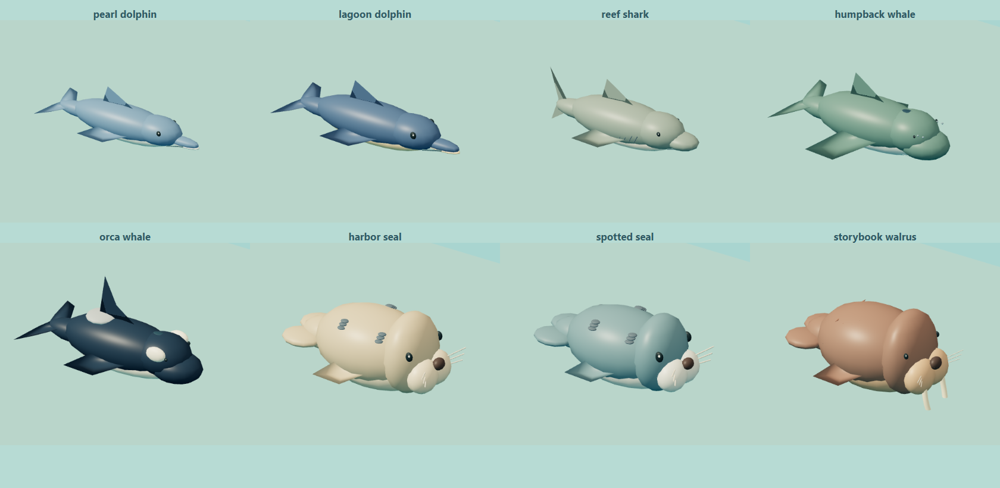
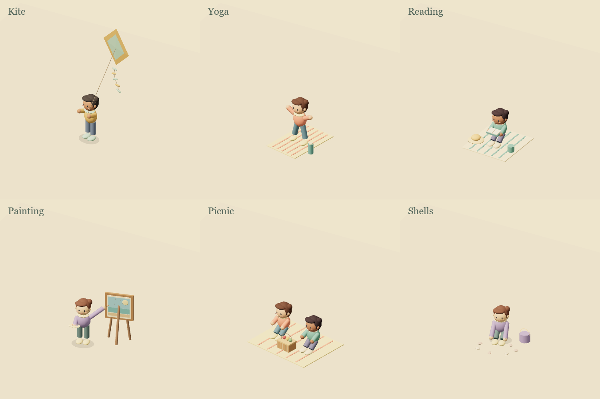
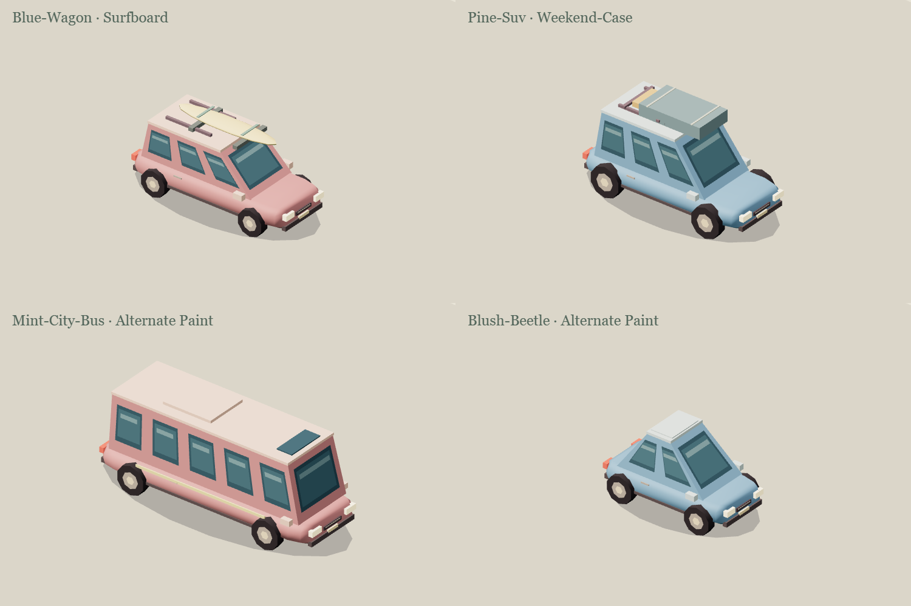

# Living world: wildlife and evolving scenery

## Customer outcome and acceptance

The household wants a miniature world worth revisiting: recognizable dolphins, sharks, whales, seals and walruses with varied sizes and behavior, alongside changing beach activities, characters, vehicles, plant movement and water detail. The scene should offer occasional discoveries without obscuring household controls or overwhelming the wall tablet.

Acceptance: Home and Studio use the same art and settings; independent category/species switches, density, pace, variety and a reproducible seed are editable and survive Undo/import/Save. Animation follows explicit time, safe shoreline/ground geometry, reduced-motion preferences, day/night and actual weather. Actor pools and geometry stay bounded. Preview uses the real rendering loop, restores the previous view and makes no device calls. Existing authored geometry, objects, bindings and holidays remain intact.

This is decorative scenery. It does not infer real wildlife sightings or occupancy. Walruses are explicitly storybook visitors, not a claim about the local coast. Variety comes from a finite authored vocabulary and many deterministic combinations, not an infinite asset generator. Actual sensor, fan, light, vacuum and weather state retain their existing meaning.

## Shared settings and ownership

`roomcraft_layout.sceneSettings.worldLife` is optional. Compatible defaults enable the new scenery without a destructive migration. The scene passes the same validated settings to its existing and new layers.

| Field | Contract |
| --- | --- |
| `enabled`, `marine`, `dolphins`, `sharks`, `whales`, `seals`, `walruses` | Boolean, default true |
| `characters`, `vehicles`, `vegetation`, `water`, `weatherAccents`, `surprises` | Boolean, default true; decorative additions/variation, never physical device controls |
| `density` | 0–1, default 0.65 |
| `pace` | 0.25–2, default 1 |
| `variety` | 0–1, default 0.8 |
| `seed` | Integer 0–9999, default 37 |

The pure settings module owns validation and immutable updates; Home's save adapter checks administrator identity, concurrent settings edits and readback while retaining a rollback snapshot. Studio uses one history transaction. The world clock receives explicit time from the HA adapter, so a reload does not restart every long story. Preview and demo use separate elapsed clocks. Reduced motion holds the presentation still.

Marine art and route planning belong to `storybook-marine-life.mjs`. `storybook-world-moments.mjs` owns additional grounded scenery events; existing beach, sidewalk, boats, traffic, trees and ocean modules retain their domain behavior. `storybook-scene.mjs` composes them once for both surfaces. No runtime animation frame, entity value or private image enters the saved layout.

## Art catalog and editable limits

The ocean pool contains pearl and lagoon dolphins, a reef shark, humpback and orca whales, harbor and spotted seals, and a storybook walrus. Each has three restrained coat palettes and deterministic encounter scale from 80–100% at maximum variety (84–100% at the default). Existing conservative route reservations cover the largest form. Eight skinned actors share one material; foam uses one additional material, nine total draw submissions, at most 64 foam instances and 27,154 submitted triangles. Color buffers update on encounter changes without replacing geometry or materials.

Beach recipes rotate through kite flying, yoga, reading, painting, picnic and shell collecting, with six character palettes. Groups keep their proportions and stay stable for eight-minute encounters, separated by a short empty interval. Gull flights, butterflies and wind-driven leaf/blossom drift use bounded schedules; water glints/rain rings require compatible actual conditions and existing effects toggles. Eight fixed instancing pools draw the additional moments, with fewer than 500 active parts in the tested maximum-density fixture.

Traffic variations add restrained paint choices and roof cargo without changing measured vehicle counts/speeds or the selected fleet style. Ambient boats and sidewalk groups respect the new category gates, pace and bounded density. Static tree geometry and the underlying real weather remain when decorative activity is paused.

The current editor changes **recipe settings**, not each transient animal or leaf as an independent furniture object. Marine routes are derived from valid water and reserve coast, boat/wake and other animal envelopes. Narrow/invalid regions omit an unsafe actor or vignette. Preview temporarily frames the complete enabled route envelope and restores the prior camera; Studio disables placement gestures during that temporary camera. This is a finite, extensible catalog; additional silhouettes/behaviors belong in the owning modules and their visual/bounds tests.

## Verification and release evidence

Implementation and verification in progress. Record exact tests, visual proofs, native-scheduler UI checks, runtime source, HA/Site artifacts, actual tablet behavior and limits after they run. Public evidence must use synthetic layouts and generic identifiers.

## Rollback

Previous verified runtime: `07972b7eda27db8c22362ac72d53571f2c9a0725`, HA resource `fddc98664af18134`, owner-private Studio 112. Rebuild/reinstall that source, restore the protected pre-install dashboard backup if the new settings were saved, and restore Site 112 separately. See [deployment recovery](deployment.md).
