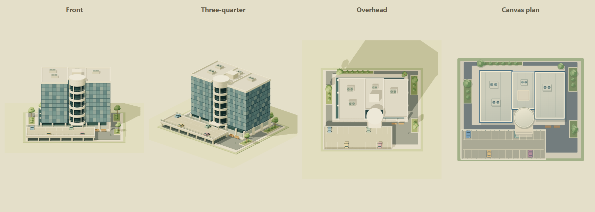

# Editable office campus landmark

**Status:** implementation in progress; the exact release gate and deployment evidence will be recorded below. Previous verified runtime: `4490638e`, HA resource `309de5e7f537f676`, private Studio version106.

## Customer outcome

A layout author can add a recognizable miniature office campus to the exterior landscape, farther inland and to the right of an existing house landmark. It uses the same perspective, lighting, editable project and Home/Studio renderer. The existing home, road, house, furniture and device bindings remain unchanged.

Acceptance requires a detailed office model, complete default framing, ground support and planting clearance, normal editing/Undo/Save, identical saved geometry across transports, and verified target-tablet rendering. This release adds one decorative catalog recipe; it does not connect to or control office equipment, alter traffic routing, or reproduce a surveyed commercial interior.

## Reference and art

[Innoflight’s official contact page](https://innoflight.com/contact-us/) identifies the current office. A [2026 property brochure with exterior and aerial photographs](https://platform.reverecre.com/api/project-file/324e43aa-472e-4f12-a9fb-8303820169d8/5880%20Oberlin%20Drive%20-%20Teaser%20-%202.9.26.pdf) provides the visible building reference. The building is a six-story mirrored blue-gray office tower with horizontal glazing bands, fine vertical mullions, stepped wings, a pale cylindrical entrance rotunda with curved balconies, a flat roof and adjacent parking deck.

The model is an artistic miniature with simplified proportions and inferred small architectural/landscape details. Code-native geometry and Canvas art are original renderings; no reference photo, map tile, company logo, private commute information or surrounding unrelated building is embedded in the assets. The catalog name is generic; authors can name their own placed item.

The model uses four opaque merged layers and 17,900 triangles. The default height is122.8 plan units; the 3D height control scales it vertically without moving its support plane. Factory bytes are deterministic, and each instance owns its disposable geometry/materials.

## Studio controls and contract

Choose **Objects → Exterior scenery → Office campus**. Place the object outside the home, then edit its name, center, rotation, width, depth or optional 3D height. Duplicate, Delete and Undo use the standard project history. **Save** publishes the project, and **Return to live dashboard** opens Home.

| Property | Contract |
| --- | --- |
| Type | `sceneryOfficeCampus` |
| Default footprint | 220 × 180 illustration plan units, including parking/landscape |
| Local frontage | +Z before the standard authored rotation |
| Support | Local Y=0; scene exterior ground Y=−111 |
| Dimension/height controls | Existing object width/depth and model-height controls; no new coordinate system |
| Device bindings | Disallowed, including secondary action targets |
| Serialization | Layout version2 and existing reference revision preserved |
| Layer ownership | One grouped 3D recipe plus its matching compatibility Canvas illustration |

The campus is one movable recipe; its building, parking deck, roof details and plants scale together rather than becoming separately selectable objects. [Exterior landmark contracts](exterior-landmarks.md) govern camera bounds, terrain support and the fixed 2D PNG crop. Outside-crop scenery remains in saved JSON and the live/Studio 3D scene. No change to condo dimensions is needed.

## Module ownership

- `ha-local/storybook-office-campus.mjs`: independent deterministic factory and disposable geometry/materials.
- `ha-local/storybook-exterior.mjs`: shared building classification, footprint exclusion and camera extent union.
- `ha-local/storybook-scene.mjs`: single Home/Studio factory resolution, exterior elevation, picking and planting clearance.
- `ha-local/storybook-meadow.mjs`: supported terrain pad; `storybook-side-road.mjs` treats the campus as an obstacle.
- `public/model-library.js`, `object-controls.js`, `engine/edit-safety.js`: catalog, editable properties and decorative binding guards.
- `public/object-art.js`: scalable compatibility art and catalog thumbnail.
- Exterior/campus unit tests and `scripts/verify-exterior-browser.mjs`: model dimensions, determinism, framing, existing scenery preservation, editing and Save.

## Release evidence

Pending the exact source revision. Run the complete [release standard](release-standard.md), then the built-bundle exterior browser fixture. Freeze runtime source before deployment; record source, manifests, test totals, CI, HA asset/layout readback, Site version/audience and tablet evidence here. A synthetic check must not be described as a production or tablet check.

## Rollback

The preceding [exterior landmark release](exterior-landmarks.md#exact-artifacts-and-deployment-evidence) is the rollback baseline: runtime `4490638e29e831cd21c9723627f5bc44eeab6353`, HA `309de5e7f537f676`, owner-private Site106. Back up before asset installation and before Studio Save. Restore the matching previous project and runtime together if reverting this feature; old renderers do not recognize the office model. Keep private configuration and screen captures in the administrator’s protected management backup directory, outside Git.
