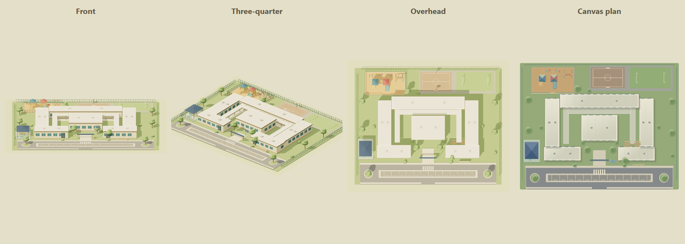

# Editable elementary school campus

**Status:** deployed and verified on 12 November 2026: runtime `3d6f31db`, HA `8555f9c637e3207c`, owner-private Studio 109. The complete source gate passed 647 tests and GitHub CI. Authenticated Studio Save, exact independent readback and the wall tablet verified the two additions.

## Customer outcome

The household wants a recognizable miniature of the elementary school beside the home, placed to the left of the condo with playgrounds and a separate side road meeting the coastal street. The campus must match the established materials, perspective and lighting and remain editable through Studio.

Acceptance requires visible school buildings and varied play areas, an unobstructed entrance from the left branch, consistent exterior elevation, complete camera framing, standard move/dimensions/height/rotation/Undo/Save, and preservation of the current 80 objects, condo dimensions, right-side road, house, office and all household controls. School art and placement must share the Home/Studio renderer. The public catalog is generic; private home location and original reference imagery stay outside Git.

This is an artistic grouped campus recipe, not a surveyed floor plan, live school monitoring, child tracking or a traffic routing integration. The release must identify which visible architectural features come from references and which small details are inferred. Campus buildings, play equipment, fencing and planting scale together; the campus and side road remain separate selectable objects.

## Authoring and engine contract

The school uses the existing exterior-building classification, ground plane, selection, camera framing and terrain/planting exclusion. A model-specific entrance recipe connects to the existing side-road compiler. Saved layout version 2 and the current reference marker are preserved. The campus accepts no Home Assistant entity/action binding. The fixed design-space PNG can crop exterior scenery outside the original plan; the complete layout remains in JSON and the shared 3D view.

Choose **Objects → Exterior scenery → Elementary school & playgrounds**. Move the campus, change its name, dimensions, rotation or model height, duplicate/delete it, or undo the change through the ordinary Inspector. The road is a separate **Connecting side road** item; its width and length remain editable. Save publishes the common project and Return to live dashboard opens Home.

| Property | Contract |
| --- | --- |
| Type / factory | `scenerySchoolCampus` / `makeStorybookSchoolCampus(item)` |
| Default footprint | 300 × 240 illustration plan units |
| Frontage | Local +Z before authored rotation |
| Ground / native maximum height | Local Y0, exterior scene Y−111 / 32 plan units |
| Road entrance | Local X0, Z120, width28, asphalt topY1.6; scales with the campus |
| Height override | Existing optional model-height property; ground stays fixed |
| Grouping | Buildings, schoolyard, play equipment, fencing and landscape belong to one model |
| Binding | Decorative; primary and secondary HA entity/action bindings rejected |
| Default scene placement | Left of the existing home, with a separate straight branch from the main road |

`storybook-school-campus.mjs` owns deterministic disposable 3D geometry. `object-art.js` owns the matching Canvas thumbnail/plan. Exterior classification and `storybook-scene.mjs` connect that factory to shared ground, selection, framing and planting protection. `storybook-side-road.mjs` owns the short school entrance and its pavement/terrain support. Model catalog, object controls and edit-safety guards own authoring and binding validation. No installation-specific school or home location belongs in these modules.

## Reference and art provenance

The visual reference is the public Morning Creek Elementary campus. The [school’s official directions](https://morningcreek.powayusd.com/apps/pages/maps-directions) and [district directory](https://www.powayusd.com/apps/pages/elementary-schools) verify its identity. Public aerial imagery from [Esri World Imagery](https://services.arcgisonline.com/ArcGIS/rest/services/World_Imagery/MapServer) informs the low cream/white flat-roof campus: central square building, surrounding long classroom wings and courtyard, entrance blocks, front asphalt drop-off/parking, a separate shaded play corner, rear hardcourt apron and lawn field. The aerial acquisition date is not verified.

This is an original stylized model of those visible features, not an aerial-photo texture or exact survey. Small play structures, colors, windows, roof equipment, planting and fence details are artistic interpretations. The school and road rotate together into the requested illustrated setting rather than reproduce geographic north. Original imagery, nearby residential details and private location discovery stay out of source and public proof images.

The factory uses four opaque merged layers and 18,454 triangles, with no texture downloads or nondeterministic variation. Each instance owns its geometry and materials. The maximum height is the 32-unit flagpole. Solid wing plinths reach the parcel surface; the 28-unit street entrance opens directly into the asphalt circulation without a curb or fence across it.

## Verification and release

| Surface | Actual result |
| --- | --- |
| Frozen runtime | `3d6f31db0adebb503f9ce0ad9b589d5aeda6acd3` |
| Full source manifest | `sha256:51cdb9348a6b3a14e11bf34017d5055120617ff32c0741d6158a95958e9c7dd4` — 364 inputs |
| Full release gate | Clean dependency install; 544 site, 65 HA bridge/weather, 30 installer and 8 presence tests passed (647 total). Architecture checked 113 authored modules / 34,954 lines. TypeScript, lint, production build, manifest readback and whitespace passed. Lint retains 17 existing warnings and no errors. |
| Runtime CI | [GitHub run passed](https://github.com/Kenkneeshio/AI_VIBECODING/actions/runs/43319481726) |
| Model and art | Exact footprint, native height, grounded opaque geometry, deterministic bytes, independent ownership/disposal and Canvas transformations passed. Reviewed synthetic front/three-quarter/overhead/Canvas proof. All six wing foundations meet the parcel surface. |
| Independent geometry | Entrance and parking-floor raycasts across scale/aspect/height variants match the derived approach within floating-point tolerance; all 28 units of entrance width are clear. Both road branches compile with four total building approaches, preserving existing right-side connections and supporting terrain/planting exclusions. |
| Built editor browser | Real Chrome catalog placement at negative coordinates, resize/height/reset, rotation, move/Delete/Undo, road length/Undo, decorative binding rejection, selection, PNG/project mock Save and saved-scene rebuild passed. Default camera includes the whole school and both branches; eight main views and phone/tablet/ultrawide framing pass geometry checks. |
| HA installation | Private backup before writing. Resource `8555f9c637e3207c`; eleven installed assets exactly match the build over LAN and remote origin. Home/Studio/Controls and eight non-view dashboard fields matched the installer backup before layout publication. |
| Actual Studio publication | One upload and one guarded Save after a separate verified rollback copy. The real submitted project matches API readback exactly; the new school and road render in the authenticated editor. |
| Independent saved-project comparison | 80 → 82 items; every original item and its ordering unchanged. Only the new road at (−80,350), size64×840, rotation0 and school at (−300,475), size300×240, rotation270 were added. Both are unbound. All previous device mappings, hotspots and non-item layout fields match. The school entrance has a 68-unit approach to the road. |
| Wall tablet | Trusted ADB and Companion HOME alias verified; Companion 2026.10.1-full cold-launched. A loaded private 1920 × 1080 capture shows the complete school/play areas on the left, its separate street and entrance, existing home/stairs/garage and both right-side landmarks without clipping. |
| Private Site | Version109 deployed successfully with owner-only access preserved. Source `2cd8df29843b64da647035f404eab121650d237a`; subset manifest `sha256:18c0519884f2d5ede555fcd3530d51df6f59c36ce32bbe5c6e38c42da6ff20b8` (264 inputs). Archive `sha256:487cfb5f086aa2cd9bcb069ef0ed492632e5fee1b8b8f6fbe9da8b5d18815abf`; deployment `appgdep_6af63ce109ec8191bb23a5496bedb633`. No separate hosted-browser visual check was run. |

The initial inventory-wide test exposed a missing school factory in its test dispatch; it was registered, and the full gate passed again before the runtime was frozen. The reviewed foundation gap was filled before the final model tests. Source, Site and HA artifacts were frozen independently and are identified above. No physical device was actuated by these checks. Actual configuration, reference photos and browser/tablet captures remain in protected local storage outside Git.

## Rollback

Restore runtime `6419875cd428705da558ccb6a08343129929e9fc`, HA `b9409959a1d19a3e`, owner-private Studio 108 and the protected pre-school project together. That project contains 80 items and the corrected short office approach. Keep private backups, actual device screenshots and reference media in protected management storage outside Git.
