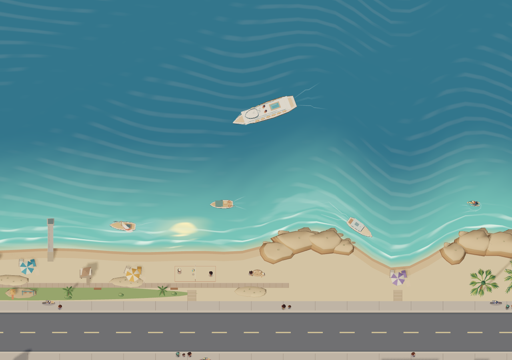

# Overhead Studio, LiDAR ruler, room controls and La Jolla coastline

| Customer | Outcome | Observable acceptance |
| --- | --- | --- |
| Layout author | Edit the live scene directly overhead | Deleting, dragging, and drawing structure keep the same overhead view. Compatible items can be placed on the kitchen worktop. |
| Layout author | Save and return from adjacent controls | Save publishes through the normal dashboard revision check. Return opens Home and handles unpublished drafts. |
| Household operator | See and operate devices by room on a phone | Controls loads the current published rooms and labels, preserves configured device actions, and has room sections with touch targets. |
| Layout author | Align the vacuum without guessing the physical scale | Select matching corners, inspect the preview, apply or undo, and save the verified fit. |
| Household operator | Read a real distance on the vacuum scan | Open the LiDAR ruler in Home, choose two points, and see their straight-line distance in metres and feet. |
| Household operator | Try higher quality graphics with a recovery path | The preview starts at once and restores the prior display settings after five seconds unless confirmed. |
| Household operator | See a La Jolla-inspired coast in Roomcraft | Shores sand, a beachfront path and park, and the Cove's sandstone headland share the camera, surf and lighting of the home scene. |

Home Assistant owns the published project and revision. The editor and the control view derive from that data. Publishing the layout keeps all three dashboard views. The original image and fallback artwork remain available for older layouts and the export pipeline.

This release preserves the published floor-plan geometry, bindings, cameras and commute configuration. The coastline models a stylized view across the street. The graphics preset changes display quality on the current browser, independent of layout and device control.

The vacuum camera supplies raster calibration and millimetre map coordinates. The ruler transforms both selected scan points into those coordinates and retains the image only while open. Plan distance comparisons invert the full robot-to-plan transform. A directional fit requires at least four spread landmarks and substantially better held-out corner error. Saving the alignment publishes the same six-number transform and map identifier used by the robot marker and overlay.

The existing live transform spans about 92–101 plan pixels per metre by direction. In a read-only comparison of 23 walls, an automatic wall fit increased the held-out error from about 0.35 m to 0.38 m. The release keeps the current calibration until matching landmarks establish a better fit. The scan ruler works immediately with the vacuum camera's own calibration.

## La Jolla art references

- The City of San Diego coastal plan uses a 2022 aerial map in Figure 2-5 and beach and promenade photographs in Figure 2-6. They show the order of the park, La Vereda path, seawall, beach and surf. [Coastal Resilience Master Plan](https://www.sandiego.gov/sites/default/files/2025-06/final-crmp-peir.pdf)
- The City's beach archive shows the Cove's small sand pocket between bluff faces. Its sea-cave archive records the sandstone ledges east of the Cove. [Cove photograph](https://www.sandiego.gov/digital-archives-photos/la-jolla-cove-beach-1969), [sea cave collection](https://www.sandiego.gov/digitalarchives/collections/mammoth-caves)
- Scripps's pier photographs, campus walking map and Shores camera show the long straight research pier and its relationship to the open beach. [Scripps Pier](https://scripps.ucsd.edu/about/scripps-pier), [walking map](https://scripps.ucsd.edu/system/files/2025-01/WalkingMap_2024.pdf), [Shores camera](https://scripps.ucsd.edu/piercam)

## Release verification

- Runtime source `a6d36a086202789ea78c59b3ff9cccfb6a8e8faa` passed 473 JavaScript and 38 Python tests, TypeScript, lint with warnings, the production build, and deterministic manifest verification. The runtime manifest was `sha256:a88046b8ccf6113b635dee9951ce93a8cc01995ef0b7a3d8394069bf2fad4219`.
- Browser fixtures verified the exact built Studio and Home assets, including countertop placement, both delete paths, the guided survey, the LiDAR ruler, room controls, and graphics timeout, confirmation, and restore. Home Assistant served eight matching assets on both LAN and Nabu Casa. The published layout, projection, and other non-view fields matched the protected pre-install backup.
- A signed-in Nabu Casa browser verified the five-second graphics rollback, measured the authenticated Dreame scan, opened all three views and returned from Studio. At 390 CSS pixels, Controls rendered 26 sections and 187 entries without horizontal overflow. The verification sent no dashboard saves, uploads, or device commands.
- The wall tablet cold-opened Home and showed the new shoreline with its night lighting. The installed Controls and Studio views opened on the tablet, and **Return to live dashboard** brought it back to Home. Insane graphics was left off on the tablet.
- The owner-private Studio was published as version 91 from Site source `af640b53065d770ec298c7224fe7b66ad7bf2cad`. The packaged Studio bundle matched the Home Assistant build.

## Rollback

Rebuild and install the previous source `4065be98457f6b19f9ebf2fe0086bb5165b070a8` and restore the protected pre-install dashboard configuration if rolling back the three-view release. Use private Studio version 90 for hosted rollback. See the [deployment recovery guide](deployment.md).
