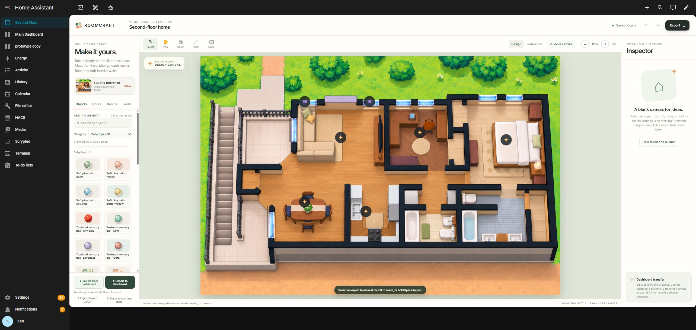
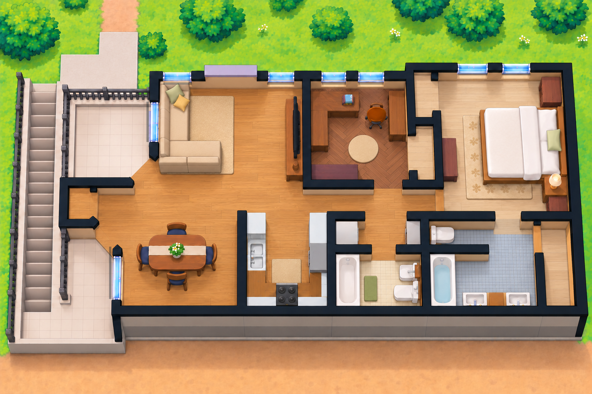
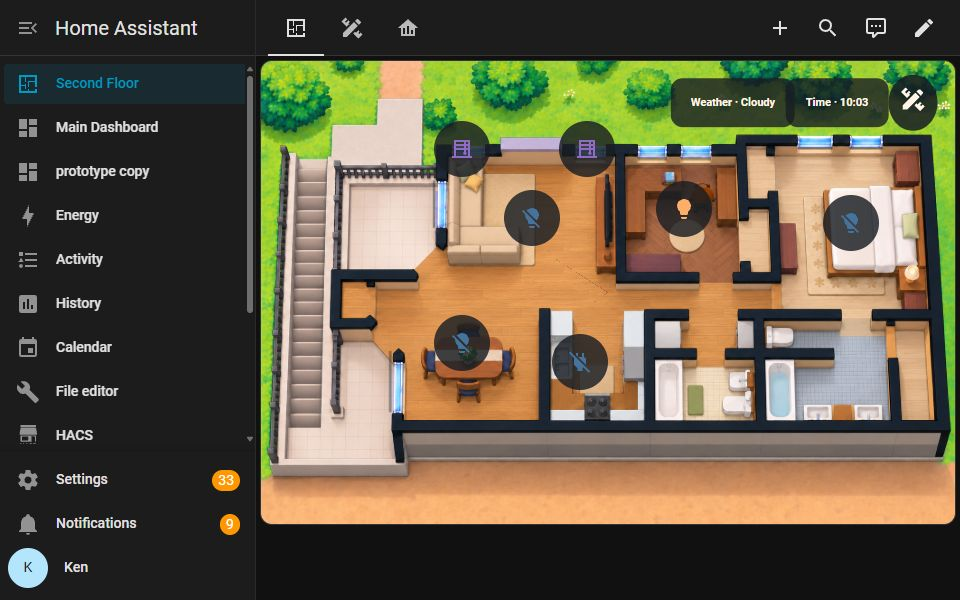
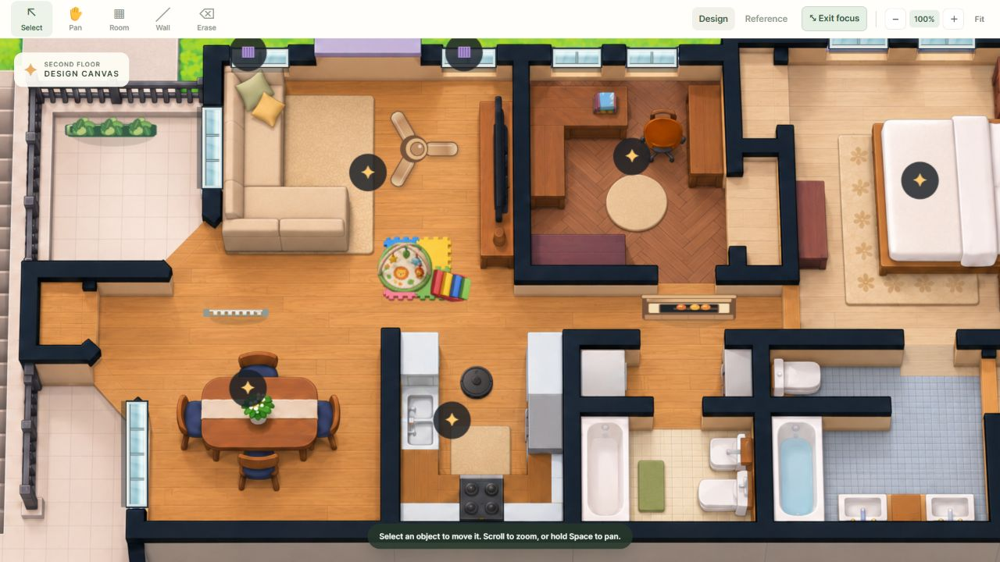

# Roomcraft user manual

Roomcraft is the editor for the illustrated Second Floor dashboard. Use it to make a layout, then transfer the image and controls to Home Assistant. You can also download the image, editable project, or Home Assistant YAML separately.

The current HA-hosted Studio is shown above. The left palette chooses objects, floor finishes, rooms, or walls; the center canvas edits the plan; the right Inspector edits the selection. **Import from dashboard** and **Export to dashboard** are at the bottom of the palette. The [legacy screenshot archive](legacy/README.md) keeps the previous editor capture.

## The plan and its perspective

The canvas is a top-down plan with lightly raised walls and furniture. The balcony and stair are outdoors at left. The stair begins at the lower-left landing and descends toward the top-left. Doorways between upstairs rooms remain on one floor level. Bedroom, study, baths, and living spaces have different finishes. The editor uses this image as a reference and separate illustrated assets to redraw edited geometry; an edited scene can differ from individual pixels in the reference PNG.

This image was downloaded from the live Home Assistant plan after a successful Studio export and readback. It shows the corrected sofa orientation, recessed blue windows, and separate floor textures while keeping the upstairs rooms on one level. The [legacy screenshot archive](legacy/README.md) retains the earlier flat-window view for comparison.

## 1. Open the editor and choose a view

The Second Floor dashboard has three views: **Floor Plan**, **Layout Studio**, and **Live Home**. On a laptop or tablet connected to the home network, open [Layout Studio](http://192.168.68.96:8123/second-floor/studio) and sign in to Home Assistant. The pencil-ruler icon in Floor Plan also navigates to Studio. The editor runs inside this Home Assistant view and uses your HA session; an administrator account is needed to publish a layout. A fresh browser loads the saved dashboard project by default. If that browser has a local draft, the draft opens first; use **Import from dashboard** to deliberately replace it with the current published layout.

For Ken's HA profile, **Second Floor** is the default dashboard and the first sidebar item. Home Assistant stores that preference for the account across devices. Other accounts can choose their own default. The layout has been checked in a tablet-sized browser viewport; the physical Fire tablet was offline during this release and still needs an on-device check.

This 960 × 600 browser preview shows the complete 696 × 465 plan card without page scrolling. It is a responsive check, not a photograph or verification of the physical Fire tablet.

The owner-private cloud editor is an alternate route when available; use the Site URL supplied by the owner. It has its own sign-in. Both editors share the dashboard's saved `roomcraft_layout`; after exporting in one, import in the other to refresh its draft. Use Layout Studio on the home network as the normal authoring path.

This manual describes the HA-hosted Studio paired with owner-private cloud editor version 13. The own-tab Studio fallback completed a live import, export, and dashboard readback with 6 rooms, 33 walls, 13 items, and 7 controls.

If Chrome leaves the embedded editor blank, use **Open editor in a new tab** inside Layout Studio. Keep the Studio tab open while editing in the new tab: it supplies the authenticated dashboard connection through the opener. A direct visit to `/local/roomcraft/editor.html` has no such connection and cannot import or export to the dashboard.

Use **Design** to edit. Use **Reference** to compare against the original furnished image. **Focus canvas** hides editing panels for a larger view. **Fit**, the zoom buttons, and the percentage button control scale; wheel or trackpad scrolling zooms, and **Pan** or Space-drag moves the view.

## 2. Work with furniture and objects

Open **Objects**. Search the catalog or filter by category, select an item, then click its location on the plan. The catalog includes living and bedroom furniture, kitchen and bath objects, plants, rugs, lamps, windows, baby play items, safety pieces, climbing blocks, a fireplace shelf, ceiling fan, and robot vacuum art. Select a placed item to edit its name, size, position, angle, and appearance in the **Inspector**. The rotate and duplicate actions are there too.

Windows and wall-mounted objects snap near walls. If the editor asks you to click closer to a wall, move the pointer to the intended wall segment and try again. After placing a window, zoom to 100% and check that its long edge, frame depth, and shadow follow that wall. Drag it along the wall if it needs repositioning. Use **Select** to drag an item. Use **Erase** or the Inspector's remove action to delete it. **Restore reference furniture** adds missing original furnishings without replacing your other edits.

The [window artwork comparison](images/window-perspective-comparison.png) shows why the lower, recessed glazing is the Design view's target for the original openings.

## 3. Change a floor finish

Open **Floors**, choose a finish, then click the room to paint. A selected room's **Floor finish** menu in the Inspector provides the same control. Each room stores its own finish; the shared level through doorways stays continuous. To change a room boundary, select the **Room** tool, click that room, and drag a corner handle. **Rooms → Add room** creates another editable floor region.

For clean results, keep room polygons inside their walls and avoid overlapping neighboring floors. If a new room covers an existing room, reshape its points or remove it.

## 4. Change walls

Choose **Wall** and drag from the start point to the end point. Hold **Shift** for a straight horizontal or vertical segment. Open the **Walls** palette to choose graphite, plaster, sage, or walnut, then click a wall to apply the finish. Choose **Select** to click a wall; drag an interior segment or its endpoints, or enter exact coordinates in the Inspector. Choose **Erase** to remove an interior wall. The original illustrated exterior shell keeps its outline aligned with the reference art, but its finish can be changed.

After changing a wall, check its adjoining floor polygon and any nearby window or wall-mounted object. These are separate editable layers.

## 5. Link an object or control to Home Assistant

The plan's markers represent Home Assistant controls. Select a marker to change its title, entity ID, location percentage, tap action, or hold action. The Inspector accepts an entity ID in `domain.object_id` form, such as `light.example_living_room`. You can also select a placed object and set its optional **Entity ID** to include it as a control in the YAML export.

Confirm a device's physical location in Home Assistant before placing a control. A friendly name does not prove the room. The editor stores control placement; Home Assistant performs actual device actions. A device that is unavailable or missing should be corrected in Home Assistant before use.

## 6. Save, import, and publish

Edits save in the current browser automatically. For a portable backup, use **Export → Editable layout JSON**. On another browser, choose **Import layout JSON**. Keep this JSON private if it contains real entity IDs or room details.

Use the two buttons at the lower-left of either editor to work with the live dashboard:

1. **Import from dashboard** loads its saved editable project and current controls. Save your current draft as JSON first if you want to retain it.
2. Edit rooms, walls, floors, objects, and markers.
3. **Export to dashboard** renders a detailed PNG, uploads it to Home Assistant, and saves the editable project with the dashboard. Reload the dashboard to see the result.
4. Import once more to verify that the same project opens for the next editing session. If you switch between the HA-hosted and cloud editors, import in the second editor before editing.

The editor checks the dashboard revision before exporting. If another change happened, import the newest dashboard version and review your draft before retrying. This protects a teammate's more recent dashboard edit.

The **Export** menu also provides a PNG and a manual Home Assistant YAML fallback. The YAML references a local image path; copy the PNG to that path before applying it manually.

The **Floor Plan** view overlays working device markers, current weather, time, and the edit icon on the published plan shown above. Its centered layout keeps the entire 3:2 image visible in tested laptop and tablet-sized browser viewports. **Live Home** shows native Home Assistant weather, time, sun, garage, fan, vacuum status and map, second-floor controls, and the working garage camera feed. Front-door and porch camera feeds currently fail through Home Assistant's image proxy and are left out until repaired. Live Home reads from Home Assistant; the Roomcraft editor controls the authored room layout. A robot icon drawn in Roomcraft is decorative until its vacuum-map coordinates have been calibrated to the floor-plan coordinates.

## Undo and recovery

- **Undo** and **Redo** step through the current editing session.
- **Reset to starting plan** restores the initial furnished design; export JSON first if you want the current state later.
- **Recover previous browser draft** appears when an older local draft is available. The editor also keeps a route back to the pre-recovery layout.
- A dashboard backup is separate from browser local storage and the JSON file. Use all three appropriately when making major changes.

## Troubleshooting

| Symptom | Action |
| --- | --- |
| Object will not place | Return to **Design**; for windows and wall fixtures, click close to a wall. |
| Floor looks misplaced | Select **Room**, inspect its corner handles, and keep the polygon within the room. |
| A wall cannot move | The illustrated exterior shell is fixed. Select or draw an interior wall. |
| Dashboard export says the dashboard changed | Import the dashboard again, compare changes, and retry. |
| Dashboard image updates but browser shows the prior image | Reload the Home Assistant view; its browser may still hold the earlier image. |
| Layout Studio shows **Configuration error** after a card update | Reload the affected Home Assistant tab. If the error persists, check the registered Roomcraft card resource and dashboard configuration using the [deployment guide](deployment.md). The cause of the observed transient error was not confirmed. |
| HA-hosted Studio opens but the editor is blank | Click **Open editor in a new tab** in Studio and keep the Studio tab open. The new tab can still import and export through its authenticated opener. |
| HA-hosted Studio opens but transfer is unavailable | Confirm you opened `/second-floor/studio` while signed in to Home Assistant, or used its own-tab button while keeping Studio open. Direct `/local/roomcraft/editor.html` lacks the dashboard bridge. Publishing needs an administrator account. See the [deployment guide](deployment.md). |
| Cloud editor transfer is unavailable | Confirm the owner-private Site sign-in and its server-side Home Assistant connection. |

