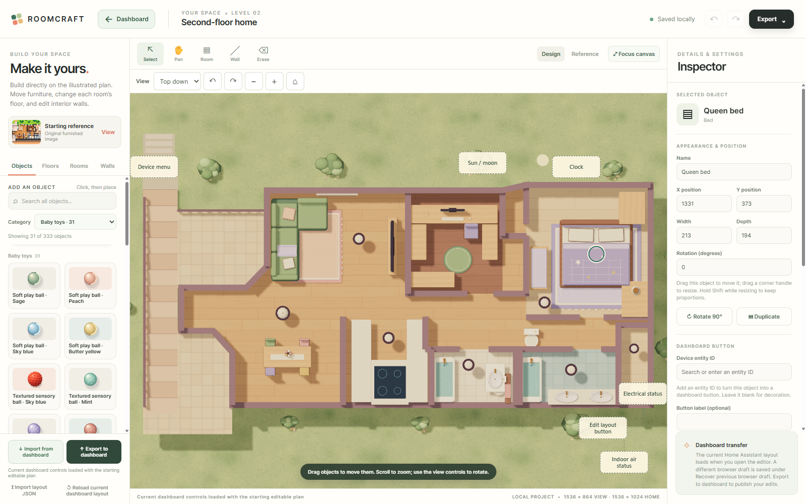
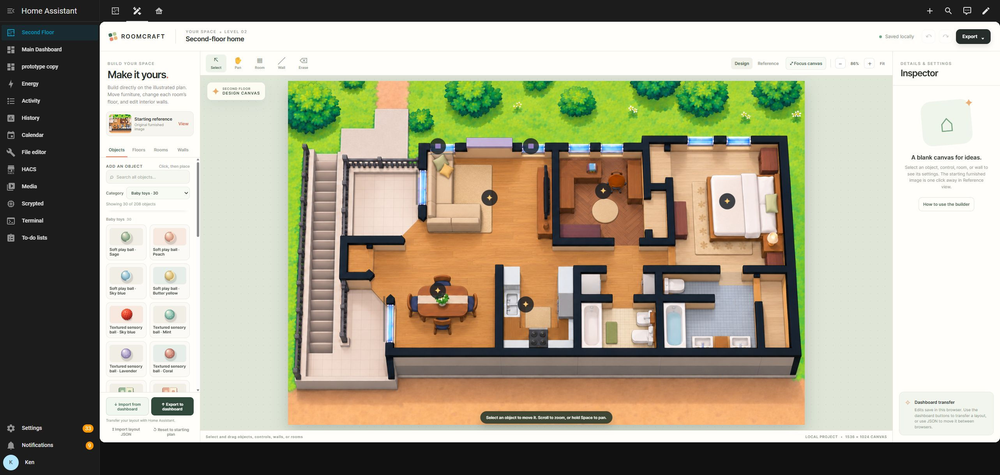
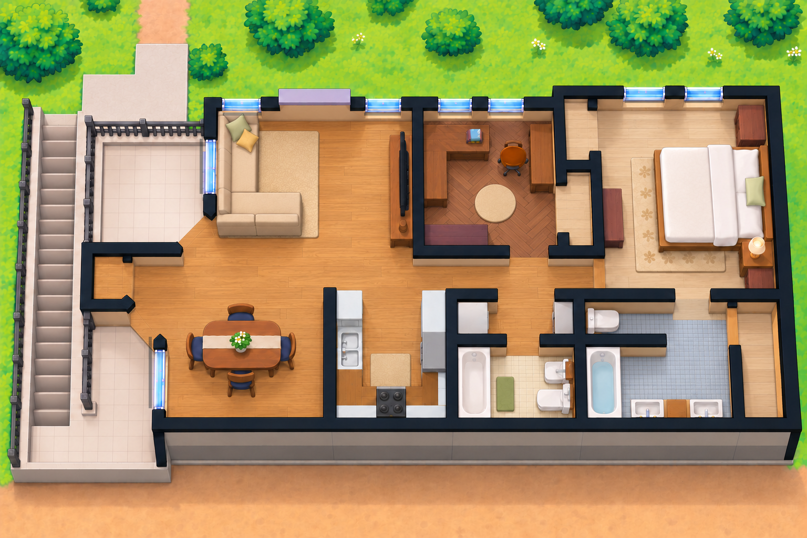
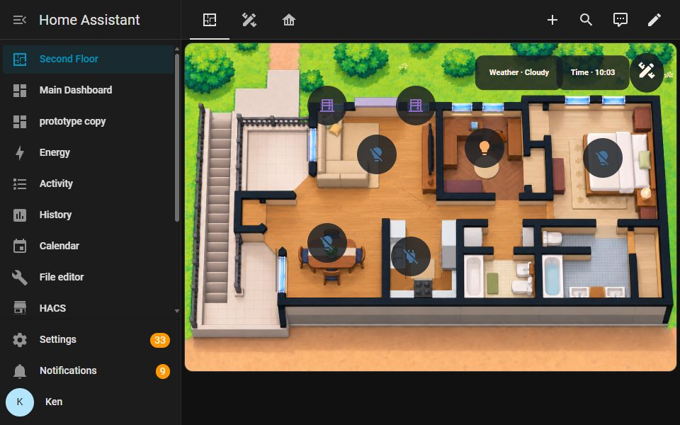
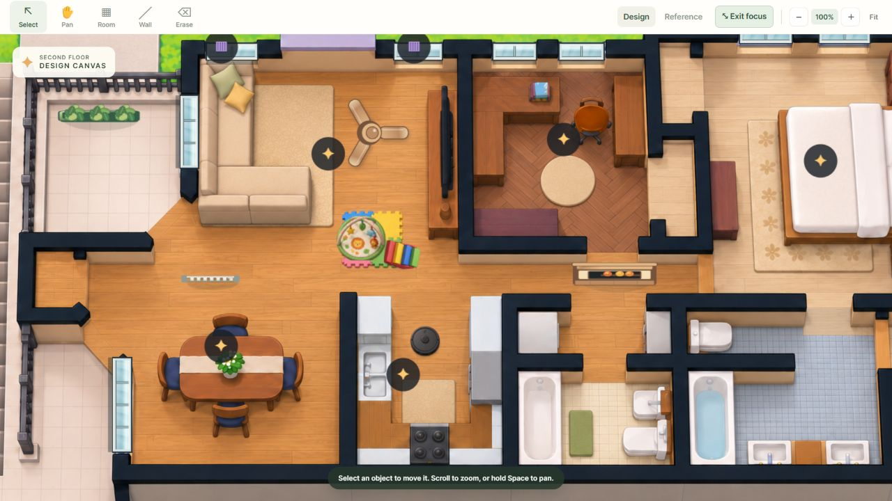
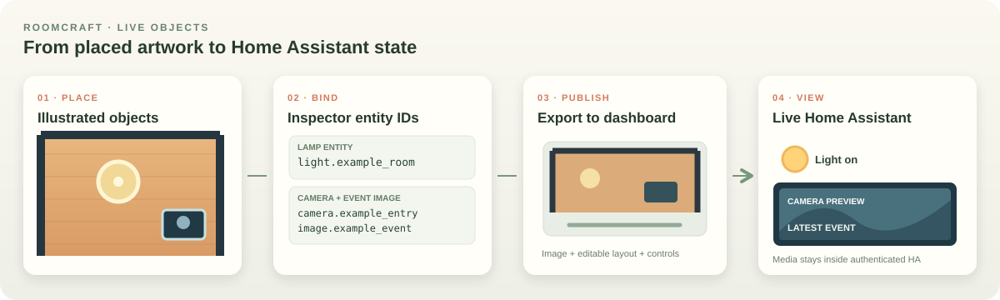
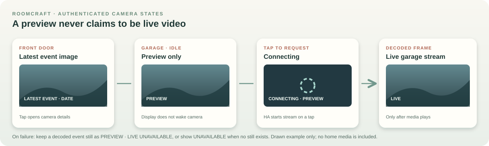

# Roomcraft user manual

Roomcraft Studio edits the layout used by Roomcraft Home. Use the 3D view to arrange objects, or the 2D plan to edit rooms and walls, then export to Home Assistant. You can also download the image, editable project, or Home Assistant YAML separately.

## Find and edit object models

Open **Main menu → Object models** in Studio or Roomcraft Home. Choose **On the plan** to find and edit an existing object, **Add objects** to search the catalog, or **Home Assistant devices** to match a device to a model. Choose a suggested model or browse all compatible choices. Roomcraft Home opens Studio for placement and edits.

Select a placed object and open **Dimensions** in the Inspector. Enter width and depth in plan pixels. **Keep width/depth ratio** applies to numeric edits and corner drags. Enter **Height in 3D** where available, or leave it blank for the model's natural height. **Reset dimensions** restores the catalog footprint and natural height.

Search **Fish Aquarium** or **Lizard Terrarium** to place the animated tanks. They animate in 3D and use a still illustration in the 2D plan, and the 3D animation respects the device's reduced-motion setting.

## Track presence on the 3D plan

Open **Main menu → Presence tracking** in Roomcraft Home to see the bound switches' radar target counts and recent zone reports. A calibrated switch can show one anonymous character for each fresh target. The sensor can miss an occupant or pick up moving objects, so its count is an estimate of detected targets. It has no heart-rate or breathing-rate reading.

An administrator enables detailed reporting for the compatible switch in Home Assistant. In Home Assistant Studio, select its presence switch object and set **Radar targets entity** to the device's **Radar target count** sensor. The existing occupancy indicator on the switch continues to follow its occupancy binding.

Use **Plan pixels per metre**, **Rotation offset**, and **Flip radar left and right** to align the radar with the drawing. Select **Use switch position** to apply those settings from the placed switch. Have someone stand at two known points, preferably at different distances and on different sides of the switch, and adjust until their positions agree with the plan. Use **Export to dashboard** to publish the calibration. The advanced transform field accepts six affine coefficients when additional adjustment is needed.

Characters leave the live view when fresh positions stop. Each switch tracks independently, so overlapping coverage can show the same person twice. Positions stay in Roomcraft Home and authenticated Home Assistant Studio. Layout exports and the private web editor contain the saved calibration. [Home Assistant presence setup](../ha-presence/README.md)

## Change the view

Roomcraft Home and Studio start in **Default**. It uses your saved angle or opens directly overhead. Use **View** for **High angle**, **Dollhouse**, **Corner**, or a view from the north, east, south, or west. Directions follow the plan, with north at the top of Top down. The arrow buttons rotate the camera, the plus and minus buttons zoom, and the home-shaped reset button returns to Top down.

Choose **Free view** to orbit. Drag across the scene to rotate and tilt. Pinch or scroll to zoom. With the scene focused, use the arrow keys and **+** or **−**. On the dashboard, drag from an open part of the scene and tap devices and cameras as usual. To open at a particular angle, choose **Free view**, set the angle and zoom, and choose **Main menu → Save as default**. Roomcraft Home and the Home Assistant Studio use the same default for your signed-in account. The private web editor saves the angle in the current browser. Choose **Main menu → Use Top down as default** to clear your saved angle. Select **Default** from **View** to return to it at any time.

In Studio, choose a 3D preset to select and drag objects. **Free view** dedicates the canvas to camera movement. Picking a catalog object returns to your last 3D preset for placement. The Inspector controls size, rotation, finish and device binding. Camera and interface items have labeled placeholders in editing views. Choose **2D plan** for the illustrated view. Room, wall and reference tools also switch to that view.

**Dashboard look** in Studio uses the lighting and device appearance from the latest dashboard import. Turn it off for daylight while editing. The dashboard reloads the saved layout after **Export to dashboard**. In Home Assistant, **Dashboard** returns to the live view inside the same signed-in app or tab.

This public demonstration uses the furnished starter layout and no live household media. On your HA instance, Studio loads your published layout and shows camera and interface positions as editable labels.

The older 2D plan view is shown above. The left palette chooses objects, floor finishes, rooms, or walls; the center canvas edits the plan; the right Inspector edits the selection. **Import from dashboard** and **Export to dashboard** are at the bottom of the palette. The [legacy screenshot archive](legacy/README.md) keeps previous editor captures.

## The plan and its perspective

The canvas is a top-down plan with lightly raised walls and furniture. The balcony and stair are outdoors at left. The stair begins at the lower-left landing and descends toward the top-left. The house, balcony, and lower-left stair landing are on the second floor. The detached garage sits on the first-floor ground plane. Choose **From west** to see the height difference clearly. Doorways between upstairs rooms remain on one floor level. Bedroom, study, baths, and living spaces have different finishes. The editor uses this image as a reference and separate illustrated assets to redraw edited geometry; an edited scene can differ from individual pixels in the reference PNG.

### Wall-to-wall tablet view

The full-width view uses the existing drawing and keeps every original column, x0–1536. It shows project y80–944 as a 1536 × 864 image, an exact 16:9 shape. The authored house, stair, balcony, rooms, and furnishings do not change size or position in the editable 1536 × 1024 project. When you move a lamp, fan, control, or camera frame in Studio and export, Roomcraft places its Home Assistant target over the matching object in the displayed image. Keep the camera frame inside the visible lower exterior before exporting; it remains movable in the editor. The image fills the tablet width by showing less sky and ground, without clipping the sides or stretching the house.

The original reference is a single PNG, but Design mode reconstructs its removable contents as scene items. Rugs, original windows, cabinetry, bath fixtures, furniture, lights, controls, and newly placed catalog objects can all be selected, moved, resized, rotated, or removed independently. Floors, walls, railings, and stairs also come from editable layout records. Check **Design** against **Reference** after a large move to compare the editable reconstruction with the source image.

This public-safe PNG shows the corrected sofa orientation, recessed blue windows, distinct floor textures, movable light fixtures, the five-blade ceiling fan, and a drawn camera placeholder on the left. The newer office desk lamp, second camera frame, and live device treatments are not shown in this older static graphic. Live camera media remains a separate authenticated Home Assistant overlay. The upstairs rooms remain on one level. The photo-inspired baby play area sits in front of the sofa. The [legacy screenshot archive](legacy/README.md) retains earlier flat-window captures for comparison.

## 1. Open the editor and choose a view

The Second Floor dashboard has three views: **Floor Plan**, **Layout Studio**, and **Live Home**. On a laptop or tablet connected to the home network, open `http://<HA-LAN-IP>:8123/second-floor/studio` and sign in to Home Assistant. The pencil-ruler icon in Floor Plan also navigates to Studio. The editor runs inside this Home Assistant view and uses your HA session; an administrator account is needed to publish a layout. On opening, the editor loads the current saved dashboard project. If a browser held a different local draft, the editor saves it for **Recover previous browser draft**. If Home Assistant cannot be reached, that local draft remains available.

For the owner's HA profile, **Second Floor** is the default dashboard and the first sidebar item. Home Assistant stores that preference for the account across devices. Other accounts can choose their own default. On the Apolosign Calendar wall tablet, Home Assistant Companion is also the default Android Home app, so pressing Home returns to the panel. A private 1920 × 1080 tablet capture showed the entire original left staircase and right exterior wall without crop or scroll, high-contrast object states, the front-door last-event still, decoded live garage and overhead feeds, current rain, and the 12-hour forecast strip. Physical touch coverage and automatic launch after a tablet reboot remain to be checked. See the [tablet access runbook](tablet-access.md) for recovery and rollback.

This 960 × 600 browser preview shows the previous 3:2 plan card without page scrolling. The current full-width view was checked on the actual tablet in a separate private capture. That capture is not published because it includes authenticated live camera media. Use the live dashboard for the current appearance; this older image remains a guide to the control locations and editor entry.

The owner-private cloud editor is an alternate route when available; use the Site URL supplied by the owner. It has its own sign-in. Both editors share the dashboard's saved `roomcraft_layout` and load it on opening. Use **Import from dashboard** to refresh without reloading the page after someone else publishes a change. Use Layout Studio on the home network as the normal authoring path.

This manual describes the HA-hosted Studio and owner-private cloud editor. Both editors load the current Home Assistant layout on opening; a different local browser draft remains recoverable. The own-tab Studio fallback and layout transfer have readback evidence in the [changelog](../CHANGELOG.md).

If Chrome leaves the embedded editor blank, use **Open editor in a new tab** inside Layout Studio. Keep the Studio tab open while editing in the new tab: it supplies the authenticated dashboard connection through the opener. A direct visit to `/local/roomcraft/editor.html` has no such connection and cannot import or export to the dashboard.

Use **Design** to edit. Use **Reference** to compare against the original furnished image. **Focus canvas** hides editing panels for a larger view. **Fit**, the zoom buttons, and the percentage button control scale; wheel or trackpad scrolling zooms, and **Pan** or Space-drag moves the view.

## 2. Work with furniture and objects

Open **Objects**. Search the catalog or filter by category, select an item, then click its location on the plan. The catalog includes living and bedroom furniture, kitchen and bath objects, plants, rugs, lamps, windows, baby play items, safety pieces, climbing blocks, a fireplace shelf, ceiling fan, robot vacuum art, and camera thumbnails. The **Living & dining**, **Bedroom & storage**, and **Lights & lamps** categories include an 88-entry crafted-miniature collection. Search `crafted`, `detailed`, `realistic`, `upholstered`, `wood`, `bed`, `sofa`, `desk`, or a specific construction such as `canopy` or `storage`. The art uses warm, believable miniature materials—fabric seams and piping, wood grain and joinery, hardware, glass, ceramic, and metal—without branded characters or copied game assets. **Climate, doors & fans** includes a wall thermostat/AC, window fan, and garage door control; these are perspective-matched editable objects.

Select a placed catalog item to edit its name, position, angle, and product options in the **Inspector**. **Style** changes the construction and uses that product's authored dimensions. **Size** changes to a real catalog size and also applies its authored width and depth. **Color / finish** changes the material or color while keeping the object's current dimensions, including a manual resize. All three preserve the object's position, rotation, Home Assistant binding, and custom name. The Width and Depth fields remain available for a deliberate custom footprint. Rotate, duplicate, resize, move, and remove work like any other object; hold **Shift** while resizing to keep proportions.

### Choose a bed construction and size

The Bedroom catalog includes 42 bed entries rather than one picture stretched to many shapes. Choose among quilted, crib, toddler, low-platform, arched-upholstered, drawer-storage, four-poster-canopy, daybed, and bunk constructions. Available sizes depend on the construction and include crib, toddler, twin, full, queen, and king. For example, a platform bed offers twin through king; a canopy offers queen and king; a daybed and bunk use twin geometry.

Place a bed, then use **Style** to compare constructions and **Size** to choose the intended footprint. Watch Width and Depth update to that product's authored values. Use **Color / finish** afterward to compare wood, upholstery, metal, or painted options without moving or resizing the bed. A bunk should keep its guard rail and ladder, a storage bed its drawer fronts, and a canopy its four posts and rails at every supported finish; if a choice loses those features, undo and report it as an art regression.

Windows and wall-mounted objects snap near walls. If the editor asks you to click closer to a wall, move the pointer to the intended wall segment and try again. After placing a window, zoom to 100% and check that its long edge, frame depth, and shadow follow that wall. Drag it along the wall if it needs repositioning. Use **Select** to drag an item. Use **Erase** or the Inspector's remove action to delete it.

**Remove all objects** clears furniture, rugs, windows, fixtures, lights, and interface objects while keeping room boundaries, floor finishes, and walls. The confirmation dialog shows the exact object count, and the editor returns to **Design** so the furnished read-only Reference image cannot be mistaken for the cleared result. **Restore reference layout** adds every missing reference object through the same engine, returns to Design, and preserves extra objects and structural edits. After a deletion is saved, reopening the editor does not recreate it automatically; restoration is always explicit.

The dining ceiling fan and its center light are separate objects even though they occupy one physical fixture. Select the small center light to move or configure the light switch; select a blade or outer fan area for the motor. Each object's own Home Assistant switch alone controls its status dot and animation. The exterior garage is also an editable detached-garage object; its cover state animates only the paneled door.

The [window artwork comparison](images/window-perspective-comparison.png) shows why the lower, recessed glazing is the Design view's target for the original openings.

### Arrange the photo-inspired play area

Search **1977** or **photo** in **Objects** to show 16 color and shape variants across 11 new designs. The multicolor bear-panel play yard, gray leaf mat, brown checker puzzle mat, wooden play arch, colorful activity table, teddy bear floor chair, gray bolster, and bunny plush are placed in the current living-room plan. They remain separate objects: choose **Select**, click one, drag it, or enter its position, dimensions, and angle in the Inspector. The mats sit underneath the raised play objects, and the ceiling fan remains visible over the play area in the rendered plan. Use **Undo** if a placement blocks a lamp or other control.

The catalog also has individual bear-face fence panels in six colors, a white mantel with dark tile hearth, and a toy side shelf. Place these after confirming the actual living-room wall and fireplace position; the current plan's TV and windows do not establish that location. The objects are illustrated interpretations of the supplied photo in the plan's perspective, not a measured or exact recreation. The source photo and its people are not part of the catalog or dashboard graphic.

## 3. Change a floor finish

Open **Floors**, choose a finish, then click the room to paint. A selected room's **Floor finish** menu in the Inspector provides the same control. Each room stores its own finish; the shared level through doorways stays continuous. To change a room boundary, select the **Room** tool, click that room, and drag a corner handle. **Rooms → Add room** creates another editable floor region.

For clean results, keep room polygons inside their walls and avoid overlapping neighboring floors. If a new room covers an existing room, reshape its points or remove it.

## 4. Change walls and fences

Choose **Wall** or **Fence** and drag from the start to the end. You can also tap each endpoint. Hold **Shift** for a horizontal or vertical segment. Open **Walls** to select any segment, including exterior walls and balcony rails. Drag the segment or an endpoint, or enter exact coordinates in the Inspector. The Inspector also changes the type and finish and removes the selected segment.

Open **Walls** to control **Snap segment ends**. Draw a wall or fence, or drag an endpoint near another corner or wall centerline. The green dot shows the snap point. **Join nearby ends** closes small gaps up to 18 project pixels as one edit, so **Undo** restores the previous positions. The 3D view gives the walls a shared height and preserves the larger openings shown on the plan.

Use **Rooms** for the balcony and porch surfaces and **Objects** for the exterior stair. After changing a wall, check the adjoining floor polygon and any nearby window or wall-mounted object. These are separate editable layers.

## 5. Link lights, fans, controls, and cameras to Home Assistant

The plan's markers represent Home Assistant controls. Select a marker to change its title, entity ID, location percentage, tap action, or hold action. The Inspector accepts an entity ID in `domain.object_id` form, such as `light.example_living_room`.

On the live **Floor Plan**, open the top-left device menu and use **Show object details on plan** when identifying controls or troubleshooting a binding. A compact card appears next to each interactive object with its label, current HA state, and entity ID; camera tiles show their bound camera entity beside the frame. The cards automatically choose the side with available screen space and do not cover the object itself. Turn the option off to restore the clean illustrated view. The choice is remembered separately by each browser or tablet and does not change the saved layout.

### Make a lamp or fan a live control

1. Place a lamp, ceiling light, or fan in its actual room, then select it.
2. In the Inspector, enter the matching Home Assistant **Entity ID**, for example `light.example_living_room` or `fan.example_ceiling_fan`. Leave it blank for a decorative object. Choose **Live graphic** if Automatic classifies the fixture incorrectly: light, fan, air conditioning, window/blinds, door/garage, general device, or no state graphic.
3. Export to the dashboard and open **Floor Plan**. The object itself is the control target. Home Assistant supplies a high-contrast active/inactive treatment without a visible status badge. Its accessible name carries the current state and actions; the hover title shows the state. A tap briefly outlines it in turquoise and a hold in amber. Unknown or unavailable state stays neutral; the editor never stores live state in the layout JSON. See the [state and motion guide](live-object-graphics.md).
4. If a separate control marker already represents the same entity, review its position before publishing. The linked fixture takes the entity's placement in the exported plan so there is one control for that device.

The furnished scene includes bedside and office desk lamps plus room light fixtures as editable objects. The office has one physical desk lamp, drawn with the same raised lamp style as the bedroom; it is the single office light control. The previous separate study ceiling fixture duplicated that light and has been removed. These objects can be moved, resized, or removed without changing the original PNG. A fixture with no entity binding is artwork only. When a crafted light is bound, the dashboard keeps its table, floor, faceted ceiling, pendant, or sconce construction while Home Assistant supplies truthful on, off, and unavailable treatment.

The dining ceiling fan and its center light are two independent controls. Tap the blades to toggle the verified motor channel; hold for native details. Tap the small center lamp to toggle the verified light channel. Its compact transparent target leaves the surrounding blades available for the fan. The blades rotate in low-frame-rate steps only while the motor channel reports on, and the center adds a glow only while the light channel reports on. Reduced-motion preference stops animation without changing state. The old ceiling-fan entity and scene controls are historical and are not used by these artworks.

The master humidifier and dining air purifier use the same object-first pattern. Their illustrated appliances are the buttons; mist or airflow appears only while that appliance reports on. At the bottom-right, immediately above the forecast strip, one uniform row holds Layout Studio, indoor-air, and electrical controls. The pencil-ruler opens the editor. The air and lightning markers open informational panels upward so they remain on screen; tapping a sensor row opens Home Assistant details and never toggles equipment. All three controls remain movable in Studio.

The robot is intentionally compact. Tap it for its authenticated map, status, Start/Pause/Dock/Locate, and available room actions; hold for native details. The robot moves on the plan only from fresh calibrated map coordinates and animates only while Home Assistant reports cleaning or returning. A fixed robot is omitted from the exported background so there is never a second frozen copy.

The current plan includes these additional editable controls. Select one to inspect or change its private binding; the table describes its role without publishing device IDs.

| Object | Location and live graphic |
| --- | --- |
| Office desk lamp | One bedroom-style lamp on the study desk; the only office light control |
| Hallway thermostat / AC | At the hall wall; climate treatment |
| Office window fan | Freestanding in the office; it is not wall-locked and its fan treatment is driven by its switch |
| Garage door control tile | On the exterior balcony below the garage camera; door/open treatment |
| Garage camera thumbnail | On the open balcony tile; idle event preview, tap to start its own authenticated stream |

### Add a camera thumbnail

1. In **Objects**, choose **Cameras & controls → Camera thumbnail** and place separate frames for the doorbell, overhead view, and garage. Each is independently movable and resizable.
2. Enter each frame's `camera.*` entity in **Camera entity ID**. For a dated last-event image, add its `image.*` entity in **Event image entity**.
3. For the doorbell choose **Live during an event** and list its ring/person `binary_sensor.*` entities in **Event sensors**. Between events the last image stays visible. A ring or person event starts a 60-second live attempt; if that battery camera cannot stream, the tile returns to the still.
4. For an overhead camera that already plays in Home Assistant choose **Always show live feed**. For the garage choose **Live stream** so a tap requests a stream. Hold or right-click any frame for native camera details. Export, then check all three frames independently in **Floor Plan** while signed in.

The current installation has three frames: a front-door dated still between events, a separately bound garage stream, and an overhead stream. A private tablet capture showed both garage and overhead **LIVE** after decoded playback; a real doorbell event has not yet been observed in this release. Check each selected feed and trigger sensor in Home Assistant before changing its binding. The overhead mode mounts native playback but does not send a wake command merely because it appears.

The design canvas shows stylized placeholders, not private camera frames. The dashboard fetches media through the current Home Assistant session. A tile says **LIVE** only after decoded media advances or a playing frame is detected; otherwise it shows **PREVIEW**, **CONNECTING**, or an unavailable message as appropriate. Failure in one frame does not replace another. Camera URLs and tokens do not belong in the exported layout or public repository.

### Read the outdoor weather

The exterior layer shows the current local condition and a strip of forecast hours through the next 12 hours. Tap a forecast tick to preview that hour's rain, snow, clouds, daylight, or night briefly; the artwork then returns to current observed weather. The sun and moon are drawn only outside the house, so room controls stay legible. Forecast times follow Home Assistant's configured time zone. A forecast is a prediction for the selected hour, while **Now** is the current weather entity. The weather layer is configured in the private HA dashboard by an administrator; moving furniture in Studio does not change that binding. Reduced-motion mode stops decorative animation. Current rain and the forecast strip were verified on the tablet; the actual day/night transition remains to be observed.

Confirm a device's physical location in Home Assistant before placing a control. A friendly name does not prove the room. The editor stores control placement; Home Assistant performs actual device actions. A device that is unavailable or missing should be corrected in Home Assistant before use.

The [control and compact-menu guide](ha-controls-and-menu.md) maps the known fixtures and explains which interactions belong on illustrated objects. Its [sanitized entity inventory](ha-inventory/README.md) is a dated metadata snapshot, grouped by Home Assistant area and domain. It omits changing device values and private identifiers. The earlier inventory snapshot recorded the office bulb as unavailable; availability has since changed, so check its current HA state before editing that binding. No primary room light was verified for either bathroom, the dressing nook, or the balcony; keep decorative fixtures unbound until the real entity is confirmed.

## 6. Save, import, and publish

Edits save in the current browser automatically. For a portable backup, use **Export → Editable layout JSON**. On another browser, choose **Import layout JSON**. Keep this JSON private if it contains real entity IDs or room details.

Use the two buttons at the lower-left of either editor to work with the live dashboard:

1. **Import from dashboard** loads its saved editable project and current controls. Save your current draft as JSON first if you want to retain it.
2. Edit rooms, walls, floors, objects, and markers.
3. **Export to dashboard** renders a detailed PNG, uploads it to Home Assistant, and saves the editable project with the dashboard. Reload the dashboard to see the result.
4. Import once more to verify that the same project opens for the next editing session. If you switch between the HA-hosted and cloud editors, import in the second editor before editing.

Select **← Dashboard** in the editor header to return to the Second Floor plan. The HA-hosted editor uses the same-origin dashboard route; the owner-private Site uses the dashboard address supplied by its authenticated connection. If you have edits that have not been exported to Home Assistant, the editor asks before leaving and keeps a browser draft. Choose **Cancel** to remain in Studio. Returning to the dashboard does not publish those edits; use **Export to dashboard** first when you want them visible on the wall panel. During an import or export, the control asks you to wait and stays in the editor. If the dashboard link is unavailable or the unpublished draft cannot be saved, it stays in the editor with a message; export editable JSON for recovery if browser storage is full.

The editor checks the dashboard revision before exporting. If another change happened, import the newest dashboard version and review your draft before retrying. This protects a teammate's more recent dashboard edit.

The **Export** menu also provides a PNG and a manual Home Assistant YAML fallback. The YAML references a local image path; copy the PNG to that path before applying it manually.

The **Floor Plan** view overlays high-contrast device states, exterior weather and time, the edit icon, and three authenticated camera frames. Its centered 16:9 image retains the full original house width on the wall tablet. Tap a bound robot vacuum to open its nearby state and map panel. The panel provides Start, Pause, Dock, Locate, and room buttons when the map supplies room identifiers; opening it does not start a command. Hold the robot to open native Home Assistant details. When the item has a valid map-to-plan calibration, its marker follows fresh map coordinates while cleaning or returning and parks at its last calibrated position while docked. A stale active map freezes the marker instead of fabricating travel. The current private Dreame calibration is installation-specific and should be rechecked if either the vacuum map or illustrated floor plan changes. **Live Home** shows native Home Assistant weather, time, sun, garage, fan, vacuum status and map, second-floor controls, and a garage camera card. Live Home reads from Home Assistant; the Roomcraft editor controls the authored room layout.

The shipped drawer has **On plan**, **All entities**, search with registry availability, and six curated groups: Planning, Weather and Air Quality, Lighting, Security and Control, Energy, and Robot Vacuum. The [Main Dashboard map](main-dashboard-map.md) lists their source references. The Studio edit link remains on the plan; use **Live Home** for native detailed cards. The plan fit on the target tablet's actual display; the drawer's fit and touch behavior still need an on-device check.

## Undo and recovery

- **Undo** and **Redo** step through the current editing session.
- **Reset to starting plan** restores the initial furnished design; export JSON first if you want the current state later.
- **Recover previous browser draft** appears when a different local draft was replaced by the current dashboard layout or when an older legacy draft is available. The editor also keeps a route back to the pre-recovery layout.
- A dashboard backup is separate from browser local storage and the JSON file. Use all three appropriately when making major changes.

## Troubleshooting

| Symptom | Action |
| --- | --- |
| Object will not place | Return to **Design**; for windows and wall fixtures, click close to a wall. |
| A linked lamp or fan shows no live state | Check that its `light.*` or `fan.*` entity exists in Home Assistant, then import the current dashboard layout and export again. An unbound object stays decorative. |
| Camera thumbnail shows unavailable | Check that frame's `camera.*`, optional `image.*`, and event sensors in HA. An event still needs HA's authenticated image proxy. The garage requests a stream after a tap; the doorbell attempts one during an event; the overhead mounts native media. **LIVE** requires decoded playback. A failed stream returns to a preview or unavailable message. |
| Floor looks misplaced | Select **Room**, inspect its corner handles, and keep the polygon within the room. |
| A wall or fence is hard to select | Open Walls and select the segment from the list. Edit its endpoints in the Inspector. |
| Dashboard export says the dashboard changed | Import the dashboard again, compare changes, and retry. |
| Dashboard image updates but browser shows the prior image | Reload the Home Assistant view; its browser may still hold the earlier image. |
| Layout Studio shows **Configuration error** after a card update | Reload the affected Home Assistant tab. If the error persists, check the registered Roomcraft card resource and dashboard configuration using the [deployment guide](deployment.md). The cause of the observed transient error was not confirmed. |
| HA-hosted Studio opens but the editor is blank | Click **Open editor in a new tab** in Studio and keep the Studio tab open. The new tab can still import and export through its authenticated opener. |
| HA-hosted Studio opens but transfer is unavailable | Confirm you opened `/second-floor/studio` while signed in to Home Assistant, or used its own-tab button while keeping Studio open. Direct `/local/roomcraft/editor.html` lacks the dashboard bridge. Publishing needs an administrator account. See the [deployment guide](deployment.md). |
| Cloud editor transfer is unavailable | Confirm the owner-private Site sign-in and its server-side Home Assistant connection. |

