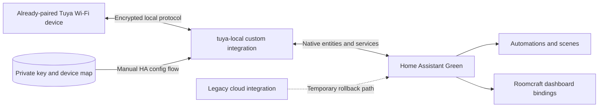

# Architecture and development boundaries

## Decision log

| Decision | Reason | Consequence |
| --- | --- | --- |
| Use a native HA integration for the pilot | HA needs entities; a Supervisor app/add-on alone would not expose them | No additional service or phone UI in the normal path |
| Start with upstream `make-all/tuya-local` | It already implements Tuya LAN protocol versions, HA config flow, and device profiles | Avoid an unmaintained fork; contribute missing profiles upstream |
| Use the manual config path and cached keys | Private Xtend diagnostics already have credentials for some paired devices | No new Tuya cloud call is needed for those devices during migration; a local workstation helper under `tools/` may assist without acting as an HA add-on |
| Migrate per device with rollback | Local support flags are not control tests; HA bindings can change | Slower rollout but measurable compatibility and safe recovery |
| Keep private mappings outside Git | Device IDs, hosts, and local keys identify and control a home | Public docs and fixtures contain only placeholders or aggregates |

## Runtime contract

The local integration owns device discovery/configuration, Tuya protocol messages, datapoint-to-entity mapping, and availability. HA owns automations and service calls. Roomcraft consumes HA entity state and action services; it must not store a Tuya local key or speak the device protocol from the browser. The [workstation migration helper](../tools/README.md) reads the existing private cache in memory, exposes non-secret readiness/status in normal output, and avoids a second persistent LAN connection. It does not write the HA token or local keys to workstation disk; HA stores each imported key in a private config entry. It is a one-time operator tool, not a Supervisor add-on.

The private migration record for each device should contain: transport category, current HA entity and integration, local HA entity, LAN reachability, protocol version, profile, credential provenance and validation time, tested read capabilities, tested write capabilities, dependent automations/dashboard bindings, fallback steps, and the maintenance time used. Keep the sensitive fields in private HA storage or an encrypted local management vault, not in this repository.

## Compatibility gates

1. **Transport:** `tuya-local` is intended primarily for Tuya Wi-Fi devices. Hub subdevices have connection-count limits; Zigbee devices are often better moved to ZHA, and some BLE devices require a different integration. [Upstream device-support notes](https://github.com/make-all/tuya-local#device-support).
2. **Credentials:** Host, device ID, key, and protocol version must be valid. Re-pairing changes the key. A read response alone is insufficient proof for some older protocol versions because the key may only be exercised on write. [Upstream configuration notes](https://github.com/make-all/tuya-local#configuration).
3. **Datapoints:** Match returned datapoints to the exact device profile before exposing controls. Firmware changes or rebranded models can alter support.
4. **Contention:** Some devices allow only one simultaneous local client. Avoid polling the same device concurrently through Xtend, LocalTuya, and tuya-local. Keep legacy cloud entities only as a rollback path and distinguish their actions from new entities.
5. **Network:** Green stays on Ethernet and must have a local route to each Wi-Fi device. This needs no new Green radio. Local control does not automatically prevent outbound device traffic; internet isolation is a later, reversible network test.

## Adjacent hardware paths

This integration covers eligible Tuya Wi-Fi LAN devices. Standard Zigbee sensors and switches should instead pair directly with Home Assistant's [ZHA integration](https://www.home-assistant.io/integrations/zha/) after adding a [Connect ZBT-2](https://www.home-assistant.io/connect/zbt-2/) to Green. Configure that radio for Zigbee; it cannot serve Zigbee and Thread concurrently. Keep cloud-only devices available on their existing route until there is a validated replacement or a supported local transport. Do not route Zigbee or Bluetooth hardware through the Tuya Wi-Fi migration helper merely because it appears in the same vendor account.

## Engineering ownership

- **Device/protocol team:** confirm datapoint schemas, add narrow upstream profiles or fixes, test non-destructive reads before commands.
- **HA integration team:** installation, config-flow migration, availability, entity naming, restart behavior, and no duplicate local sessions.
- **Dashboard team:** map old entities to new HA entities without changing Roomcraft geometry or embedding keys in client assets.
- **QA/documentation team:** sanitized evidence, isolated device tests, privacy review, deployment and rollback record.

There is no evidence yet for a universal cloud-free pairing method. Reverse engineering should target verified unsupported datapoints or device profiles, not promise firmware-level control of every Tuya device.
